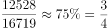
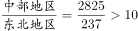
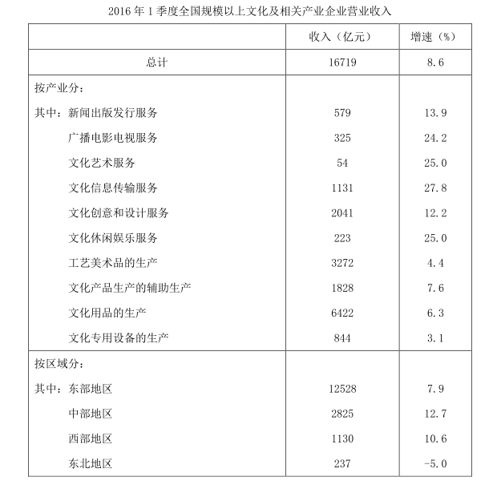

# 现期比重比较·饼图识别（扇形占比与圆心角匹配）

考点：[[20-考点/资料分析/比重/现期比重比较·饼图识别（扇形占比与圆心角匹配）|比重 / 现期比重比较·饼图识别（扇形占比与圆心角匹配）]]
材料：[[15-材料/资料分析/186852 2016年1季度全国规模以上文化及相|186852 2016年1季度全国规模以上文化及相]]

**问法模型**：题干出现'哪个饼图最准确反映各地区……比重关系'→用现期比重=部分/总体算出四地区占比，转化为扇形比例/圆心角特征逐一排除图形

## 推理链
1. 第1步：从表格'按区域分'提取现期收入：东部12528、中部2825、西部1130、东北237亿元；总体取总计16719亿元（文字段+表格总计行）。
2. 第2步：现期比重公式：比重=部分收入/总收入，可进一步换算为圆心角=比重×360°。
3. 第3步：东部比重=12528/16719≈74.9%≈3/4（圆心角约270°）；中部=2825/16719≈16.9%；西部=1130/16719≈6.8%；东北=237/16719≈1.4%（圆心角仅约5°）。
4. 第4步：东部扇形必须约占整圆3/4，C、D两项东部占比明显不足3/4，排除C、D。
5. 第5步：比较最大与最小扇形之比：东部/东北=12528/237≈52.8倍（中部/东北=2825/237≈11.9倍同样>10），最小扇形占比不足1.5%；B项各扇形差距远达不到10倍量级，排除B。
6. 第6步：仅A项同时满足'东部约3/4、中部约1/6、西部约7%、东北仅约1.4%'的结构特征，故选A。

**最快解法**：⚡ 极端占比锚点排除法（截位估算+特殊分数）：第一步只算东部12528/16719≈75%≈3/4（圆心角270°），一眼排除C、D；第二步只算东北237/16719≈1.4%（圆心角约5°，且最大/最小之比远超10倍），排除中庸分配的B，锁定A，全程无需精确计算四个比重。

## 易错点
- ⚠ 维度混用陷阱：饼图只能用'按区域分'4项数据（东部/中部/西部/东北），绝不能把'按产业分'10个产业数据掺入，两维度共享总计16719亿元但不能相加。
- ⚠ 指标误用陷阱：饼图反映的是收入比重（现期值占比），不能按增速分配扇形；东北增速为-5.0%是负增长，但其收入237亿元仍需占约1.4%的扇形，勿因负增长而遗漏或误判大小。
- ⚠ 图形排除不彻底：仅凭'东部最大'不够，B项常以'东部最大但占比偏小、各扇形差距不足'设置干扰，必须用'东部≈3/4'和'东北≈1.4%（最大/最小>10倍）'双重锚点验证；区域之和16720与总计16719的尾差不影响结论。

## 母题抽象
> 🧩 当题干出现'哪个饼图/图形最准确反映……比重关系'时，用'极端占比锚点排除法'：先算最大部分÷总体（判定约3/4、1/2等特殊比例）排除明显不符项，再算最小部分占比或最大/最小倍数关系排除剩余干扰项，最后锁定唯一匹配图形。

**同类特征**：哪个饼图能够最准确地反映、各地区……营业收入的比重关系、现期比重、部分与总体的占比结构、按区域分（四个地区）、扇形占比/圆心角匹配

## 相关题
- [[10-真题/资料分析/比重/4792819 现期比重计算（多部分比重依次求解）|4792819]]（新疆 2014，相关度1）
- [[10-真题/资料分析/比重/827355 现期比重比较（部分占比过半速判）|827355]]（政法干警 2014，相关度1）
- [[10-真题/资料分析/比重/2272297 现期比重比较|2272297]]（选调 2015，相关度1）
- [[10-真题/资料分析/比重/2032972 现期比重计算（多地区占比求和）|2032972]]（吉林 2015，相关度1）
- [[10-真题/资料分析/比重/2187857 现期比重计算（部分量需先由'总量−其中量'减法间接求得）|2187857]]（山东 2018，相关度1）

---

### 题干

以下哪个饼图能够最准确地反映全国各地区2016年1季度规模以上文化及相关产业营业收入的比重关系？

### 选项
- A. A　✅
- B. B
- C. C
- D. D

### 官方解析

根据题干所求“以下哪个饼图最能反映全国各地区2016年1季度······的比重关系”可判定此题为现期比重问题。

定位表格可知东部地区1季度营业收入为12528亿元，定位文字材料第一段可知2016年1季度全国规模以上文化及相关产业企业实现营业收入16719亿元，因此东部地区的比重为，观察图形，可排除C、D两项。

由表格材料可知，因此所占的比重之比同样大于10倍，观察图形，可排除B项。

故正确答案为A。

### 给定材料

        2016年1季度，全国规模以上文化及相关产业企业共4.7万家，实现营业收入16719亿元，比上年同期增长，增速比上年全年增速提高1.7个百分点。 

 

> [!warning] 疑点（官方解析可能有误，待人工复核）
> 官方解析'由表格材料可知，因此所占的比重之比同样大于10倍'一句公式缺失，按数据可复原为最大/最小扇形之比（东部12528/东北237≈52.8倍，或中部2825/东北237≈11.9倍）大于10倍，与排除B的结论一致，答案A本身无误。
