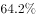

# 基期比重——百分点差还原

考点：[[20-考点/资料分析/比重/基期比重——百分点差还原|比重 / 基期比重——百分点差还原]]
材料：[[15-材料/资料分析/186986 2016年全国民间固定资产投资总体规|186986 2016年全国民间固定资产投资总体规]]

**问法模型**：求基期（2015年）比重 → 材料只给2016年比重及'比上年降低3个百分点'的百分点差，用百分点加法直接还原，无需套基期量之比公式

## 推理链
1. 第1步：定位文字首段末句：'2016年民间固定资产投资占全国固定资产投资的比重为（原卷图片数值，给定文本空缺），比1—11月份降低0.3个百分点，比上年降低3个百分点'
2. 第2步：题目问2015年（基期）比重，可用条件只有'比上年降低3个百分点'这一百分点差，规则：比重变化以'个百分点'表述时只能加减，'降低'说明2015年更高
3. 第3步：排除干扰差值——'比1—11月份降低0.3个百分点'是与1—11月累计进度的比较，材料未给1—11月任何数值，与'比上年'口径无关，不能混用
4. 第4步：设2016年比重为P（原卷图片给出），则2015年比重=P+3个百分点，纯口算加法，不涉及365219亿元与全国总投资的除法（全国投资总额在文字中未给出）
5. 第5步：与选项对照，A即为'2016年比重+3个百分点'的还原值，故正确答案为A

**最快解法**：⚡ 百分点还原法（口算秒杀）：见'比重比上年降低3个百分点'，直接2016年比重+3个百分点=2015年比重，锁定选项A；切勿用基期量相除，也不掺入'比1—11月份-0.3个百分点'

## 易错点
- ⚠ 把'降低3个百分点'误当比例降幅，错用2016年比重×(1-3%)或÷(1+3%)；百分点差只能加减，不能乘除
- ⚠ 方向搞反：'比上年降低'意味着基期(2015年)更高，应加3个百分点而非减3个百分点
- ⚠ 误用'比1—11月份降低0.3个百分点'做还原（时间口径混用），或试图用365219亿元去除全国固定资产投资总额——该总额在文字中未给出，属读数陷阱

## 母题抽象
> 🧩 当题干问基期比重且材料只给'现期比重+比上年提高/降低x个百分点'时，直接做百分点加减还原（降低则基期=现期+x个百分点，提高则相减），不套基期比重除法公式

**同类特征**：基期比重（2015年比重）、'比上年降低3个百分点'、百分点差还原、现期比重在文字首段、干扰口径：比1—11月份降低0.3个百分点、无需基期量相除

## 相关题
（暂无）

---

### 题干
2015年，民间固定资产投资占全国固定资产投资的比重为：

### 选项
- A. 

　✅
- B. 

- C. 

- D. 

### 官方解析

定位文字材料首段末句，“2016年民间固定资产投资占全国固定资产投资的比重为······比上年降低3个百分点”，则2015年民间固定资产投资占全国固定资产投资的比重为。

故正确答案为A。

### 给定材料

       2016年，全国民间固定资产投资为365219亿元，比上年名义增长，增速比1—11月份提高0.1个百分点，民间固定资产投资占全国固定资产投资的比重为，比1—11月份降低0.3个百分点，比上年降低3个百分点。

       分地区看，东部地区民间固定资产投资164674亿元，比上年增长；中部地区107881亿元，比上年增长，增速回落0.1个百分点；西部地区71056亿元，比上年增长，增速回落0.5个百分点；东北地区21608亿元，比上年下降，降幅收窄1.6个百分点。

       分产业看，第一产业民间固定资产投资15039亿元，比上年增长，增速比1—11月份回落0.5个百分点；第二产业增长，增速较去年提高0.3个百分点；第三产业167673亿元，年度增长，增速与1—11月份持平。第二产业中，工业民间固定投资180970亿元，比上年增长，比1—11月份提高0.3个百分点。

> [!warning] 疑点（官方解析可能有误，待人工复核）
> 给定文本中2016年比重的具体百分数因原卷图片缺失而空缺，官方解析按'2016年比重+3个百分点'直接定位A，本题数值核验依赖原卷图片数值，属材料口径缺失而非解析错误

<!-- CODEX-ANSWER-REVIEW:BEGIN -->
### 本次独立复核

**复核状态：** `resolved`（答案与解析已核定）

**计分答案：** A（可计分）

**复核解析：**

图中2016年民间固定资产投资占全国固定资产投资比重为61.2%，比上年降低3个百分点；因此2015年比重约为64.2%，对应A项。

**相关信息：**

比重变化：分项增速高于整体增速时占比上升；基期比重需分别还原分子、分母后求比。

**题源依据：** [固定版本原题](https://github.com/Mentat-Uran/kaogongzhentizhengliu/blob/84ab93d4b64b61d897bece8a1c0a5bab06b4feb2/10-%E7%9C%9F%E9%A2%98/%E8%B5%84%E6%96%99%E5%88%86%E6%9E%90/%E6%AF%94%E9%87%8D/2050708%20%E5%9F%BA%E6%9C%9F%E6%AF%94%E9%87%8D%E2%80%94%E2%80%94%E7%99%BE%E5%88%86%E7%82%B9%E5%B7%AE%E8%BF%98%E5%8E%9F.md)；固定内容 commit `84ab93d4b64b61d897bece8a1c0a5bab06b4feb2`，Markdown blob `d66dca31c77d013311792a664882c6774bdee126`。
<!-- CODEX-ANSWER-REVIEW:END -->
