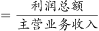
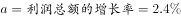
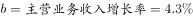
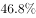

# 两期比率（营业利润率）升降比较

考点：[[20-考点/资料分析/比重/两期比率（营业利润率）升降比较|比重 / 两期比率（营业利润率）升降比较]]
材料：[[15-材料/资料分析/186992 2015年江西省规模以上工业经济运行|186992 2015年江西省规模以上工业经济运行]]

**问法模型**：题干问'营业利润率（利润总额÷主营业务收入）与上年同期相比上升还是下降'→两期比率比较模型：只需比较分子增速与分母增速的大小，分子增速小于分母增速即为下降，无需计算任何基期值

## 推理链
1. 第1步：定位材料第三段——2015年主营业务收入32459.4亿元、利税总额3543.8亿元、其中利润总额2128.0亿元，二者的同比增速以原卷补全数值为准
2. 第2步：营业利润率＝利润总额÷主营业务收入，属'分子/分母'型两期比率，判断升降只看分子增速a利润与分母增速a收入的相对大小
3. 第3步：判定规则——a分子>a分母则比率上升，a分子<a分母则比率下降；由原卷所给增速可知利润总额增速小于主营业务收入增速
4. 第4步：分子增速小于分母增速，2015年营业利润率低于2014年同期，对照选项得'有所下降'，故选B

**最快解法**：⚡ 增速差法（两期比率比较口诀'分子增速小于分母增速→比率下降，大于→上升'）：直接比较利润总额增速与主营业务收入增速，纯定性判断，不列基期公式、不算2128.0÷32459.4的具体数值，本题利润增速<收入增速，秒选B

## 易错点
- ⚠ 分子口径陷阱：必须用'利润总额2128.0亿元'，误用'利税总额3543.8亿元'（利税=利润+税金）就变成了比较利税率，方向判断必错
- ⚠ 分母口径陷阱：必须用'主营业务收入32459.4亿元'（销售收入口径），误用工业增加值7268.9亿元（生产口径）则分母错位，两口径数据不能相除充当利润率
- ⚠ 方法陷阱：本题只需增速差定性判断，不必算出基期利润率具体值；另注意材料原文中各增速均为空白，数值一律以原卷补全为准，不得凭空代入

## 母题抽象
> 🧩 当题干出现'某率（利润率、占比等分子÷分母指标）与上年同期相比升/降'时，用两期比率增速差法：只比较分子指标增速与分母指标增速，分子增速小→下降（大→上升），完全不算基期值；动手前先核对分子分母口径（利润≠利税、收入≠增加值）

**同类特征**：营业利润率、与上年同期相比、有所上升/有所下降（定性选项）、利润总额÷主营业务收入、两期比率升降比较、只需增速差、无需基期计算

## 相关题
- [[10-真题/资料分析/增长/2031162 增速之差（百分点加减还原，简单计算题）|2031162]]（北京 2017，相关度1）
- [[10-真题/资料分析/增长/2031160 混合增长率（基期差值模型，求部分增速）|2031160]]（北京 2017，相关度1）
- [[10-真题/资料分析/比重/2049596 两期比重比较（现期比重vs基期比重作差判升降与幅度）|2049596]]（山东 2017，相关度1）
- [[10-真题/资料分析/增长/2060620 同比增长率读数比较|2060620]]（深圳市考 2017，相关度1）
- [[10-真题/资料分析/增长/2261940 同比增速直接比较（读数比大小）|2261940]]（广东 2019，相关度1）

---

### 题干
2015年江西省规模以上工业企业的营业利润率与上年同期相比（  ）

### 选项
- A. 有所上升
- B. 有所下降　✅
- C. 持平
- D. 无法判断

### 官方解析

营业利润率，由题干“2015年江西省规模以上工业企业的营业利润率与上年同期相比”，结合选项，可知本题为两期比重的比较问题，仅需比较增长率与的大小关系即可。根据“利润总额”“主营业务收入”定位材料第三段，定位数据：，，，即2015年江西省规模以上工业企业的营业利润率低于上年同期。

故正确答案为B。

### 给定材料

        2015年，江西规模以上工业增加值7268.9亿元，比上年增长。分轻重工业看，轻工业增加值2731.2亿元，增长；重工业4537.7亿元，增长。分经济类型看，国有企业增加值269.1亿元，增长；集体企业19.3亿元，下降；股份合作企业22.3亿元，下降；股份制企业2847.6亿元，增长；私营企业2992.2亿元，增长；外商及港澳台商投资企业1112.5亿元，增长。

        2015年江西省规模以上工业38个行业大类中34个突破增长，占比近九成。其中，电子、电子机械、纺织、农副产品、医药和有色等六大重点行业表现突出，分别增长、、、、、，合计实现增加值2707.0亿元，占规模以上工业的比重为，对规模以上工业增长的贡献率达。高新技术产业增加值1869.7亿元，增长，占规模以上工业的比重为，比上年提高0.8个百分点。抚州、赣州、吉安高新区晋升为国家级高新技术开发区，年末国家级高新技术开发区7家，居全国第六、中部第一；省级高新技术产业园区3家，比上年新增1家；国家高新技术产业化基地27个，居全国第一。

        2015年江西省规模以上工业企业实现主营业务收入32459.4亿元，比上年增长；实现利税总额3543.8亿元，增长，其中，利润总额2128.0亿元，增长。主营业务收入超百亿元的企业10户，其中，江铜集团2010.4亿元，居全省首位。

