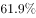

# 基期比重计算

考点：[[20-考点/资料分析/比重/基期比重计算|比重 / 基期比重计算]]
材料：[[15-材料/资料分析/186992 2015年江西省规模以上工业经济运行|186992 2015年江西省规模以上工业经济运行]]

**问法模型**：题干问基期年份（2014年）'某部分占总体比重'→套用基期比重公式：部分现期值/(1+部分增速) ÷ 总体现期值/(1+总体增速)=现期比重×(1+总体增速)/(1+部分增速)

## 推理链
1. 第1步：题干出现'2014年……占……比重'，现期材料为2015年，判定为基期比重问题，部分=重工业增加值，总体=规模以上工业增加值，定位材料第1段
2. 第2步：提取数据：2015年重工业增加值4537.7亿元（增速a）、规模以上工业增加值7268.9亿元（增速b），本文本中a、b为空白，需以原卷补全数值代入
3. 第3步：核验口径：轻工业2731.2亿元+重工业4537.7亿元=7268.9亿元，恰等于总量，直接以7268.9亿元为分母，无需另找口径
4. 第4步：套用基期比重公式：2014年比重=4537.7/(1+a)÷[7268.9/(1+b)]=4537.7/7268.9×(1+b)/(1+a)
5. 第5步：先截位直除现期比重：4537.7/7268.9≈62.4%，再乘修正因子(1+b)/(1+a)微调；若重工业增速a高于总体增速b，则2014年比重略低于62.4%，反之略高
6. 第6步：代入原卷补全的增速a、b算出具体数值，与四个选项对照，官方确定答案为C

**最快解法**：⚡ 公式法+截位直除：先算现期比重4537.7/7268.9≈62.4%（截前三位直除），再乘修正因子(1+总体增速)/(1+重工业增速)，按'部分增速与总体增速的差'判断结果比62.4%略高还是略低，即可锁定C，无需算出精确的基期分母

## 易错点
- ⚠ 现期/基期混淆：把2015年现期比重4537.7/7268.9≈62.4%直接当作2014年比重选答，漏做基期换算
- ⚠ 修正因子分子分母放反：基期比重=现期比重×(1+总体增速)/(1+部分增速)，总体增速在分子、重工业增速在分母，放反则升降方向判断相反
- ⚠ 材料文本中总体增速与重工业增速均为空白且无图表，必须回原卷补全数值再代入，不能凭空填数，也不能因缺数而误选与62.4%数值最接近的选项

## 母题抽象
> 🧩 当题干出现'上年（基期年份）+某部分占总体比重'且部分与总体的现期值及各自同比增速均给出时，用基期比重公式=现期比重×(1+总体增速)/(1+部分增速)，先截位直除现期比重锁定量级，再按增速差方向微调对照选项

**同类特征**：基期年份（2014年）、占……的比重、重工业增加值、规模以上工业增加值、部分—总体结构、基期比重计算

## 相关题
- [[10-真题/资料分析/比重/5509885 基期比重计算|5509885]]（内蒙古 2023，相关度3）
- [[10-真题/资料分析/比重/2385131 基期比重计算|2385131]]（深圳市考 2019，相关度3）
- [[10-真题/资料分析/比重/2434312 基期比重计算|2434312]]（新疆 2019，相关度3）
- [[10-真题/资料分析/比重/2049856 基期比重计算|2049856]]（湖南 2017，相关度2）
- [[10-真题/资料分析/比重/2050986 基期比重计算|2050986]]（江西 2017，相关度2）

---

### 题干
2014年江西省重工业增加值占规模以上工业增加值的比重为（    ）。

### 选项
- A. 

- B. 

- C. 

　✅
- D. 

### 官方解析
材料中给出的时间为2015年，由题干“2014年······占······比重”可知，本题为基期比重问题。根据“江西省重工业增加值”“规模以上工业增加值”定位材料第一段，定位数据，“2015年，江西规模以上工业增加值7268.9亿元，比上年增长”“重工业4537.7亿元，增长”，代入基期比重计算公式，2014年的比重。
故正确答案为C。

### 给定材料

        2015年，江西规模以上工业增加值7268.9亿元，比上年增长。分轻重工业看，轻工业增加值2731.2亿元，增长；重工业4537.7亿元，增长。分经济类型看，国有企业增加值269.1亿元，增长；集体企业19.3亿元，下降；股份合作企业22.3亿元，下降；股份制企业2847.6亿元，增长；私营企业2992.2亿元，增长；外商及港澳台商投资企业1112.5亿元，增长。

        2015年江西省规模以上工业38个行业大类中34个突破增长，占比近九成。其中，电子、电子机械、纺织、农副产品、医药和有色等六大重点行业表现突出，分别增长、、、、、，合计实现增加值2707.0亿元，占规模以上工业的比重为，对规模以上工业增长的贡献率达。高新技术产业增加值1869.7亿元，增长，占规模以上工业的比重为，比上年提高0.8个百分点。抚州、赣州、吉安高新区晋升为国家级高新技术开发区，年末国家级高新技术开发区7家，居全国第六、中部第一；省级高新技术产业园区3家，比上年新增1家；国家高新技术产业化基地27个，居全国第一。

        2015年江西省规模以上工业企业实现主营业务收入32459.4亿元，比上年增长；实现利税总额3543.8亿元，增长，其中，利润总额2128.0亿元，增长。主营业务收入超百亿元的企业10户，其中，江铜集团2010.4亿元，居全省首位。

> [!warning] 疑点（官方解析可能有误，待人工复核）
> 材料文本中总体增速与重工业增速均为空白（原卷补全项），官方解析只给公式未代入具体数值，答案C需以原卷增速代入后方可复核；解析方法与口径本身无误
