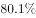
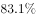

# 基期比重计算

考点：[[20-考点/资料分析/比重/基期比重计算|比重 / 基期比重计算]]
材料：[[15-材料/资料分析/186994 江西省2015年财政总收入运行情况（|186994 江西省2015年财政总收入运行情况（]]

**问法模型**：题干问'2014年（早于材料现期2015年）税收收入占财政总收入的比重'→ 基期比重模型：[现期部分量/(1+部分增速)] ÷ [现期总量/(1+总量增速)]

## 推理链
1. 第1步：题干求2014年税收占财政总收入比重，而文字材料主数据均为2015年（税收收入2373.0亿元、财政总收入3021.5亿元），时间错位判定为基期比重问题
2. 第2步：总增速b在文字中留空，须从统计图右轴折线读取2015年增长12.7%
3. 第3步：用公式求基期总量：3021.5/(1+12.7%)≈2681.0亿元，恰与图中2014年柱值2681.0吻合，交叉验证增速读取无误
4. 第4步：套基期比重公式：[2373.0/(1+a)]÷[3021.5/(1+12.7%)]=2373.0/(1+a)÷2681.0（a为税收收入增速），等价于现期比重2373.0/3021.5≈78.5%再乘修正系数(1+12.7%)/(1+a)
5. 第5步：以现期比重约78.5%为锚作方向判断后与选项对照，结果最接近B项，故选B

**最快解法**：⚡ 公式法+截位直除：先截位直除验基期总量3021.5/1.127≈2681（与图中2014年柱值互证），再套基期比重=2373.0/(1+a)÷2681.0；因税收增速与总增速12.7%接近，可直接以现期比重2373.0/3021.5≈78.5%为锚，微调后对照选项锁定B

## 易错点
- ⚠ 基期现期混淆：题干问2014年比重，若直接用现期数2373.0/3021.5≈78.5%而非套基期比重公式，在税收增速与总增速差异大时会选错
- ⚠ 跨期混除陷阱：误把2015年税收2373.0直接除以2014年总收入2681.0得约88.5%，分子未换算成基期值，必错
- ⚠ 双轴图读取陷阱：文字段总增速12.7%留空，只能从右轴折线末点读取，勿把左轴柱高（亿元）当增速用，也勿把折线点位（%）当总量用；文字中税收增速留空且图中无此数据，不可凭空补数

## 母题抽象
> 🧩 当题干出现'某年（早于材料现期）……占……的比重'且材料给出现期部分量、总量及增速时，用基期比重公式：现期部分/(1+部分增速)÷[现期总量/(1+总量增速)]=现期比重×(1+总量增速)/(1+部分增速)，并可用图中基期柱值反向验证

**同类特征**：2014年（时间早于材料现期2015年）、税收收入、占财政总收入的比重、基期比重、增速须从双轴图折线读取、文字段百分比留空

## 相关题
- [[10-真题/资料分析/比重/1796152 基期比重计算|1796152]]（贵州 2016，相关度3）
- [[10-真题/资料分析/比重/16593082 基期比重计算|16593082]]（甘肃 2024，相关度3）
- [[10-真题/资料分析/比重/2049856 基期比重计算|2049856]]（湖南 2017，相关度2）
- [[10-真题/资料分析/比重/2172071 基期比重计算|2172071]]（广州市考 2018，相关度2）
- [[10-真题/资料分析/比重/2188466 基期比重计算|2188466]]（黑龙江 2018，相关度2）

---

### 题干
2014年江西省的税收收入占财政总收入的比重为（  ）。

### 选项
- A. 

- B. 

　✅
- C. 

- D. 

### 官方解析
根据题干所求“2014年江西省的税收收入占财政总收入的比重”，材料数据为2015年，可判定此题为基期比重问题。
定位文字材料，2015年财政总收入B为3021.5亿元，增长率b为，税收收入A为2373.0亿元，增长率a为，占财政总收入比重为。代入公式，基期比重，最接近B项。
故正确答案为B。

### 给定材料

        江西省2015年财政总收入3021.5亿元，比上年增长，财政总收入占生产总值的比重为，比上年提高1.0个百分点。其中，税收收入2373.0亿元，增长，占财政总收入比重为，其他收入648.5亿元。所有县（市、区）财政总收入突破6亿元，其中，财政总收入超10亿元的县（市、区）85个，比上年增加8个；超20亿元的36个，增加7个；超30亿元的17个，增加2个；超50亿元的5个，增加2个；百亿县实现零突破，南昌县财政总收入达100.9亿元。

> [!warning] 疑点（官方解析可能有误，待人工复核）
> 文字材料中税收收入增速a与税收占比均留空，统计图亦只提供财政总收入的增速12.7%，官方解析公式中增长率a未代入具体数值，严格计算缺一参数；在a缺失条件下只能以现期比重约78.5%为基准并按a≈b近似处理与选项对照，此口径缺口不影响官方答案B的既定地位
