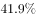
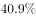

# 比重互补（现期比重之1−已知比重求剩余部分）

考点：[[20-考点/资料分析/比重/比重互补（现期比重之1−已知比重求剩余部分）|比重 / 比重互补（现期比重之1−已知比重求剩余部分）]]
材料：[[15-材料/资料分析/187066 某年度某机构关于中国宠物主人消费行为|187066 某年度某机构关于中国宠物主人消费行为]]

**问法模型**：题干问'男性养宠者占养宠人群的比重'，而材料首句只给'女性养宠者占'→ 采用互补模型：男性占比=1−女性占比

## 推理链
1. 第1步：定位材料首句，养宠人群按性别仅分为男性与女性两类，样本基数为10680份有效问卷，原文只给出'女性养宠者占'（文本中该百分数数值空格缺省，选项以公式形式呈现）
2. 第2步：男女两类互斥且合计覆盖全部养宠人群，占比之和为100%，故用比重互补公式：男性占比=1−女性占比
3. 第3步：设女性占比为a%（原文缺省的具体数值），代入得男性占比=1−a%=（100−a）%，本题只需匹配表达式、无需算出具体数字
4. 第4步：与选项对照，C项即'1−女性占比'的表达式，与官方解析'男性养宠物者占比为（1−女性占比）'一致，故正确答案为C

**最快解法**：⚡ 互补公式法：确认养宠人群为男女二分结构后，直接写出'男性占比=1−女性占比'，在选项中锁定含'1−'结构的表达式即可秒选，无需读取或计算具体百分数

## 易错点
- ⚠ 原文中女性占比数值为空格缺省，切勿凭记忆或常识补一个具体百分数（如误补50%）再硬算数值
- ⚠ 基期现期混淆：本材料为单一时点截面调查，题干明确问现期比重，直接用1−比重，不可画蛇添足除以(1+增长率)
- ⚠ 误将材料中其他占比（如'80-90后'占比、宠物角色认知占比）错当女性占比代入互补公式

## 母题抽象
> 🧩 当题干求某群体占比、而材料只给出其对立面且该分类为占比和=100%的二分结构时，用'所求占比=1−已知占比'的互补模型，正确选项通常直接呈现'1−'结构表达式

**同类特征**：男性养宠者占养宠人群的比重、材料仅给女性占比、单一时点截面问卷、男女互斥二分类、现期比重、10680份有效问卷统一基数

## 相关题
- [[10-真题/资料分析/比重/4792819 现期比重计算（多部分比重依次求解）|4792819]]（新疆 2014，相关度1）
- [[10-真题/资料分析/比重/827355 现期比重比较（部分占比过半速判）|827355]]（政法干警 2014，相关度1）
- [[10-真题/资料分析/比重/2272297 现期比重比较|2272297]]（选调 2015，相关度1）
- [[10-真题/资料分析/比重/2032972 现期比重计算（多地区占比求和）|2032972]]（吉林 2015，相关度1）
- [[10-真题/资料分析/比重/2187857 现期比重计算（部分量需先由'总量−其中量'减法间接求得）|2187857]]（山东 2018，相关度1）

---

### 题干
问卷中，男性养宠者占养宠人群的比重为：

### 选项
- A. 

- B. 

- C. 

　✅
- D. 

### 官方解析

根据问题中“男性养宠者占养宠人群的比重”可判定此题为现期比重问题。定位文字材料首句，“女性养宠者占”，则男性养宠物者占比为。

故正确答案为C。

### 给定材料

        某年度某机构关于中国宠物主人消费行为及倾向调查回收的10680份有效问卷显示：女性养宠者占，宠物主人为“80-90后”占。将宠物定义为“孩子”“亲人”“朋友”和“宠物”的分别为、、和。的人月开销在100元以内，的人开销在101至500元之间，而花费在501至1000元之间的达到，月消费1000元以上的人群达到。在购买物品方面，购买宠物食物的人数达到有效问卷总人数的，其次为药品、保健品，以及日用品、玩具、服饰五项，均接近。宠物主人外出时，四成“委托亲朋照顾”，三成“一起带走”，委托寄养还不到。在训练方面，的宠物处于自主训练或放任生长的状态，但近一半人希望爱宠得到专业训练。在购买渠道方面，的被访问者选择综合电商平台，选择线下综合商店或专卖店者为，选择宠物类垂直电商平台的占，但其复购率更高。值得注意的是，目前宠物主人对购物类O2O服务有选择意向的不足。

