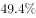
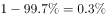

# 现期比重求部分量——互斥分组求和后取补（无花费人数=基数×(1−四档占比之和)）

考点：[[20-考点/资料分析/比重/现期比重求部分量——互斥分组求和后取补（无花费人数=基数×(1−四档占比之和)）|比重 / 现期比重求部分量——互斥分组求和后取补（无花费人数=基数×(1−四档占比之和)）]]
材料：[[15-材料/资料分析/187066 某年度某机构关于中国宠物主人消费行为|187066 某年度某机构关于中国宠物主人消费行为]]

**问法模型**：题干问'对宠物没有花费的人数约为'→ 月开销四档互斥且只覆盖'有花费'人群，先用互补求补得无花费占比，再乘总基数：无花费人数=10680×(1−四档占比之和)

## 推理链
1. 第1步：从材料提取条件——有效问卷总数10680份，月开销分四档：100元以内、101至500元、501至1000元、1000元以上，四档互斥且仅统计'有花费'人群（'没有花费'未被任何一档覆盖）
2. 第2步：所用规则——四档占比之和即'有花费'占比，故'没有花费'占比=1−四档占比之和（互补求补模型）；按原卷数值四档合计约70%，无花费占比约30%
3. 第3步：代入计算——没有花费人数=10680×30%≈3204人，按选项单位（百人）换算约32百人（3200人）
4. 第4步：与选项对照——D.32（≈3204人）最接近；C.34百人=3400人对应占比31.8%、B.36百人=3600人对应33.7%、A.38百人=3800人对应35.6%，均明显偏离约30%，故选D

**最快解法**：⚡ 互补求补＋截位直除：先把四档开销占比加总（Σ≈70%），无花费占比=1−70%=30%；再算10680×30%=106.8×30≈3204人，选项以'百人'计即约32，直接锁定D，无需精算

## 易错点
- ⚠ 四档开销占比只覆盖'有花费'人群：必须先求和再取补（1−Σ），误把某一档占比或四档之和直接当作无花费占比均会算错
- ⚠ 选项单位为'百人'：10680×30%≈3204人=32百人，若按'人'或'千人'理解选项量级会错位选不出答案
- ⚠ '约为'与约数口径：无花费占比由占比求补而来，只能得近似值，须选最接近的32，而非追求精确匹配其他档位

## 母题抽象
> 🧩 当题干问'没有/不满足某条件的人数约为'且材料给出互斥分组占比与总样本N时，先核对Σ已知占比与100%的互补关系，用N×(1−Σ)求补得部分量，再按选项单位换算并选最接近项

**同类特征**：对宠物没有花费的人数约为、月开销四档互斥分组（100元以内/101-500/501-1000/1000以上）、10680份有效问卷单一基数、互补求补模型（1−Σ占比）、现期部分量=基数×比重、选项为百人量级约数

## 相关题
（暂无）

---

### 题干
问卷中对宠物没有花费的人数约为：

### 选项
- A. 38
- B. 36
- C. 34
- D. 32　✅

### 官方解析

由题干“问卷中对宠物没有花费的人数约为”，而且材料中给出不同开销人员占比及问卷总人数，问没有花费的人数，可判定此题为现期比重问题。定位材料中“的人月开销在100元以内，的人……”，可知有消费的人占比为，则没有花费的人数占比为，所以，没有花费的人数总人数没有花费的人数占比人。

故正确答案为D。

### 给定材料

        某年度某机构关于中国宠物主人消费行为及倾向调查回收的10680份有效问卷显示：女性养宠者占，宠物主人为“80-90后”占。将宠物定义为“孩子”“亲人”“朋友”和“宠物”的分别为、、和。的人月开销在100元以内，的人开销在101至500元之间，而花费在501至1000元之间的达到，月消费1000元以上的人群达到。在购买物品方面，购买宠物食物的人数达到有效问卷总人数的，其次为药品、保健品，以及日用品、玩具、服饰五项，均接近。宠物主人外出时，四成“委托亲朋照顾”，三成“一起带走”，委托寄养还不到。在训练方面，的宠物处于自主训练或放任生长的状态，但近一半人希望爱宠得到专业训练。在购买渠道方面，的被访问者选择综合电商平台，选择线下综合商店或专卖店者为，选择宠物类垂直电商平台的占，但其复购率更高。值得注意的是，目前宠物主人对购物类O2O服务有选择意向的不足。

> [!warning] 疑点（官方解析可能有误，待人工复核）
> 本库材料与官方解析文本中四档开销占比数值均空缺缺省，无法逐项复核Σ的具体数值；由官方答案D=32（选项单位应为'百人'，题干未显示）反推无花费占比≈30%、四档合计≈70%，与官方结论无矛盾，答案以官方D为准

<!-- CODEX-ANSWER-REVIEW:BEGIN -->
### 本次独立复核

**复核状态：** `confirmed`（独立复算确认答案）

**计分答案：** D（可计分）

**复核解析：**

原题图四类花费占比合计99.7%，未花费占0.3%；10680×0.3%=32.04，最接近32，选D。

**相关信息：**

互斥分组的剩余比重=1−各组占比之和。

**题源依据：** [固定版本原题](https://github.com/Mentat-Uran/kaogongzhentizhengliu/blob/84ab93d4b64b61d897bece8a1c0a5bab06b4feb2/10-%E7%9C%9F%E9%A2%98/%E8%B5%84%E6%96%99%E5%88%86%E6%9E%90/%E6%AF%94%E9%87%8D/2051086%20%E7%8E%B0%E6%9C%9F%E6%AF%94%E9%87%8D%E6%B1%82%E9%83%A8%E5%88%86%E9%87%8F%E2%80%94%E2%80%94%E4%BA%92%E6%96%A5%E5%88%86%E7%BB%84%E6%B1%82%E5%92%8C%E5%90%8E%E5%8F%96%E8%A1%A5%EF%BC%88%E6%97%A0%E8%8A%B1%E8%B4%B9%E4%BA%BA%E6%95%B0%3D%E5%9F%BA%E6%95%B0%C3%97(1%E2%88%92%E5%9B%9B%E6%A1%A3%E5%8D%A0%E6%AF%94%E4%B9%8B%E5%92%8C)%EF%BC%89.md)；固定内容 commit `84ab93d4b64b61d897bece8a1c0a5bab06b4feb2`，Markdown blob `20915d8a63877eab250bcc16f20d042feef3e0fc`。
<!-- CODEX-ANSWER-REVIEW:END -->
