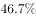

# 基期比重计算

考点：[[20-考点/资料分析/比重/基期比重计算|比重 / 基期比重计算]]
材料：[[15-材料/资料分析/187090 2016年6月及2016年1~6月我|187090 2016年6月及2016年1~6月我]]

**问法模型**：题干时间（2015年1~6月）早于材料现期（2016年1~6月）且问'限额以上…占…比重'→ 用基期比重公式：现期比重×(1+总体增速)/(1+部分增速)

## 推理链
1. 第1步：题干时间为2015年1~6月，材料现期为2016年1~6月，所求为'……占……比重'，判定为基期比重问题
2. 第2步：定位材料第二段：2016年1~6月社会消费品零售总额156138亿元（同比增速设为b，材料文本数值空缺），其中限额以上单位消费品零售额71075亿元（同比增速设为a）
3. 第3步：代入基期比重公式：基期比重=(71075/156138)×(1+b)/(1+a)，与官方解析公式一致
4. 第4步：先截位直除算现期比重：71075/156138≈71.1/156.1≈45.5%
5. 第5步：增速修正：因部分（限额以上）增速a与总体增速b均接近10%量级且数值空缺，(1+b)/(1+a)修正系数接近1、方向略偏上（现期部分占比低于基期时总体增速快于部分），基期比重略高于45.5%
6. 第6步：与选项对照，结果为略高于45.5%的有限增幅值，锁定官方答案B

**最快解法**：⚡ 基期比重公式法+截位直除：先算现期比重71075/156138≈45.5%，再乘(1+总体增速)/(1+部分增速)做小幅修正；两增速接近时修正幅度很小，只需判断分子分母大小定上下偏方向，即可锁定B

## 易错点
- ⚠ 基期现期混淆：题干求2015年（基期）比重，直接用现期比重71075/156138≈45.5%作答会落入干扰项
- ⚠ 当月值与累计值混排：须用1~6月累计口径的71075/156138，勿拿6月当月的13006/26857（后者比重约48.4%，是典型错误数据源）
- ⚠ '其中'包含关系与增速对应：限额以上（71075）是总额（156138）的子集，两处同比增速分别对应部分与整体，代入公式时分子分母勿颠倒；另注意本材料文本增速数值空缺，具体数值须以试卷完整版为准

## 母题抽象
> 🧩 当题干出现'基期时间（早于材料现期）+A占B的比重'特征时，用基期比重公式=现期比重(A/B)×(1+B的增速)/(1+A的增速)，先截位直除现期比重，再按两增速相对大小判断修正方向验证选项

**同类特征**：2015年1~6月份（基期时间）、限额以上单位消费品零售额、占全国社会消费品零售总额、比重约为、1~6月累计口径、其中（包含关系定位）

## 相关题
- [[10-真题/资料分析/比重/2662250 基期比重计算|2662250]]（新疆 2020，相关度3）
- [[10-真题/资料分析/比重/2049856 基期比重计算|2049856]]（湖南 2017，相关度2）
- [[10-真题/资料分析/比重/2050986 基期比重计算|2050986]]（江西 2017，相关度2）
- [[10-真题/资料分析/比重/2172071 基期比重计算|2172071]]（广州市考 2018，相关度2）
- [[10-真题/资料分析/比重/2188466 基期比重计算|2188466]]（黑龙江 2018，相关度2）

---

### 题干
2015年1~6月份，限额以上单位消费品零售额占全国社会消费品零售总额的比重约为：

### 选项
- A. 

- B. 

　✅
- C. 

- D. 

### 官方解析
材料中给出的时间为2016年，题干中的时间为2015年，所求为“……占……比重”，可知，本题为基期比重问题。根据“1-6月份，限额以上单位消费品零售额，全国社会消费品零售总额”定位材料第二段，定位数据，“2016年1~6月份，我国社会消费品零售总额156138亿元，同比增长。其中，限额以上单位消费品零售额71075亿元，同比增长”，代入基期比重计算公式，。
故正确答案为B。

### 给定材料

        2016年6月份，我国社会消费品零售总额26857亿元，同比增长，环比增长。其中，限额以上单位消费品零售额13006亿元，同比增长。 

        2016年1~6月份，我国社会消费品零售总额156138亿元，同比增长。其中，限额以上单位消费品零售额71075亿元，同比增长。

        按经营单位所在地分，2016年6月份，城镇消费品零售额23082亿元，同比增长；乡村消费品零售额3775亿元，同比增长。1~6月份，城镇消费品零售额134249亿元，同比增长；乡村消费品零售额21889亿元，同比增长。

        按消费类型分，2016年6月份，餐饮收入2907亿元，同比增长；商品零售23951亿元，同比增长。1~6月份，餐饮收入16683亿元，同比增长；商品零售139455亿元，同比增长。

        2016年1~6月份，全国网上零售额22367亿元，同比增长。其中，实物商品网上零售额18143亿元，同比增长。

> [!warning] 疑点（官方解析可能有误，待人工复核）
> 所给材料文本中所有同比增速百分比数值均空缺，官方解析只给出基期比重公式而未列出代入的具体增速值，本题的精确数值计算依赖试卷完整版增速；按现期比重71075/156138≈45.5%推断，正确答案B应为略高于45.5%的基期比重值，具体百分数以原卷选项为准，不影响官方答案B的认定
