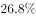
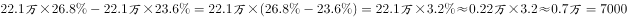

# 现期比重部分量求差（占比差×全国总量）

考点：[[20-考点/资料分析/比重/现期比重部分量求差（占比差×全国总量）|比重 / 现期比重部分量求差（占比差×全国总量）]]
材料：[[15-材料/资料分析/187100 中国人民银行《2015年中国区域金融|187100 中国人民银行《2015年中国区域金融]]

**问法模型**：题干问'两地区营业网点机构个数相差约'→ 用（西部网点占比−中部网点占比）×全国网点总量22.1万个，一步求部分量之差

## 推理链
1. 第1步：题干锁定2015年末现期，正文给全国银行业金融机构网点共计22.1万个（时点存量总量），是占比换算绝对量的唯一总量来源
2. 第2步：表格第二列'营业网点·机构个数占比'：西部26.8%、中部23.6%（勿错取第四列法人机构占比31.1%/24.9%）
3. 第3步：部分量之差=（西部占比−中部占比）×全国总量=（26.8%−23.6%）×22.1万个=3.2%×22.1万个=0.032×221000=7072个
4. 第4步：7072≈7000，与选项对照：A为7000最接近，B为8000偏差明显，C的28000、D的30000量级约为正确值4倍，故选A

**最快解法**：⚡ 占比先相减再乘总量＋截位估算：26.8%−23.6%=3.2个百分点，3.2%×22.1万≈3×2210+0.2×2210≈6630+440≈7070个，直接锁定A（7000）

## 易错点
- ⚠ 百分号处理陷阱：必须先算占比差3.2个百分点再乘22.1万个，得0.7072万=7072个；若漏乘总量或把3.2%×22.1万误读成7万量级都会选错
- ⚠ 列口径陷阱：表格中'营业网点机构个数占比'与'法人机构个数占比'是两列不同口径数据，若误用法人列（31.1%−24.9%）×22.1万≈1.37万个，无对应选项且口径错误
- ⚠ 量级甄别：C/D（28000/30000）约为正确值的4倍，属量级陷阱，估算时先定数量级（3%×22万个≈6千多）再对照选项

## 母题抽象
> 🧩 当题干出现'两地区某指标（个数/规模）相差约'且材料只给各地区占比+全国总量时，用（占比A−占比B）×全国总量，先减后乘、先估量级再对照选项

**同类特征**：2015年末、西部地区和中部地区、营业网点机构个数相差约、占比差×全国总量、现期部分量之差、选项量级差异明显（7000与28000）

## 相关题
- [[10-真题/资料分析/增长/2172271 基期量计算（时点值差法：基期时点值=现期时点值-期间新增量）|2172271]]（江苏 2018，相关度1）
- [[10-真题/资料分析/倍数/2051596 倍数计算（'比…多几倍'口径，占比相除约去总量）|2051596]]（陕西 2017，相关度1）
- [[10-真题/资料分析/平均数/2051604 现期平均数大小比较（资产总额占比÷网点个数占比，全国总量约掉）|2051604]]（陕西 2017，相关度1）

---

### 题干
2015年末，我国西部地区和中部地区的银行业金融机构的营业网点机构个数相差约：

### 选项
- A. 7000　✅
- B. 8000
- C. 28000
- D. 30000

### 官方解析

材料时间为2015年末，由题干“2015年末，我国西部地区和中部地区的银行业金融机构的营业网点机构个数”，结合表格给出中部和西部机构占比可知，本题为现期比重问题。定位文字材料第一段可知，2015年末，全国各地区银行业金融机构网点共计22.1万个，定位表格第二列可知，2015年末，西部金融机构营业网点占比为，中部金融机构营业网点占比。西部地区和中部地区机构个数相差为。

故正确答案为A。

### 给定材料

        中国人民银行发布的《2015年中国区域金融运营报告》披露：2015年末，全国各地区银行业金融机构网点共计22.1万个，从业人员379.0万人，资产总额174.2万亿元，同比分别增长、、。分地区看，中部、西部和东北地区银行业金融机构发展加快，从业人员和资产规模占全国的比例同比均有所提高，东部地区这两项指标同比分别下降1.0个百分点和0.7个百分点。

