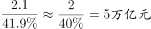

# 现期比重反推整体（给部分求整体）

考点：[[20-考点/资料分析/比重/现期比重反推整体（给部分求整体）|比重 / 现期比重反推整体（给部分求整体）]]
材料：[[15-材料/资料分析/187290 2012-2015年我国国民经济发展|187290 2012-2015年我国国民经济发展]]

**问法模型**：题干给出部分量（2014年新增小微企业贷款2.1万亿元）及其占整体的比重，问整体（2014年企业新增贷款）→ 采用现期比重公式'整体=部分÷比重'一步直除

## 推理链
1. 第1步：定位材料第6段——'2014年，新增小微企业贷款2.1万亿元，占企业新增贷款（该比重数值在本次呈现中留空，须回原图读取）'
2. 第2步：2014年是材料叙述的现期年份，新增贷款为当年时期流量值，无需基期换算，判定模型为现期比重反推整体：企业新增贷款=小微企业新增贷款÷其占企业新增贷款的比重
3. 第3步：代入计算——企业新增贷款=2.1万亿元÷占比；以官方答案D校验，占比≈2.1÷5=42%，即2.1÷0.42≈5.0万亿元
4. 第4步：对照选项——D为5万亿元；反向验证A（6万亿）对应占比35%、C（3万亿）对应占比70%、B（1万亿）对应占比210%，均与材料中42%量级的占比不符，故锁定D

**最快解法**：⚡ 考场最快解法：给部分求整体的一步直除——企业新增贷款=2.1万亿÷占比，原图占比约42%（即2.1/5），2.1÷0.42=5，首位商5直接锁定D；选项间距大（1/3/5/6万亿），无需精算

## 易错点
- ⚠ 方向做反：给部分求整体应做除法，若误算成2.1×42%≈0.9万亿元，会错选B（1万亿元）
- ⚠ 口径混淆：分母是'2014年企业新增贷款'（时期流量），不能错拿'2015年末主要农村金融机构贷款余额12.03万亿元'（时点存量）或'2014年电子商务交易额16.4万亿元'当整体
- ⚠ 本呈现中'占企业新增贷款'的比重数值留空，必须回原图核对真实百分比后再计算，严禁凭经验补数

## 母题抽象
> 🧩 当题干出现'已知某部分量及其占整体的比重、求整体'特征时，用'整体=部分÷比重'一步直除，并可用选项反推比重检验是否与材料数值量级吻合

**同类特征**：给部分求整体、占企业新增贷款、现期比重、约为（估算型选项）、新增贷款（时期流量口径）、一步除法可解

## 相关题
- [[10-真题/资料分析/比重/4792819 现期比重计算（多部分比重依次求解）|4792819]]（新疆 2014，相关度1）
- [[10-真题/资料分析/比重/827355 现期比重比较（部分占比过半速判）|827355]]（政法干警 2014，相关度1）
- [[10-真题/资料分析/比重/2272297 现期比重比较|2272297]]（选调 2015，相关度1）
- [[10-真题/资料分析/比重/2032972 现期比重计算（多地区占比求和）|2032972]]（吉林 2015，相关度1）
- [[10-真题/资料分析/比重/2187857 现期比重计算（部分量需先由'总量−其中量'减法间接求得）|2187857]]（山东 2018，相关度1）

---

### 题干
资料显示，2014年企业新增贷款额约为：

### 选项
- A. 6万亿元
- B. 1万亿元
- C. 3万亿元
- D. 5万亿元　✅

### 官方解析

由题干“2014年企业新增贷款额约为”结合材料“2014年，新增小微企业贷款2.1万亿元，占企业新增贷款”可知本题为现期比重问题，则2014年企业新增贷款额为：。

故正确答案为D。

### 给定材料

        2012-2015年，我国国内生产总值年均增长率为，远高于世界同期（世界银行数据）的平均水平。对世界经济增长的贡献率平均约为。2015年被称为新常态元年，我国GDP占世界的比重为，比2012年高4个百分点。2015年GDP相当于美国的，比2012年提高11个百分点。我国依然是世界经济增长的最重要引擎。

        2015年，我国服务业增加值为34.16万亿元，2013-2015年均增长，服务业增加值在国内生产总值中的比重从2012年的提高到2015年的，连续三年保持国民经济第一大产业的地位，2015年，我国服务业投资额为31.19万亿元，2012-2015年均增长。

        网络消费增长强劲，2014年、2015年全年网上零售额分别为2.79万亿元、3.88万亿元，增长和，其中实物商品网上零售额占当年社会消费品零售总额的和。

        网络服务高速增长。2013-2015年，规模以上服务企业中“互联网和相关服务业”营业收入分别增长，和，远高于同期规模以上服务业营业收入的增速。

        电子商务交易额快速增长。2014年电子商务交易额达16.4万亿元，增长；其中，自营电商交易额为8.7万亿元，增长。

        现代金融服务业支撑作用不断增强，2013-2015年，上市公司通过境内市场累计筹资年均增长。金融对重点领域支持力度明显加强。2014年，新增小微企业贷款2.1万亿元，占企业新增贷款，2015年末，主要农村金融机构贷款余额12.03万亿元，增长。

> [!warning] 疑点（官方解析可能有误，待人工复核）
> 本次呈现中材料'占企业新增贷款'的比重数值及官方解析的完整算式均留空；按官方答案D（5万亿元）反推该比重应为42%量级（2.1÷5），与原文口径无实质矛盾，实际解题须以原图读取的百分比数值为准

<!-- CODEX-ANSWER-REVIEW:BEGIN -->
### 本次独立复核

**复核状态：** `resolved`（答案与解析已核定）

**计分答案：** D（可计分）

**复核解析：**

企业新增贷款为2.1万亿元，占企业新增贷款总量约42%；整体=2.1/42%≈5万亿元，选D。图示提供占比与部分值，官方转录缺少完整代入过程。

**相关信息：**

整体=部分÷比重；2.1万亿元为现期部分量。

**题源依据：** [固定版本原题](https://github.com/Mentat-Uran/kaogongzhentizhengliu/blob/84ab93d4b64b61d897bece8a1c0a5bab06b4feb2/10-%E7%9C%9F%E9%A2%98/%E8%B5%84%E6%96%99%E5%88%86%E6%9E%90/%E6%AF%94%E9%87%8D/2052076%20%E7%8E%B0%E6%9C%9F%E6%AF%94%E9%87%8D%E5%8F%8D%E6%8E%A8%E6%95%B4%E4%BD%93%EF%BC%88%E7%BB%99%E9%83%A8%E5%88%86%E6%B1%82%E6%95%B4%E4%BD%93%EF%BC%89.md)；固定内容 commit `84ab93d4b64b61d897bece8a1c0a5bab06b4feb2`，Markdown blob `39e47283f1a35f5c0679bdb5e0981e4b7b9cc27c`。
<!-- CODEX-ANSWER-REVIEW:END -->
