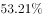
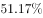
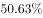
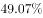
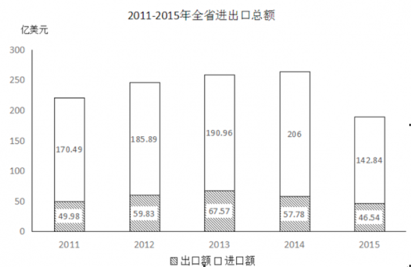
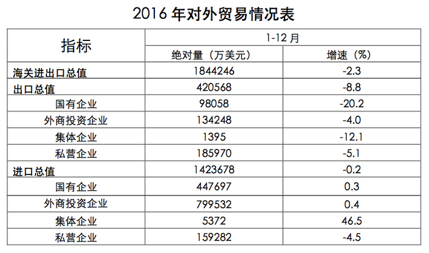

# 现期比重计算（分量相加÷总量）

考点：[[20-考点/资料分析/比重/现期比重计算（分量相加÷总量）|比重 / 现期比重计算（分量相加÷总量）]]
材料：[[15-材料/资料分析/187292 某省对外贸易情况：图1给出2011-|187292 某省对外贸易情况：图1给出2011-]]

**问法模型**：题干问'2016年某类企业进出口总值占海关进出口总值的比重约为'→ 现期比重=（该类企业出口+进口）÷海关进出口总值，直接从表2取数相除

## 推理链
1. 第1步：题干时间2016年与表2（2016年1-12月）口径一致，为现期比重，无需基期换算；定位表2：外商投资企业出口134248万美元、进口799532万美元，海关进出口总值1844246万美元
2. 第2步：现期比重公式：比重=分量÷总量，其中分量=外商投资企业出口+进口=134248+799532=933780万美元
3. 第3步：代入计算：933780÷1844246
4. 第4步：截位直除：≈93.4÷184.4≈0.506，即约50.6%
5. 第5步：与选项对照，C项（约50.6%）最接近，故选C

**最快解法**：⚡ 截位直除：分子134248+799532=933780≈93.4（万），分母1844246≈184.4（万），首位商5（93.4/184.4≈50.6%），直接锁定C

## 易错点
- ⚠ 分子须将表2中外商投资企业的出口、进口两行相加（134248+799532），勿只取出口或只取进口一行
- ⚠ 分母应使用海关进出口总值1844246万美元；表2四类企业分项之和小于总值（存在未列出的其他企业类型），勿用出口+进口分项之和当分母
- ⚠ 表2为7位数万美元口径，本题分子分母同单位相除无需换算，但若错误换算或与图1（亿美元）混算会出严重量级错误

## 母题抽象
> 🧩 当题干出现'某年某类主体进出口总值占某总值的比重约为'且时间为现期时，用'分量（出口+进口相加）÷总量'，截位直除看首位商验证选项

**同类特征**：2016年、外商投资企业进出口总值、占海关进出口总值、比重约为、现期比重、表2行列取数

## 相关题
- [[10-真题/资料分析/比重/4792819 现期比重计算（多部分比重依次求解）|4792819]]（新疆 2014，相关度1）
- [[10-真题/资料分析/比重/827355 现期比重比较（部分占比过半速判）|827355]]（政法干警 2014，相关度1）
- [[10-真题/资料分析/比重/2272297 现期比重比较|2272297]]（选调 2015，相关度1）
- [[10-真题/资料分析/比重/2032972 现期比重计算（多地区占比求和）|2032972]]（吉林 2015，相关度1）
- [[10-真题/资料分析/比重/2187857 现期比重计算（部分量需先由'总量−其中量'减法间接求得）|2187857]]（山东 2018，相关度1）

---

### 题干
2016年该省外商投资企业进出口总值占海关进出口总值的比重约为：

### 选项
- A. 

- B. 

- C. 

　✅
- D. 

### 官方解析
由题干所求“……占……比重”，可判定此题为现期比重问题。定位统计表，2016年该省外商投资企业进出口总值为，海关进出口总值为，2016年该省外商投资企业进出口总值占海关进出口总值的比重约为，与C项最接近。
故正确答案为C。

### 给定材料

下面是某省的对外贸易进出口总额的部分数据资料，请根据图表回答下述问题：

