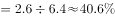

# 现期比重计算

考点：[[20-考点/资料分析/比重/现期比重计算|比重 / 现期比重计算]]
材料：[[15-材料/资料分析/187626 2015年5月及2015年1-5月全|187626 2015年5月及2015年1-5月全]]

**问法模型**：题干直接问'2015年5月医院诊疗人次占全国的比重'，时间为材料现期且分子分母均直接给出 → 采用现期比重模型：比重=部分现期量÷总量现期量

## 推理链
1. 第1步：题干时间限定为'2015年5月'当月口径，对应材料第1段：全国医疗卫生机构诊疗人次6.4亿人次，其中医院2.6亿人次
2. 第2步：校验层级——医院2.6亿=公立2.3亿+民营0.3亿，2.6亿即'医院'这一层级的完整口径，可直接作分子
3. 第3步：现期比重公式：比重=医院诊疗人次÷全国诊疗人次
4. 第4步：代入计算：2.6÷6.4=0.40625≈40.6%
5. 第5步：对照选项，与官方正确答案C（即40.6%左右该比值）一致，故选C

**最快解法**：⚡ 截位直除：2.6÷6.4，首两位商40，得≈40.6%；亦可反向验证6.4×40%=2.56略小于2.6，故比重略高于40%，锁定对应选项C

## 易错点
- ⚠ 当月/累计口径混用：分子误取1-5月累计医院12.2亿人次、分母误取31.1亿人次（得≈39.2%），而题干明确是2015年5月当月，必须用第1段的2.6亿与6.4亿
- ⚠ 层级重复计算：误将公立2.3亿、民营0.3亿与医院2.6亿相加，或跨级混加基层分项，医院2.6亿已包含公立+民营
- ⚠ 指标与量级混淆：勿混入出院人数（万人）或村卫生室（仅1-5月累计口径）等数据；分子分母必须同为'诊疗人次'且同为当月值

## 母题抽象
> 🧩 当题干出现'某期A占B的比重'且时间为材料现期时，直接用部分现期量÷总量现期量；先核对当月/累计口径与层级归属，再用截位直除对照选项

**同类特征**：2015年5月（当月口径）、医院诊疗人次、占、全国医疗卫生机构诊疗人次、比重、部分÷总体

## 相关题
- [[10-真题/资料分析/比重/2604234 现期比重计算|2604234]]（广东 2020，相关度2）
- [[10-真题/资料分析/比重/1751688 现期比重计算|1751688]]（江苏 2015，相关度2）
- [[10-真题/资料分析/比重/2456370 现期比重计算|2456370]]（浙江 2020，相关度2）
- [[10-真题/资料分析/比重/2050970 现期比重计算|2050970]]（江西 2017，相关度2）
- [[10-真题/资料分析/比重/2188157 现期比重计算|2188157]]（陕西 2018，相关度2）

---

### 题干
2015年5月，医院诊疗人次占全国医疗卫生机构诊疗人次的比重：

### 选项
- A. 

- B. 

- C. 

　✅
- D. 

### 官方解析

由题干“2015年5月”和“比重”判定为现期比重问题，根据材料第一段第一句“2015年5月，全国医疗卫生机构诊疗人次达6.4亿人次，其中，医院2.6亿人次”可得，所求比重。

故正确答案为C。

### 给定材料

        2015年5月，全国医疗卫生机构诊疗人次达6.4亿人次，同比提高，环比提高。其中，医院2.6亿人次，同比提高，环比降低；基层医疗卫生机构诊疗人次为3.6亿人次，同比提高，环比降低；其他机构0.2亿人次。医院中：公立医院2.3亿人次，同比提高，环比提高；民营医院0.3亿人次，同比提高，环比提高。基层医疗卫生机构中：社区卫生服务中心（站）0.6亿人次，同比提高，环比降低；乡镇卫生院0.8亿人次，同比提高，环比降低。

        2015年1-5月，全国医疗卫生机构总诊疗人次达31.1亿人次，同比提高。其中：医院12.2亿人次，同比提高；基层医疗卫生机构18.0亿人次，同比提高；其他机构10.1亿人次。医院中：公立医院10.8亿人次，同比提高；民营医院1.3亿人次，同比提高。基层医疗卫生机构中：社区卫生服务中心（站）2.7亿人次，同比提高；乡镇卫生院4.1亿人次，同比提高；村卫生室诊疗人次8.4亿人次。

        2015年5月份，全国医疗卫生机构出院人数达1738.4万人，同比提高，环比降低。其中：医院1330.2万人，同比提高，环比降低；基层医疗卫生机构出院人数为333.4万人，同比降低，环比降低；其他机构74.8万人。医院中：公立医院1156.5万人，同比提高，环比降低；民营医院173.7万人，同比提高，环比提高。

        2015年1-5月，全国三级公立医院次均门诊费用为276.5元，与去年同期比较，按当年价格上涨，按可比价格上涨；二级公立医院次均门诊费用为182.7元，按当年价格同比上涨，按可比价格同比上涨。

        2015年1-5月，全国三级公立医院人均住院费用为12536.8元，与去年同期比较，按当年价格上涨，按可比价格上涨；二级公立医院人均住院费用为5320.6元，按当年价格同比上涨，按可比价格同比上涨。

