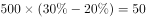

# 结构占比与部分量换算（已知部分量求其他部分量并作差比较）

考点：[[20-考点/资料分析/比重/结构占比与部分量换算（已知部分量求其他部分量并作差比较）|比重 / 结构占比与部分量换算（已知部分量求其他部分量并作差比较）]]
材料：[[15-材料/资料分析/187636 某总公司下属甲、乙、丙3个分公司职工|187636 某总公司下属甲、乙、丙3个分公司职工]]

**问法模型**：题干给出某主体内某部分的实际人数（甲分公司提升职务150人）→ 用 人数÷该部分占比 求出该主体总人数，再乘以其余各部分占比求人数并作差比较

## 推理链
1. 第1步：看图注'从内到外分别为甲、乙、丙'，锁定最内环为甲分公司，读出甲：参加培训20%、提升职务30%、改善工作环境20%、提高薪酬30%（合计100%）
2. 第2步：题干条件：甲分公司有意愿提升职务的职工有150人，对应占比30%
3. 第3步：求甲分公司总人数＝150÷30%＝500人
4. 第4步：提高薪酬人数＝500×30%＝150人；参加培训人数＝500×20%＝100人
5. 第5步：150−100＝50人，即提高薪酬比参加培训多50人
6. 第6步：对照选项，D'多50人'与计算一致，故选D

**最快解法**：⚡ 份数法（比例折算）：甲环内 提升职务:提高薪酬:参加培训＝30%:30%:20%＝3:3:2，150人对应3份→每份50人，提高薪酬＝3份＝150人，参加培训＝2份＝100人，差恰为1份＝50人，直接选D，无需先算总数500

## 易错点
- ⚠ 环层归属陷阱：图注'从内到外为甲、乙、丙'，若误读乙环（35%/25%/15%/25%）或丙环（35%/40%/10%/15%）的数据则必错
- ⚠ 部分量与占比混用：150人是'提升职务'这一部分的实际人数而非总人数，若直接拿150×30%或不先求总数500就套算会出错
- ⚠ 方向陷阱：150−100＝+50，是'多50人'，勿被'比'字句式绕成'少'或算成少的人数；同时各占比的分母是本分公司人数而非全公司总数

## 母题抽象
> 🧩 当题干出现'假设某主体内某部分有X人，问该主体内另一部分比第三部分多/少多少'时，先用X÷该部分占比求总体（或用占比连比化成份数），再按各自占比求两部分人数作差，验证方向与差值对应选项

**同类特征**：假设……有意愿……的职工有150人、甲分公司（最内环）、提高薪酬比参加培训多/少、环形结构图占比换算、部分量→总量→部分量、同一主体内两部分人数比较

## 相关题
（暂无）

---

### 题干
假设甲分公司有意愿提升职务的职工有150人，那么该分公司有意愿提高薪酬的职工人数比有意愿参加培训的职工人数（  ）

### 选项
- A. 少100人
- B. 少50人
- C. 多100人
- D. 多50人　✅

### 官方解析

由图可得，甲分公司有意愿提升职务、提高薪酬、参加培训的职工比重分别为、、，根据有意愿提升职务的职工有150人，可得人，故人。

故正确答案为D。

### 给定材料

某总公司下属3个分公司职工意愿调查结构图

> [!warning] 疑点（官方解析可能有误，待人工复核）
> 官方解析文本中比重数值与结果数字缺失（显示为'比重分别为、、''可得人，故人'），按内环数据30%、30%、20%代入恰得总数500人、150人与100人、差50人，与答案D自洽，系解析文字丢数而非答案错误

<!-- CODEX-ANSWER-REVIEW:BEGIN -->
### 本次独立复核

**复核状态：** `confirmed`（独立复算确认答案）

**计分答案：** D（可计分）

**复核解析：**

甲类培训占总量30%，150对应总量150÷30%=500；甲类工资占30%，为150。甲类培训占20%，为100。培训工资比150−100=50，对应D。

**相关信息：**

工资环图的扇区比例按图例由内到外判读；配合已知的培训额反推总量。

**题源依据：** [固定版本原题](https://github.com/Mentat-Uran/kaogongzhentizhengliu/blob/84ab93d4b64b61d897bece8a1c0a5bab06b4feb2/10-%E7%9C%9F%E9%A2%98/%E8%B5%84%E6%96%99%E5%88%86%E6%9E%90/%E6%AF%94%E9%87%8D/2060646%20%E7%BB%93%E6%9E%84%E5%8D%A0%E6%AF%94%E4%B8%8E%E9%83%A8%E5%88%86%E9%87%8F%E6%8D%A2%E7%AE%97%EF%BC%88%E5%B7%B2%E7%9F%A5%E9%83%A8%E5%88%86%E9%87%8F%E6%B1%82%E5%85%B6%E4%BB%96%E9%83%A8%E5%88%86%E9%87%8F%E5%B9%B6%E4%BD%9C%E5%B7%AE%E6%AF%94%E8%BE%83%EF%BC%89.md)；固定内容 commit `84ab93d4b64b61d897bece8a1c0a5bab06b4feb2`，Markdown blob `8c0c392d868d4aa6dd4b1dd21bdaaa631c98eea6`。
<!-- CODEX-ANSWER-REVIEW:END -->
