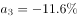
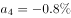

# 两期比重升降（高低）定性比较

考点：[[20-考点/资料分析/比重/两期比重升降（高低）定性比较|比重 / 两期比重升降（高低）定性比较]]
材料：[[15-材料/资料分析/189698 2015年全国纺织行业运行情况：规模|189698 2015年全国纺织行业运行情况：规模]]

**问法模型**：题干出现'2015年占出口总额比重低于2014年水平的有（哪些）'→两期比重比较模型：比重升降只取决于部分增速a与整体增速b的大小，a<b则现期比重低于基期，全程无需计算比重或基期量

## 推理链
1. 第1步：从材料第3段提取整体与部分：整体=2015年出口纺织品、服装2912亿美元，同比增速b为负值（转录文本数值空缺，以原始试卷补齐）；四个部分增速方向：对美国增长（正）、对欧盟下降、对日本下降、对东盟下降（均为负）
2. 第2步：两期比重规则：现期比重−基期比重的符号与(a−b)相同，部分增速a<整体增速b则2015年比重低于2014年；a>b则高于
3. 第3步：逐一比较：美国a>0而b<0，故a>b→比重上升；欧盟、日本降幅大于整体降幅→a<b→比重下降；东盟降幅小于整体降幅→a>b→比重上升（该排序与官方解析'增速小于整体的，只有欧盟和日本'一致）
4. 第4步：比重低于2014年水平的只有欧盟和日本，对照选项：A仅东盟、B美国和东盟、D欧盟日本东盟三者均不符，锁定C

**最快解法**：⚡ 两期比重规则法（a与b大小比较，零计算）：先看整体2912亿美元同比为负增长，美国为正增长必大于整体→比重上升，排除B；剩下的欧盟、日本、东盟虽同为下降，只需比降幅与整体降幅的大小：降幅大于整体→比重低于上年，降幅小于整体→比重高于上年，由原始数据直接锁定'欧盟和日本'，不列公式、不做除法

## 易错点
- ⚠ 把'同比下降'误当成'比重下降'：东盟也是同比下降，但因降幅小于整体降幅，比重反而上升，误选D是本题最大陷阱
- ⚠ 只比正负不比数值大小：欧盟、日本、东盟三个都是负增长，必须拿各自降幅与整体降幅（负值）比大小；若走基期回推路线，负增速代入'基期=现期/(1+a)'时极易弄错符号
- ⚠ 陷阱解法是去算各年比重：既费时，又会掉进口径坑——美欧日东盟出口额之和小于2912亿美元总额（还有其他出口对象），不能拿份额拼接验证

## 母题抽象
> 🧩 当题干出现'现期比重低于/高于（上年）基期、比重上升/下降的对象有哪些'特征时，用两期比重规则法：部分增速a与整体增速b比大小，a<b比重降、a>b比重升，只查增速不做任何计算

**同类特征**：比重低于2014年水平、占当年出口总额比重、主要贸易伙伴（按对象分类）、各部分同比有增有降、仅需比较部分增速与整体增速、问'有哪些'而非算数值

## 相关题
（暂无）

---

### 题干
在美国、欧盟、日本和东盟四大主要贸易伙伴中，2015年我国纺织品、服装对其出口额占当年我国纺织品、服装出口总额比重低于2014年水平的有：

### 选项
- A. 仅东盟
- B. 美国和东盟
- C. 欧盟和日本　✅
- D. 欧盟、日本和东盟

### 官方解析

由问题“2015年······的比重低于2014年”可得本题为两期比重比较问题，仅需比较部分增长率a与整体增长率b的大小关系，只需查找出的，即为比重低于上年同期水平的国家。定位材料第三段可知“2015年我国出口纺织品、服装”为整体，其增速；各部分包括：“对美国出口额”其增速；“对欧盟出口额”其增速；“对日本出口额”其增速；“对东盟出口额”其增速。可见增速小于整体的，只有欧盟和日本。

故正确答案为C。

### 给定材料

        2015年，全国规模以上纺织企业工业增加值同比增长，高于规模以上工业整体水平0.2个百分点，增速比上年同期回落0.7个百分点。其中，纺织业、服装服饰行业、化学纤维行业增加值同比分别增长、和。

        2015年，纺织行业规模以上企业累计实现主营业务收入70713亿元，同比增长；实现利润总额3860亿元，同比增长；企业亏损面(亏损企业占所有企业比重)，比上年低0.1个百分点。

        2015年，我国出口纺织品、服装2912亿美元，同比下降，按出口商品类型看，纺织品出口1153亿美元，同比下降；服装出口1759亿美元，同比下降。按出口对象看，对美国出口额同比增长，对欧盟出口额同比下降，对日本出口额同比下降，对东盟出口额同比下降。

        2015年，我国纺织行业500万元以上项目固定资产投资完成额11913亿元，同比增长。其中东部地区固定资产投资完成额同比增长，中部地区固定资产投资完成额同比增长，西部地区固定资产投资完成额同比增长。行业新开工项目数呈现增速提升势头，新开工项目16149项，同比增长。

