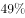
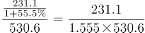
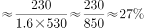
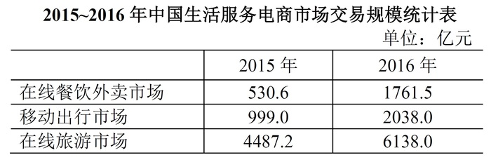

# 基期比重（由环比增速反推基期季度值）

考点：[[20-考点/资料分析/比重/基期比重（由环比增速反推基期季度值）|比重 / 基期比重（由环比增速反推基期季度值）]]
材料：[[15-材料/资料分析/191534 2015~2016年中国生活服务电商|191534 2015~2016年中国生活服务电商]]

**问法模型**：题干求'2015年（基期）第四季度占2015年全年比重'→ 基期比重模型：先由2016Q1现期值与其环比增速反推基期值2015Q4，再除以表中基期全年总量

## 推理链
1. 第1步：题干要求2015年Q4占2015年全年的比重，但材料未直接给出2015年分季数据，2015Q4为隐藏的基期量，须间接推算
2. 第2步：跨图表取数——组合图中2016年Q1交易规模231.1亿元、环比增速55.5%；一季度环比的基期恰是2015年Q4，故2015Q4=231.1÷(1+55.5%)
3. 第3步：代入计算231.1÷1.555≈148.6亿元，即2015年Q4交易规模
4. 第4步：从统计表取2015年在线餐饮外卖全年交易规模530.6亿元作分母，比重=148.6÷530.6≈28%
5. 第5步：与选项对照，计算结果约28%与B项最接近，故选B

**最快解法**：⚡ 基期比重一步式+截位直除：比重=231.1÷[(1+55.5%)×530.6]≈231.1÷825≈28%；或先用特殊分数1.555≈14/9，231.1×9/14≈148.6，再验证530.6×28%≈148.6恰好吻合，口算即可锁定B

## 易错点
- ⚠ 口径混淆：图中折线是环比增速（相对上一季度），2016Q1的55.5%恰以2015Q4为基期才能反推；若误当同比增速或用其他季度环比，则基期值全错
- ⚠ 分母年份看错：比重是占2015年全年530.6亿元，不是占2016年全年1761.5亿元；用错分母会得到约8%的离谱结果
- ⚠ 双轴图读数陷阱：柱（亿元，左轴）与线（%，右轴）量纲不同，切勿把柱高趋势当增速、把折线数值当规模；且不可用四季环比去反推2015年其他季度（材料未给）

## 母题抽象
> 🧩 当题干出现'基期某季度值占基期全年比重'且材料只给'现期该季度值+其环比增速+基期全年值'时，用'现期季值÷(1+环比增速)÷基期全年值'一步求基期比重，并用分母×选项百分数反验

**同类特征**：基期年份+季度占比、占全年……比重约为、环比增速反推基期量、跨图表取数（图给季度、表给全年）、无直接基期数据需间接推算

## 相关题
（暂无）

---

### 题干
2015年第四季度在线餐饮外卖市场交易规模占全年交易规模的比重约为：

### 选项
- A. 

- B. 

　✅
- C. 

- D. 

### 官方解析

根据题干所求“2015年……占……比重”，结合材料，可判定此题为基期比重问题。定位图形材料，2016年第一季度在线餐饮外卖市场交易规模为231.1亿元，环比增速，表格材料中，2015年在线餐饮外卖市场交易规模530.6亿元。可计算出，2015年第四季度在线餐饮外卖市场交易规模占全年交易规模的比重约为，B项最接近。

故正确答案为B。

### 给定材料

