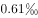
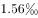
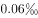
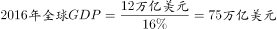

# 现期比重——两步链式比重（部分→64国→全球）相乘

考点：[[20-考点/资料分析/比重/现期比重——两步链式比重（部分→64国→全球）相乘|比重 / 现期比重——两步链式比重（部分→64国→全球）相乘]]
材料：[[15-材料/资料分析/191536 2016年'一带一路'沿线64国的经|191536 2016年'一带一路'沿线64国的经]]

**问法模型**：题干问'蒙古GDP约占全球总体GDP的比重'（现期、部分占上位整体），而材料只给蒙古GDP、64国GDP总量及'64国占全球GDP比重'→采用两步链式比重模型：所求=（蒙古GDP÷64国GDP）×（64国占全球GDP比重）。

## 推理链
1. 第1步：定位表格第一行取分子：蒙古2016年GDP=116.5亿美元；定位文字段取中间整体：2016年'一带一路'沿线64国GDP之和≈12.0万亿美元（表格六行加总≈120139.6亿美元，与文字段互证）。
2. 第2步：统一单位量纲：12.0万亿美元=120000亿美元，使分子分母同为'亿美元'（导读提示的核心量级陷阱：亿美元÷万人式换算在此不适用，此处只差10000倍）。
3. 第3步：明确模型：所求比重=蒙古占64国GDP的比重×64国占全球GDP的比重（第二步乘数为文字段所给占比p，且p<1）。
4. 第4步：第一步截位直除：116.5÷120000≈0.00097，即蒙古约占64国GDP的0.097%。
5. 第5步：第二步乘以文字段'64国占全球GDP比重'p；因p<1，最终结果必小于0.097%（约0.1%）量级。
6. 第6步：与选项对照：四个选项作量级辨析，落在'小于0.1%'范围的仅D项，与官方答案D一致。

**最快解法**：⚡ 量级排除法+截位直除：先把12.0万亿美元统一为120000亿美元，116.5÷120000≈0.097%；再乘文字段所给64国占全球占比p（p<1），所求必<0.1%，对照选项量级直接锁定D，无需精确算出最终百分数。

## 易错点
- ⚠ 单位量级陷阱：116.5亿美元÷12.0万亿美元若不做÷10000换算会得到约97%的荒谬结果（差10000倍），必须先统一为116.5÷120000。
- ⚠ 漏乘链式第二步：题问'占全球'而非'占64国'，只算第一步≈0.097%会误选大一个量级的选项；须再乘文字段'64国占全球GDP比重'。
- ⚠ 材料信息缺失陷阱：所给文本中'占全球GDP的'后百分数空缺（材料导读已标注三处占比缺失），若试图只从所给文本复算精确值会卡壳，应改用量级范围（结果<0.097%）筛选选项。

## 母题抽象
> 🧩 当题干出现'某部分约占全球（上位整体）比重'、而材料只给'部分占中间整体'+（中间整体占全球比重）两层数据时，用两步链式比重相乘：先统一单位做第一步截位直除，再乘中间占比，最后用'结果必小于第一步比重'的量级范围排除选项。

**同类特征**：现期（2016年）无增速直接运算、约占全球（上位整体）的比重、表格单行数据（蒙古116.5亿美元）+文字段汇总（12.0万亿美元）联合取数、亿美元与万亿美元跨单位相除、两步链式比重（部分→64国→全球）、选项为百分数量级辨析

## 相关题
（暂无）

---

### 题干
2016年，蒙古GDP约占全球总体GDP的：

### 选项
- A. 

- B. 

- C. 

- D. 

　✅

### 官方解析

由题干“2016年，蒙古约占全球······”，可判定本题为现期比重问题。

定位表格第一行，“蒙古GDP为116.5亿美元”；定位文字材料第一段，“2016年，‘一带一路’沿线64个国家GDP之和约为12.0万亿美元，占全球GDP的”。可知，，则2016年蒙古GDP约占全球GDP总体的比重。

故正确答案为D。

### 给定材料

<b>根据以下资料，回答下列5题。</b>

        2016年“一带一路”沿线64个国家GDP之和约为12.0万亿美元，占全球GDP的；人口总数约为32.1亿人，占全球总人口的；对外贸易总额（）约为71885.6亿美元，占全球贸易总额的。

> [!warning] 疑点（官方解析可能有误，待人工复核）
> 所给材料原文中'占全球GDP的'之后百分数空缺（材料导读如实标注三处占比缺失），官方解析在该处隐含按原题所给百分数代入方能得出D的具体数值；依所给文本只能独立复算出'蒙古占64国GDP≈0.097%'及'最终结果必小于0.097%'的范围，无法精确复现D项百分数，属材料转写信息缺失而非答案口径问题，答案D以官方为准。

<!-- CODEX-ANSWER-REVIEW:BEGIN -->
### 本次独立复核

**复核状态：** `confirmed`（独立复算确认答案）

**计分答案：** D（可计分）

**复核解析：**

公式图给出沿线64国GDP约12.0万亿美元、占全球GDP的16.0%，故全球GDP约为12.0÷0.16=75万亿美元=750000亿美元。蒙古GDP为116.5亿美元，占全球GDP的116.5÷750000×100%≈0.01553%=0.1553‰，按题意取约值为0.16‰，选D。原题选项的单位“%”是转录错误，已统一修正为“‰”；该修正亦与同题地市卷考生回忆版第114题的单位相符（该卷为回忆版，非考试机构勘误）。

**修订材料：**

2016年“一带一路”沿线64个国家GDP之和约为12.0万亿美元，占全球GDP的16.0%。蒙古2016年GDP为116.5亿美元。统一为亿美元后，全球GDP=12.0万亿美元÷16.0%=75万亿美元=750000亿美元。

**修订选项：**

A. 0.61‰
B. 1.56‰
C. 0.06‰
D. 0.16‰

**相关信息：**

链式比重计算须统一单位；比例转成百分数乘100%，转成千分数乘1000。百分比与千分比相差10倍。

**题源依据：** [固定版本原题](https://github.com/Mentat-Uran/kaogongzhentizhengliu/blob/84ab93d4b64b61d897bece8a1c0a5bab06b4feb2/10-%E7%9C%9F%E9%A2%98/%E8%B5%84%E6%96%99%E5%88%86%E6%9E%90/%E6%AF%94%E9%87%8D/2133500%20%E7%8E%B0%E6%9C%9F%E6%AF%94%E9%87%8D%E2%80%94%E2%80%94%E4%B8%A4%E6%AD%A5%E9%93%BE%E5%BC%8F%E6%AF%94%E9%87%8D%EF%BC%88%E9%83%A8%E5%88%86%E2%86%9264%E5%9B%BD%E2%86%92%E5%85%A8%E7%90%83%EF%BC%89%E7%9B%B8%E4%B9%98.md)；固定内容 commit `84ab93d4b64b61d897bece8a1c0a5bab06b4feb2`，Markdown blob `f62704a57854d92c7c0b3f5a564a8def02c38573`。
<!-- CODEX-ANSWER-REVIEW:END -->
