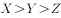
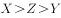
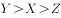
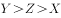
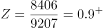

# 现期比重比较（三个比重比大小）

考点：[[20-考点/资料分析/比重/现期比重比较（三个比重比大小）|比重 / 现期比重比较（三个比重比大小）]]
材料：[[15-材料/资料分析/191538 2017年1～2月全国造船业运行情况|191538 2017年1～2月全国造船业运行情况]]

**问法模型**：题干把'出口船占全国'的三个比重分别设为符号并比较大小 → 现期比重模型：比重=分量/总量，列三个分数直接定序

## 推理链
1. 第1步：题干设2017年1～2月三个比重：出口船完工占全国造船完工、出口船承接订单占全国承接新船订单、2月末手持出口船订单占全国手持船舶订单
2. 第2步：从材料第二段取出口船分量：完工907、承接订单191、2月末手持8406万载重吨
3. 第3步：从材料第一段取全国总量：造船完工936、承接新船订单221、2月末手持9207万载重吨
4. 第4步：按比重=分量/总量列式：p=907/936，q=191/221，r=8406/9207
5. 第5步：截位直除：p≈96.9%，q≈86.4%，r≈91.3%；或用补差法验证——1−p=29/936≈3.1%，1−q=30/221≈13.6%，1−r=801/9207≈8.7%，补差越小比重越大
6. 第6步：得q<r<p，与选项对照，只有B选项符合，故选B

**最快解法**：⚡ 补差法（比'与1的差'）：三个比重均超85%，直除首位区分度低，改比补差——936−907=29、221−191=30、9207−8406=801，对应29/936≈3.1%、30/221≈13.6%、801/9207≈8.7%，补差越大比重越小，立得q(86.4%)<r(91.3%)<p(96.9%)，选B

## 易错点
- ⚠ 口径串行：'造船完工/订单/手持订单'在材料中各有全国（936/221/9207）与重点企业（912/197/8874）两套数，本题必须取全国与全国出口船口径，误取重点企业数会全盘皆错
- ⚠ 三个分数都很大（均超85%）、首位商都接近9，只看首位易误判并列；且q的分子191最小但分母221也最小，不能凭分子或绝对量差臆断比重最小，需用补差法或除到第二位（91%对97%）定序
- ⚠ 手持订单是2月末时点值，与1～2月累计流量混排，但本题三问都是现期比重，直接同段取数即可，不必做任何基期换算或时间调整

## 母题抽象
> 🧩 当题干出现'设A占总量比重为p、B占总量比重为q……则有（比较大小）'的特征时，先锁定同一口径取分量/总量列三个现期分数；若各分数均接近1（超85%），用补差法比较1−比重=（总量−分量）/总量定序，避开大数直除

**同类特征**：设…比重为…则有、三个比重并列比较大小、现期比重、出口船占全国口径、完工/承接订单/手持订单三类指标并列、纯文字多口径材料取数

## 相关题
- [[10-真题/资料分析/比重/4792819 现期比重计算（多部分比重依次求解）|4792819]]（新疆 2014，相关度1）
- [[10-真题/资料分析/比重/827355 现期比重比较（部分占比过半速判）|827355]]（政法干警 2014，相关度1）
- [[10-真题/资料分析/比重/2272297 现期比重比较|2272297]]（选调 2015，相关度1）
- [[10-真题/资料分析/比重/2032972 现期比重计算（多地区占比求和）|2032972]]（吉林 2015，相关度1）
- [[10-真题/资料分析/比重/2187857 现期比重计算（部分量需先由'总量−其中量'减法间接求得）|2187857]]（山东 2018，相关度1）

---

### 题干

设2017年1～2月出口船完工量占全国造船完工量比重为，同期出口船承接订单量占全国承接新船订单量比重为，2月末手持出口船订单量占全国手持船舶订单量比重为，则有：

### 选项
- A. 

- B. 

　✅
- C. 

- D. 

### 官方解析

由题干“······占······的比重为······”，可判定本题为现期比重问题。定位文字材料第一段可知，“2017年1~2月，全国造船完工936万载重吨······承接新船订单221万载重吨······2月末，手持船舶订单9207万载重吨”。定位文字材料第二段可知，“2017年1~2月，全国完工出口船907万载重吨······承接出口船订单191万载重吨······2月末，手持出口船订单8406万载重吨”。则三个比重分别为，，，最小，只有B选项符合。

故正确答案为B。

### 给定材料

        2017年1～2月，全国造船完工936万载重吨，同比增长；承接新船订单221万载重吨，同比增长。2月末，手持船舶订单9207万载重吨，同比下降，比2016年末下降。 

        2017年1～2月，全国完工出口船907万载重吨，同比增长；承接出口船订单191万载重吨，同比增长。2月末，手持出口船订单8406万载重吨，同比下降。

        2017年1～2月，53家重点监测的造船企业（以下简称重点企业）造船完工912万载重吨，同比增长。承接新船订单197万载重吨，同比增长。2月末，手持船舶订单8874万载重吨，同比下降。

        2017年1～2月，重点企业完工出口船886万载重吨，同比增长；承接出口船订单171万载重吨，同比增长。2月末，手持出口船订单8129万载重吨，同比下降。

