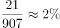
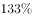
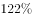
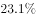

# 现期比重计算（跨段拼数：全国−重点=非重点，再求分量占总量比重）

考点：[[20-考点/资料分析/比重/现期比重计算（跨段拼数：全国−重点=非重点，再求分量占总量比重）|比重 / 现期比重计算（跨段拼数：全国−重点=非重点，再求分量占总量比重）]]
材料：[[15-材料/资料分析/191538 2017年1～2月全国造船业运行情况|191538 2017年1～2月全国造船业运行情况]]

**问法模型**：题干问'非重点企业出口船完工量约占全国出口船完工量的（比重）'→ 材料未直接给出'非重点'数据，须先做'全国−重点'跨段相减拼出分子，再按现期比重=分量/总量截位直除

## 推理链
1. 第1步：题干时间'2017年1~2月'与材料现期一致，问法为'约占……的'，判定为现期比重问题，无需基期换算
2. 第2步：定位材料第二段：全国完工出口船907万载重吨（总量）；定位第四段：重点企业完工出口船886万载重吨（已知分量）
3. 第3步：材料未直接给出非重点企业数据，跨段相减拼数：非重点企业出口船完工量=907−886=21万载重吨
4. 第4步：代入比重公式：比重=非重点/全国=21/907
5. 第5步：截位直除：分母保留前两位≈900，21/907≈21/900≈2.3%（精确值约2.32%）
6. 第6步：与选项对照，比重仅为2%出头、数值极小，与A项吻合，故正确答案为A

**最快解法**：⚡ 截位直除+量级排除：先口算907−886=21，再判断21不足907的3%，即比重必在2%~3%之间（远小于10%），21/900≈2.3%直接锁定A；若选项数值分散，可先用'分子21远小于总量的十分之一'排除偏大选项

## 易错点
- ⚠ 口径串行：'出口船完工量'同材料有两个数——全国907与重点企业886，还有全国造船完工936、重点企业912干扰，必须先确认'全国出口船'口径，抄错行即错
- ⚠ 问的是'非重点'而非'重点'：若直接算886/907≈97.7%就落入'重点企业占比'陷阱，须先减出差额21再除
- ⚠ 量级与符号：907−886=21数值很小，若将减法方向写反得负数、或把'万载重吨'单位错配，均会导致比重误判；分子极小时切勿凭直觉选50%等常规量级选项

## 母题抽象
> 🧩 当题干出现'材料未直接给出的差额主体（非重点/其他/非X类）占总体比重'特征时，先用'总量−已知分量'跨段相减拼出分子，再按比重=分量/总量截位直除，并先估量级（差额极小时比重通常仅为个位数百分点）验证选项

**同类特征**：非重点企业、出口船完工量、约占全国、现期时间与材料一致（2017年1~2月）、跨段相减拼数、现期比重

## 相关题
- [[10-真题/资料分析/比重/5911367 现期比重计算（部分求和÷整体）|5911367]]（浙江 2024，相关度2）
- [[10-真题/资料分析/比重/10204437 现期比重计算（部分÷整体，跨文字两段取数）|10204437]]（广东 2024，相关度2）
- [[10-真题/资料分析/比重/4792819 现期比重计算（多部分比重依次求解）|4792819]]（新疆 2014，相关度1）
- [[10-真题/资料分析/比重/827355 现期比重比较（部分占比过半速判）|827355]]（政法干警 2014，相关度1）
- [[10-真题/资料分析/比重/2272297 现期比重比较|2272297]]（选调 2015，相关度1）

---

### 题干
2017年1~2月，非重点企业出口船完工量约占全国出口船完工量的：

### 选项
- A. 

　✅
- B. 

- C. 

- D. 

### 官方解析

由题干“2017年1~2月，······约占······”，可判定本题为现期比重的问题。定位文字材料第二段，全国出口船完工量为907万载重吨，材料中未直接给出非重点企业出口船完工量，第四段给出重点企业出口船完工量为886万载重吨，则非重点企业出口船完工量为万载重吨，因此非重点企业出口船完工量约占全国出口船完工量的比重为。

故正确答案为A。

### 给定材料

        2017年1～2月，全国造船完工936万载重吨，同比增长；承接新船订单221万载重吨，同比增长。2月末，手持船舶订单9207万载重吨，同比下降，比2016年末下降。 

        2017年1～2月，全国完工出口船907万载重吨，同比增长；承接出口船订单191万载重吨，同比增长。2月末，手持出口船订单8406万载重吨，同比下降。

        2017年1～2月，53家重点监测的造船企业（以下简称重点企业）造船完工912万载重吨，同比增长。承接新船订单197万载重吨，同比增长。2月末，手持船舶订单8874万载重吨，同比下降。

        2017年1～2月，重点企业完工出口船886万载重吨，同比增长；承接出口船订单171万载重吨，同比增长。2月末，手持出口船订单8129万载重吨，同比下降。

