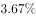
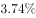
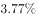
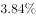

# 混合比重（两期合计比重，偏向基数大的一方）

考点：[[20-考点/资料分析/比重/混合比重（两期合计比重，偏向基数大的一方）|比重 / 混合比重（两期合计比重，偏向基数大的一方）]]
材料：[[15-材料/资料分析/191714 2016年S市科技创新年度情况：以2|191714 2016年S市科技创新年度情况：以2]]

**问法模型**：题干问'2015和2016两年经费总支出约占同期生产总值的比重'→将两年数据合并求整体比重，用混合比重模型：整体比重介于两年比重之间且偏向分母（GDP基数）大的一方。

## 推理链
1. 第1步：从统计图提取数据：2015年R&D经费支出936.14亿元、占GDP比重3.73%；2016年R&D经费支出1030.00亿元、占GDP比重3.80%（文字中比重留空，须由折线读出）
2. 第2步：题干求两年合并总比重，属混合比重：总比重=(936.14+1030.00)÷(2015年GDP+2016年GDP)，其中GDP=当年R&D经费÷当年比重
3. 第3步：定性判断——混合比重必介于3.73%与3.80%之间（'居中不中'），据此排除区间外的A、D两项
4. 第4步：比较基数（分母GDP）：2016年GDP=1030.00÷3.80%≈27105亿元＞2015年GDP=936.14÷3.73%≈25098亿元，故混合比重偏向3.80%一侧
5. 第5步：精算验证：总比重≈(936.14+1030.00)÷(25098+27105)≈1966.14÷52203≈3.77%，落在中点3.765%偏3.80%一侧，与C项吻合，故选C

**最快解法**：⚡ 混合比重'居中不中、偏向基数大'定性秒杀：先锁定总比重在3.73%~3.80%之间排除A、D；再比较分母——2016年GDP=1030.00/3.80%≈2.71万亿＞2015年GDP=936.14/3.73%≈2.51万亿，故偏向3.80%，直接选约3.77%的C项，无需列式精算。

## 易错点
- ⚠ 偏向规则记反：混合比重偏向'基数（分母GDP）大'的一方，而非'比重高'的一方；本题恰好2016年比重高且基数大，容易误以'偏向高比重'为规则，换组数据即出错
- ⚠ 基数误判：误把R&D经费（分子1030.00＞936.14）当'基数'作判断依据；正确做法是用经费÷比重倒推GDP=1030.00/3.80%≈27105亿＞936.14/3.73%≈25098亿
- ⚠ 比重留空与双轴陷阱：文字中'占生产总值比重'空白，须回统计图折线读3.73%、3.80%；左轴亿元对应柱形、右轴%对应折线，勿混读

## 母题抽象
> 🧩 当题干出现'两年（多期）合计占……比重'的特征时，用混合比重模型：整体比重居中不中、偏向分母（基数）大的一方，先定性锁定区间排除、必要时以'经费÷比重倒推GDP'加权验证。

**同类特征**：2015和2016年、总支出（两年合计）、约占同期生产总值的、混合比重、比重数据需由图中折线读取

## 相关题
- [[10-真题/资料分析/比重/5893732 混合比重（基期比重与现期比重比较，利用新增占比居中判定）|5893732]]（国考 2024，相关度1）
- [[10-真题/资料分析/比重/2015336 混合比重（全年比率=各季度比率的加权平均，介于最小与最大季度值之间）|2015336]]（重庆 2016，相关度1）

---

### 题干
2015和2016年S市研究与试验发展经费总支出约占同期生产总值的：

### 选项
- A. 

- B. 

- C. 

　✅
- D. 

### 官方解析
根据题干“2015和2016年S市研究与试验发展经费总支出占同期生产总值的比重”，而材料已给出两年的比重，故本题为混合比重问题。定位统计图：“2015年S市研究与试验发展经费占S市生产总值的比重为，2016年S市研究与试验发展经费占S市生产总值的比重为”，根据混合比重原则“混合居中但不中，偏向于基数大的”。因此混合比重在与之间，排除A、D两项。2016年对应的基数更大，因此偏向于，C项当选。
故正确答案为C。

### 给定材料

      <b>  一、根据所给资料，回答101～105题。</b>

      <b>  </b>2016年S市全年用于研究与试验发展（R&amp;D）经费支出总额为1030.00亿元，占S市生产总值的比重为。

        全年受理专利申请119937件，比上年增长，其中，受理发明专利申请54339件，增长。全年专利授权量为64230件，增长，其中，发明专利授权量为20086件，增长。全年PCT国际专利受理量为1560件，比上年增长。至年末，全市有效发明专利达85049件。年内全市新认定高新技术企业2306家。年内认定高新技术成果转化项目469项，其中，电子信息、生物医药、新材料等重点领域项目占。至年末，共认定高新技术成果转化项目10969项。全年经认定登记的各类技术交易合同2.12万件，比上年下降；合同金额822.86亿元，增长。

