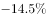
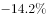
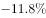
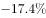

# 两期比重变化比较（比重上升判断）

考点：[[20-考点/资料分析/比重/两期比重变化比较（比重上升判断）|比重 / 两期比重变化比较（比重上升判断）]]
材料：[[15-材料/资料分析/191716 2015年我国货物进出口总体规模（总|191716 2015年我国货物进出口总体规模（总]]

**问法模型**：题干问'2015年进口金额占货物进口总额的比重高于上年的是'→ 两期比重比较模型：部分（商品金额）增速>总体（进口总额）增速⇒现期比重上升，无需计算比重具体数值

## 推理链
1. 第1步：从表格提取四个选项商品的进口金额增速（问'金额'必须用金额列'比上年增长%'，不能用数量列）：食用植物油-14.5%、氧化铝-14.2%、初级形状的塑料-11.8%、未锻轧铜及铜材-17.4%
2. 第2步：从文字段提取总体数据：2015年货物进口总额104485亿元，比上年下降，即总体增速为负
3. 第3步：使用两期比重规则：部分增长率大于总体增长率，则现期比重上升；反之比重下降
4. 第4步：四个选项增速均为负值，逐项与总体（下降）增速比较，官方解析确认只有初级形状的塑料（-11.8%）大于进口总额增长率，食用植物油、氧化铝、未锻轧铜及铜材均低于总体增速
5. 第5步：故2015年进口金额占进口总额比重高于上年的只有初级形状的塑料，对照选项选C

**最快解法**：⚡ 口诀法（两期比重升降判断）：'部分增速>总体增速⇒比重上升'。本题四个选项金额增速全为负（-14.5%、-14.2%、-11.8%、-17.4%），在总体下降背景下优先锁定降幅最小的初级形状的塑料（-11.8%），官方解析确认其为唯一高于总体增速者，直接选C，全程不列比重公式

## 易错点
- ⚠ 同名'增长'口径混淆：题干问'进口金额'的比重，必须用金额列增速（塑料-11.8%）；若误用数量列增速（塑料+2.9%、铁矿砂+2.2%等正值）会选错商品
- ⚠ 负增速比较方向搞反：同为下降时，-11.8%高于-14.2%（降幅小者增速高）；误把负数绝对值大当'增速大'会误判
- ⚠ 分母口径陷阱：比重分母是文字段的进口总额104485亿元，不能把表内12类主要商品金额加总当分母；且文字段中进口总额降幅百分数缺失，不得凭空补数，只能依据'总体下降'的事实与解析结论比较

## 母题抽象
> 🧩 当题干出现'现期（2015年）比重高于/低于上年'特征时，用两期比重口诀——比较部分增速与总体增速，部分增速大则比重上升，不必计算比重值；当各部分与总体同为负增长时，降幅小于总体降幅者比重才上升

**同类特征**：比重高于上年、两期比重比较、进口金额占…总额的比重、部分增速vs总体增速、增速为负、降幅排序、无需计算比重数值

## 相关题
- [[10-真题/资料分析/综合/10204448 综合分析-逐项判断（历史极值确认、两期比重比较、多期累计求和、基期比重）|10204448]]（广东 2024，相关度1）
- [[10-真题/资料分析/比重/17097813 两期比重比较（比重差计算）|17097813]]（山西 2024，相关度1）
- [[10-真题/资料分析/比重/1746802 两期比重变化比较（增速比较法，连续两年判断）|1746802]]（国考 2016，相关度1）
- [[10-真题/资料分析/比重/2281002 两期比重比较（比重升降-高于上年判断）|2281002]]（四川 2018，相关度1）
- [[10-真题/资料分析/比重/2376886 两期比重计算与比较（西部占全国比重，需跨段拼合全国总量）|2376886]]（选调 2019，相关度1）

---

### 题干
下列商品中，2015年进口金额占我国货物进口总额的比重高于上年的是：

### 选项
- A. 食用植物油
- B. 氧化铝
- C. 初级形状的塑料　✅
- D. 未锻轧铜及铜材

### 官方解析

由题干“2015年······的比重高于上年的是······”可知，本题为两期比重问题。根据“部分增长率大于总体增长率，则现期比重上升”可知，只需要看哪一类商品进口额的增长率大于进口总额增长率即可。由文字材料可知，我国货物进口总额下降；由表格可知，食用植物油进口金额的增长率为，氧化铝进口金额的增长率为，初级形状的塑料进口金额的增长率为，未锻轧铜及铜材进口金额的增长率为。只有初级形状的塑料进口金额的增长率大于总体增长率，即初级形状的塑料现期比重上升。

故正确答案为C。

### 给定材料

       2015年，我国货物进出口总额245741亿元，比上年下降。其中，出口141255亿元，下降；进口104485亿元，下降。货物进出口差额（出口减进口）36770亿元，比上年增加13244亿元。 

