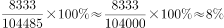

# 现期比重计算（部分-整体直接相除）

考点：[[20-考点/资料分析/比重/现期比重计算（部分-整体直接相除）|比重 / 现期比重计算（部分/整体直接相除）]]
材料：[[15-材料/资料分析/191716 2015年我国货物进出口总体规模（总|191716 2015年我国货物进出口总体规模（总]]

**问法模型**：题干为'2015年（现期），A占B的比重为'→ 现期比重=部分值÷整体值，直接用现期金额相除，无需基期换算

## 推理链
1. 第1步：题干时间为2015年=材料现期，求'原油进口金额占全年进口总额的比重'，属现期比重，直接取现期值相除
2. 第2步：到表格定位'原油'一行，因问的是'金额'，必须取金额列8333亿元，而非数量列33550万吨，也不涉及数量增速8.8%
3. 第3步：分母从文字段取全年进口总额104485亿元；注意表格只列'主要商品'，表内12类金额加总（约2.4万亿元）远小于进口总额，不可作分母，也不能误用进出口总额245741或出口141255
4. 第4步：代入公式：比重=8333÷104485
5. 第5步：估算：104485×8%≈8359，8333略小于8359，故比重≈7.97%，即约8%
6. 第6步：与选项对照，B项约8%最接近，故选B

**最快解法**：⚡ 截位直除：8333/104485≈83/1045，首位商7~8且1045×8%=83.6>83，结果约7.97%≈8%，直接锁定B；也可以反向验证：104485的8%≈8359亿元，与8333几乎相等

## 易错点
- ⚠ 分子口径混淆：原油一行有'数量33550万吨、增速8.8%'与'金额8333亿元、增速-40.5%'两套并列数据，问'金额'只能用金额列，误用数量或数量增速即错
- ⚠ 分母口径陷阱：分母须用文字段进口总额104485亿元，若把表内主要商品金额加总当分母，比重会虚高数倍；误用进出口总额245741亿元则比重减半
- ⚠ 时间与公式误用：题干求2015年现期比重，直接相除即可；误套'-40.5%'做基期或增长量换算属多余操作，且增速为负容易算错方向

## 母题抽象
> 🧩 当题干出现'现期年份+A（某商品/部分）占B（总额/整体）的比重'特征时，直接用部分值÷整体值截位直除，先核对口口径（金额vs数量）再核对分母取文字段总量而非表内加总

**同类特征**：现期比重、占…（总额）的比重、分子取表格金额列、分母取文字段进口总额、2015年现期值直接相除、原油

## 相关题
- [[10-真题/资料分析/比重/4792819 现期比重计算（多部分比重依次求解）|4792819]]（新疆 2014，相关度1）
- [[10-真题/资料分析/比重/827355 现期比重比较（部分占比过半速判）|827355]]（政法干警 2014，相关度1）
- [[10-真题/资料分析/比重/2272297 现期比重比较|2272297]]（选调 2015，相关度1）
- [[10-真题/资料分析/比重/2032972 现期比重计算（多地区占比求和）|2032972]]（吉林 2015，相关度1）
- [[10-真题/资料分析/比重/2187857 现期比重计算（部分量需先由'总量−其中量'减法间接求得）|2187857]]（山东 2018，相关度1）

---

### 题干
2015年，原油进口金额占全年进口总额的比重为：

### 选项
- A. 

- B. 

　✅
- C. 

- D. 

### 官方解析

由题干“2015年，原油进口金额占全年进口总额的比重”可知，本题为现期比重问题。根据“原油进口金额”定位到表格，可知2015年原油的进口金额为8333亿元；根据文字材料可知全年进口总额为104485亿元。故2015年，原油进口金额占全年进口总额的比重为，与B项最为接近。

故正确答案为B。

### 给定材料

       2015年，我国货物进出口总额245741亿元，比上年下降。其中，出口141255亿元，下降；进口104485亿元，下降。货物进出口差额（出口减进口）36770亿元，比上年增加13244亿元。 

