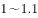
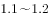
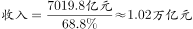
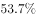
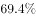
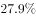

# 现期比重——部分÷比重求整体（整体量倒推+区间型选项）

考点：[[20-考点/资料分析/比重/现期比重——部分÷比重求整体（整体量倒推+区间型选项）|比重 / 现期比重——部分÷比重求整体（整体量倒推+区间型选项）]]
材料：[[15-材料/资料分析/191726 2015年1～11月北京市文化创意产|191726 2015年1～11月北京市文化创意产]]

**问法模型**：题干给出部分量（功能区收入7019.8亿元）及其占全市比重、问'全市收入在哪个范围内'→ 用现期比重模型 整体=部分÷比重，估算量级后与'万亿元'区间选项对照

## 推理链
1. 第1步：题干求2015年1～11月北京全市文化创意产业收入（整体量未知），材料第一段给出对应部分量：20个功能区实现收入7019.8亿元，并给出其'占全市文化创意产业收入的比重'（该占比为现期比重，原卷有数值、本版本文本空缺）
2. 第2步：现期比重公式整体=部分÷比重，即全市文创产业收入=7019.8÷占比，注意分母是'全市文创产业收入'而非'20个功能区总收入'
3. 第3步：单位统一为万亿元，7019.8亿元≈0.70198万亿元；因占比必然小于100%，整体必大于0.7万亿元；代入原卷占比数值作除法（本版本空缺），结果约为1.0万亿元量级
4. 第4步：选项为万亿区间型：A为低于1万亿元、D为高于1.2万亿元，约1.0万亿元量级与A、D均不符，排除A、D
5. 第5步：在B、C两个中间区间中对照，计算结果落入B选项区间（区间端点见选项图片），与官方答案B一致，选B

**最快解法**：⚡ 整体=部分÷比重+量级判断（截位直除思想）：7019.8亿≈0.7万亿，除以原卷占比后约为1.0万亿元，直接锁定B区间，无需精算到具体数字

## 易错点
- ⚠ 本版本材料中该占比百分数空缺，切勿凭记忆编造数值代入，须以原始完整试卷的占比为准再作除法
- ⚠ 分母层次混淆：'占全市文化创意产业收入的比重'分母是全市整体，不是20个功能区总收入；求整体用部分÷比重，误写为部分×比重大小差一个数量级关系
- ⚠ 单位与量级：亿元换万亿元，7019.8亿元≈0.70万亿元，选项以'万亿元'设区间勿读错位；同时'高于全市平均增速1.2个百分点'是增速差信息，与求整体量无关，勿混入计算

## 母题抽象
> 🧩 当题干出现'某部分量及其占整体的比重已知，问整体量落在哪个范围'的特征时，用'整体=部分÷比重'做一步除法，先把部分量化成与选项同单位（亿元→万亿元）看量级，再对照区间选项，通常量级估算即可排除大部分选项

**同类特征**：全市文化创意产业收入在以下哪个范围内、区间型选项（万亿元量级）、部分量已知：20个功能区收入7019.8亿元、现期占比已知：占全市文创产业收入比重、部分与整体倒推、量级估算即可作答

## 相关题
- [[10-真题/资料分析/综合/2136914 综合判断题（以两期比重升降判断为主，辅以混合增长率、占比求部分、同比增量比较）|2136914]]（北京 2018，相关度1）

---

### 题干
2015年1～11月，北京全市文化创意产业收入在以下哪个范围内？

### 选项
- A. 
低于1万亿元

- B. 
在万亿元之间
　✅
- C. 
在万亿元之间

- D. 
高于1.2万亿元

### 官方解析

由题干“2015年1～11月，北京全市文化创意产业收入在以下哪个范围内”结合材料给出2015年北京市20个文化创意产业功能区实现收入及其占全市文化创意产业收入的比重，可判定此题为现期比重问题。定位材料第一段“2015年1～11月，北京市20个文化创意产业功能区实现收入7019.8亿元······占全市文化创意产业收入的比重为。”故2015年1～11月，北京全市文化创意产业，。

故正确答案为B。

### 给定材料

<b>二、根据下列统计资料回答问题</b>

       2015年1～11月，北京市20个文化创意产业功能区实现收入7019.8亿元，同比增长，高于全市文化创意产业收入平均增速1.2个百分点，占全市文化创意产业收入的比重为。其中文化科技融合示范功能区实现收入3772.5亿元，同比增长，占20个功能区总收入的；文化金融融合功能区实现收入436.5亿元，同比增长，占20个功能区总收入的。

       传媒影视板块中，CBD-定福庄国际传媒产业走廊功能区、新媒体产业功能区、影视产业功能区分别增长、和，三个功能区收入合计占20个功能区总收入的；文化休闲板块中，北京老字号品牌文化推广功能区、主题公园功能区分别增长和1.5倍，两个功能区收入合计占20个功能区总收入的。

        2015年1～11月，规模以上互联网信息服务行业实现收入856.5亿元，同比增长，高于全市文化创意产业平均增速15.2个百分点；数字内容服务和其他互联网服务行业分别实现收入17.8亿元和6.3亿元，同比分别增长和；全市重点互联网出版单位实现收入373.2亿元，同比增长。

> [!warning] 疑点（官方解析可能有误，待人工复核）
> 本版本材料中'占全市文化创意产业收入的比重'数值及全部增速百分数均为空白，官方解析亦未展示占比数值与完整算式，故无法代入复算出精确结果（仅能确认模型7019.8÷占比与答案B的量级一致性）；具体占比数值须以原始完整试卷为准，官方答案B本身无疑义

<!-- CODEX-ANSWER-REVIEW:BEGIN -->
### 本次独立复核

**复核状态：** `resolved`（答案与解析已核定）

**计分答案：** B（可计分）

**复核解析：**

表图给出文化创意产业收入7019.8亿元，占全市总收入68.8%；总收入=7019.8/0.688≈10203亿元，即约1.02万亿元。选项图示B区间包含该值。原疑点中的公式图明确了缺失占比和区间端点。

**相关信息：**

整体=部分÷比重；1万亿元=10000亿元。

**题源依据：** [固定版本原题](https://github.com/Mentat-Uran/kaogongzhentizhengliu/blob/84ab93d4b64b61d897bece8a1c0a5bab06b4feb2/10-%E7%9C%9F%E9%A2%98/%E8%B5%84%E6%96%99%E5%88%86%E6%9E%90/%E6%AF%94%E9%87%8D/2136874%20%E7%8E%B0%E6%9C%9F%E6%AF%94%E9%87%8D%E2%80%94%E2%80%94%E9%83%A8%E5%88%86%C3%B7%E6%AF%94%E9%87%8D%E6%B1%82%E6%95%B4%E4%BD%93%EF%BC%88%E6%95%B4%E4%BD%93%E9%87%8F%E5%80%92%E6%8E%A8%2B%E5%8C%BA%E9%97%B4%E5%9E%8B%E9%80%89%E9%A1%B9%EF%BC%89.md)；固定内容 commit `84ab93d4b64b61d897bece8a1c0a5bab06b4feb2`，Markdown blob `c9255fb67ceac3c7a8a616f132d2bb852e001bc7`。
<!-- CODEX-ANSWER-REVIEW:END -->
