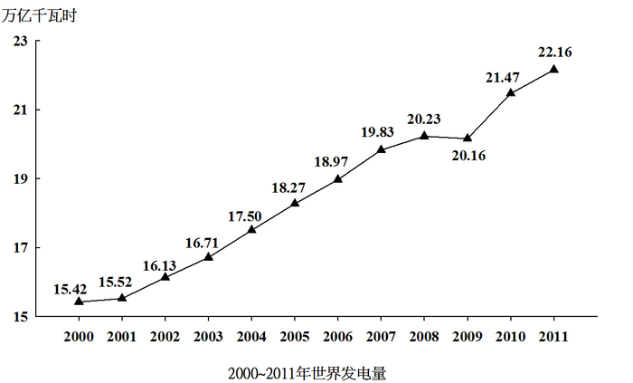

# 现期比重计算（跨图'总量×比重'求部分量后再求部分占部分比重）

考点：[[20-考点/资料分析/比重/现期比重计算（跨图'总量×比重'求部分量后再求部分占部分比重）|比重 / 现期比重计算（跨图'总量×比重'求部分量后再求部分占部分比重）]]
材料：[[15-材料/资料分析/191736 2000～2011年世界发电量总量变|191736 2000～2011年世界发电量总量变]]

**问法模型**：题干给出'三峡2010年发电量843.70亿千瓦时'求'占世界水力发电量的比重' → 先用折线图2010年总发电量×表格2010年水力比重求出世界水电总量，再用'三峡÷世界水电'求比重

## 推理链
1. 第1步：定位折线图，2010年世界总发电量为21.47万亿千瓦时；定位统计表，2010年水力发电量占世界发电量比重为15.90%
2. 第2步：表格中无绝对发电量，须跨图拼合：世界水力发电量=21.47万亿千瓦时×15.90%≈3.41万亿千瓦时，换算为34137.3亿千瓦时（1万亿千瓦时=10000亿千瓦时）
3. 第3步：三峡占世界水电比重=843.70亿千瓦时÷34137.3亿千瓦时≈843.7/34137≈2.47%
4. 第4步：与选项对照，约2.5%对应B项，故正确答案为B

**最快解法**：⚡ 截位直除+单位统一：843.70亿千瓦时=0.08437万亿千瓦时，世界水电=21.47×15.90%≈21.5×0.159≈3.42万亿千瓦时；0.08437÷3.42≈2.5%，直选B。亦可心算：21.47×0.159≈3.4，843.7亿÷3.4万亿先除3.4得0.248，再乘量级10^4的倒数即约2.5%

## 易错点
- ⚠ 单位换算陷阱：843.70亿千瓦时与21.47万亿千瓦时量级差10^4倍，若直接用843.70÷21.47或忘记亿→万亿换算，结果会差万倍（算成0.0247%或247%）
- ⚠ 表格只有比重无绝对量，不能把15.90%当水电发电量，也不能跳过'图总量×表比重'直接用843.7÷21.47
- ⚠ 年份口径：题干为2010年，水力比重须取2010年的15.90%，易误取相邻年份2009年16.06%或2011年15.69%

## 母题抽象
> 🧩 当题干问'某年A占B的比重'而B的绝对量未直接给出（总量在图、比重在表）时，用'图总量×表比重'跨图求出B，再'部分÷部分'求比重；计算前必先统一单位（亿↔万亿差10^4倍），再用截位直除估算

**同类特征**：三峡大坝2010年完成发电量843.70亿千瓦时、约占世界水力发电量的、现期比重问题、总量在折线图、比重在统计表，需跨图拼合、亿千瓦时与万亿千瓦时跨单位换算

## 相关题
- [[10-真题/资料分析/比重/4637154 现期比重（部分=整体×比重）|4637154]]（国考 2022，相关度1）
- [[10-真题/资料分析/比重/5104867 现期比重作差（两分量占同一总量的比重之差）|5104867]]（天津 2022，相关度1）
- [[10-真题/资料分析/比重/10297332 比重还原（部分=整体×比重）后判断贸易顺逆差|10297332]]（浙江 2025，相关度1）
- [[10-真题/资料分析/比重/5919126 现期比重计算（现期占'基期+现期'两期合计的比重，需先由环比增速求基期量）|5919126]]（江苏 2024，相关度1）

---

### 题干
三峡大坝2010年完成发电量843.70亿千瓦时，约占世界水力发电量的：

### 选项
- A. 

- B. 

　✅
- C. 

- D. 

### 官方解析
由题干“三峡大坝2010年完成发电量······占世界水力发电量······”，可判定本题为现期比重问题。定位折线图，2010年世界总的发电量为21.47万亿千瓦时。定位表格材料，2010年水力发电量占世界发电量的比重为。若三峡大坝2010年完成发电量843.70亿千瓦时，约占世界水力发电量的比重为。
故正确答案为B。

### 给定材料

<b>一、根据下列统计资料回答问题</b>

