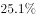
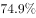
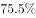
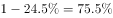
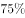

# 比重计算（先做减法求部分量：未探明储量占地质储量比重）

考点：[[20-考点/资料分析/比重/比重计算（先做减法求部分量：未探明储量占地质储量比重）|比重 / 比重计算（先做减法求部分量：未探明储量占地质储量比重）]]
材料：[[15-材料/资料分析/192012 世界煤炭储量在世界能源总储量中的地位|192012 世界煤炭储量在世界能源总储量中的地位]]

**问法模型**：题干问'未探明储量占总储量的（比重）'→ 模型：比重＝部分/整体＝(整体−已探明部分)/整体＝(14.3−3.5)/14.3

## 推理链
1. 第1步：从材料提取——世界煤炭资源地质储量（整体）为14.3万亿吨，其中探明储量为3.5万亿吨
2. 第2步：'未探明'＝地质储量−探明储量，即未探明储量＝14.3−3.5＝10.8万亿吨
3. 第3步：代入比重公式：未探明储量占地质储量比重＝10.8/14.3≈0.7552≈75.5%
4. 第4步：与选项对照，C选项对应10.8/14.3≈75.5%，故正确答案为C

**最快解法**：⚡ 减法+截位直除：口算14.3−3.5=10.8，再算10.8/14.3≈108/143，首商7、次商5，得约75.5%直接锁定C（可用1−3.5/14.3≈1−24.5%≈75.5%交叉验证）

## 易错点
- ⚠ 分母（整体）选错：整体是地质储量14.3万亿吨，误用探明储量3.5万亿吨作分母则全错
- ⚠ 忘记先做减法：直接算3.5/14.3≈24.5%（探明占比）误当答案，应取其余部分1−24.5%≈75.5%
- ⚠ 口径张冠李戴：材料叠加'煤占世界能源总储量''硬煤/褐煤占煤总储量''三国占硬煤经济可采储量'多套整体—部分体系，本题整体仅指煤炭地质储量，勿牵扯能源总储量或硬煤经济可采储量口径

## 母题抽象
> 🧩 当题干出现'未X部分（未探明等）占整体比重'且材料给出整体总量与其中X部分量时，先做减法（整体−X）求未X量再除以整体；亦可用1−X的占比快速求解并验证选项

**同类特征**：未探明储量、占地质储量（总储量）比重、整体14.3万亿吨、部分3.5万亿吨、先减法再相除、纯文字静态存量材料

## 相关题
（暂无）

---

### 题干
在世界煤炭资源地质储量中，未探明储量占总储量的：

### 选项
- A. 

- B. 

- C. 

　✅
- D. 

### 官方解析

定位材料可得，世界煤炭资源地质储量为14.3万亿吨，其中探明储量为3.5万亿吨，约占。则未探明储量占总储量的。

故正确答案为C。

### 给定材料

       世界煤储量在世界能源总储量中占，按目前规模可持续开采200年左右。据19世纪80年代初世界能源会议等组织的资料，世界煤资源地质储量为14.3万亿吨，其中探明储量为3.5万亿吨，约占；在总储量中硬煤占，褐煤占。按硬煤经济可采储量以美国、俄罗斯、中国最为丰富，分别占世界总量的、、，共占三分之二。

