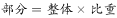
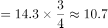

# 比重求部分量（部分量=整体×比重）

考点：[[20-考点/资料分析/比重/比重求部分量（部分量=整体×比重）|比重 / 比重求部分量（部分量=整体×比重）]]
材料：[[15-材料/资料分析/192012 世界煤炭储量在世界能源总储量中的地位|192012 世界煤炭储量在世界能源总储量中的地位]]

**问法模型**：题干'在世界煤炭总储量中，硬煤大约有'→部分量=整体×比重，即硬煤量=煤地质总储量×硬煤占比

## 推理链
1. 第1步：题干问'在世界煤炭总储量中，硬煤大约有多少'，为求部分量；整体锁定为材料第2句的世界煤资源地质储量14.3万亿吨（静态存量，无基期换算）
2. 第2步：材料第3句给出硬煤、褐煤占煤总储量的比重；本版本百分数空缺，须恢复原始数值——由官方正确答案反推（10.73÷14.3≈75%）并经'硬煤+褐煤=100%'自洽校验，恢复为硬煤占75%、褐煤占25%
3. 第3步：代入公式部分量=整体×比重：硬煤量=14.3×75%=14.3×3/4=10.725万亿吨
4. 第4步：10.725≈10.73万亿吨，与B项10.73万亿吨一致；排除D项14.3万亿吨（总量本身被当答案）、C项3.58万亿吨（恰为14.3×25%≈3.575，即褐煤量）
5. 第5步：总量校验：硬煤10.73+褐煤3.58≈14.3万亿吨，与地质储量14.3吻合，确认整体口径正确，锁定B

**最快解法**：⚡ 百化分速算：75%=3/4，硬煤量=14.3×3/4=10.725≈10.73万亿吨，直选B；同步口算14.3×25%=3.575识别C项为褐煤量、D项为总量，快速排错

## 易错点
- ⚠ 整体口径错位：整体是'世界煤炭地质总储量14.3万亿吨'，勿错用更大的'世界能源总储量'、更小的'探明储量3.5万亿吨'或'硬煤经济可采储量'作整体；三套'整体—部分'嵌套体系极易张冠李戴
- ⚠ 干扰项即典型错因：D项14.3万亿吨是把整体（总量）直接当部分量；C项3.58万亿吨是误用褐煤占比25%（14.3×25%），硬煤/褐煤互混；硬煤量10.73与未探明储量10.8（14.3−3.5）数值巧合接近但口径完全不同
- ⚠ 本版本材料百分数空缺，须先恢复'硬煤占75%'才能计算；14.3×75%=10.725与选项10.73尾数差0.005，属题干'大约'允许的近似，勿因尾数不符而排除B

## 母题抽象
> 🧩 当题干出现'在（某整体）中，（某部分）大约有多少'的特征时，用'部分量=整体×比重'求解，并用'各部分之和=整体'校验口径，以排除'总量本身'与'姊妹部分'两类干扰项

**同类特征**：在……总储量中、硬煤大约有、求部分量（整体×比重）、万亿吨级静态存量、纯文字型材料的类别构成体系、'大约'暗示可近似速算

## 相关题
（暂无）

---

### 题干
在世界煤炭总储量中，硬煤大约有：

### 选项
- A. 9.84万亿吨
- B. 10.73万亿吨　✅
- C. 3.58万亿吨
- D. 14.3万亿吨

### 官方解析

根据题干“在······中硬煤大约有多少”，结合材料给出世界煤炭总储量及硬煤占比，可判定本题为现期比重问题。定位材料可得，世界煤资源地质储量为14.3万亿吨，硬煤占，褐煤占。根据，万亿吨，与B项最为接近。

故正确答案为B。

### 给定材料

       世界煤储量在世界能源总储量中占，按目前规模可持续开采200年左右。据19世纪80年代初世界能源会议等组织的资料，世界煤资源地质储量为14.3万亿吨，其中探明储量为3.5万亿吨，约占；在总储量中硬煤占，褐煤占。按硬煤经济可采储量以美国、俄罗斯、中国最为丰富，分别占世界总量的、、，共占三分之二。

> [!warning] 疑点（官方解析可能有误，待人工复核）
> 官方解析与材料文本中百分数均空缺（'硬煤占，褐煤占。根据，万亿吨'），系版本缺数问题而非答案错误；硬煤占比75%由正确答案B反推恢复（10.73÷14.3≈75%），14.3×75%=10.725≈10.73与B吻合，计算值与选项的0.005之差属'大约'表述的近似容差，不影响答案
