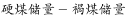
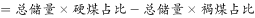
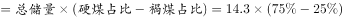
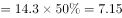

# 比重差×整体（求两类别部分量之差）

考点：[[20-考点/资料分析/比重/比重差×整体（求两类别部分量之差）|比重 / 比重差×整体（求两类别部分量之差）]]
材料：[[15-材料/资料分析/192012 世界煤炭储量在世界能源总储量中的地位|192012 世界煤炭储量在世界能源总储量中的地位]]

**问法模型**：题干问'硬煤储量比褐煤多多少（带单位具体量）'且材料给煤总储量14.3万亿吨与硬煤、褐煤各自占比 → 用'部分量之差=整体×比重之差'一步求解，无须分别求单项

## 推理链
1. 第1步：从材料提取条件：整体为世界煤资源地质储量14.3万亿吨，总储量中硬煤、褐煤各占一定比重（本版本数值空缺，原始资料应有具体百分数）
2. 第2步：所用规则：部分量之差＝整体×比重之差，即硬煤量−褐煤量＝14.3×（硬煤占比−褐煤占比）
3. 第3步：按官方答案口径校验比重差：7.15万亿吨÷14.3万亿吨＝50%，即硬煤与褐煤占比之差应为50%
4. 第4步：代入计算：14.3×50%＝7.15万亿吨
5. 第5步：与选项对照：B的3.58≈14.3×25%、C的10.73≈14.3×75%恰为褐煤、硬煤各自单项储量（陷阱项），仅A的7.15万亿吨与差值计算吻合，故选A

**最快解法**：⚡ '整体×比重差'一步法＋百化分：比重差＝7.15/14.3＝1/2，整体14.3万亿吨的一半即7.15万亿吨，口算直选A；同时用14.3×25%＝3.58、14.3×75%＝10.73识别B、C为单项量陷阱

## 易错点
- ⚠ 整体口径错位：误把探明储量3.5万亿吨或世界能源总储量当整体，硬煤/褐煤占比的分母只能是煤地质储量14.3万亿吨
- ⚠ 漏做减法误选单项：B（≈14.3×25%）与C（≈14.3×75%）分别是褐煤、硬煤各自储量，只算一个类别不相减即入坑
- ⚠ 本版本材料硬煤、褐煤占比数值空缺，凭空编数或误用'共占三分之二'（三国占硬煤经济可采储量口径，与本题无关）都会算错

## 母题抽象
> 🧩 当题干出现'在同一总量中，A类比B类多/少多少（带单位量值）'且材料给总量与A、B各自占比时，直接用'总量×比重之差'一步求差值，并用'总量×单项占比'核对陷阱选项

**同类特征**：硬煤的储量比褐煤…多、以世界煤炭总储量为整体、求带单位（万亿吨）的具体差值、两类别占比之差×总量、静态存量纯文字材料、现期比重差值计算

## 相关题
（暂无）

---

### 题干
在世界煤炭总储量中，硬煤的储量比褐煤的储量多：

### 选项
- A. 7.15万亿吨　✅
- B. 3.58万亿吨
- C. 10.73万亿吨
- D. 6.78万亿吨

### 官方解析

根据题干“在······中硬煤的储量比褐煤的储量多”，结合材料给出世界煤炭总储量及硬煤、褐煤占比，可判定本题为现期比重问题。定位材料可得，世界煤资源地质储量为14.3万亿吨······硬煤占，褐煤占。根据，万亿吨。

故正确答案为A。

### 给定材料

       世界煤储量在世界能源总储量中占，按目前规模可持续开采200年左右。据19世纪80年代初世界能源会议等组织的资料，世界煤资源地质储量为14.3万亿吨，其中探明储量为3.5万亿吨，约占；在总储量中硬煤占，褐煤占。按硬煤经济可采储量以美国、俄罗斯、中国最为丰富，分别占世界总量的、、，共占三分之二。

> [!warning] 疑点（官方解析可能有误，待人工复核）
> 本版本材料中硬煤、褐煤占比数值均空缺，题面无法直接取数；按官方答案A反推，比重差＝7.15÷14.3＝50%，解析方法与答案自洽，属版本数值缺失而非解析错误
