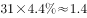

# 比重差×总天数换算为天数（部分量之差）

考点：[[20-考点/资料分析/比重/比重差×总天数换算为天数（部分量之差）|比重 / 比重差×总天数换算为天数（部分量之差）]]
材料：[[15-材料/资料分析/192254 2015年7月空气质量月报对比：京津|192254 2015年7月空气质量月报对比：京津]]

**问法模型**：题干为'甲区域某占比比乙区域高4.4个百分点，求多多少天'→采用'天数差=当月总天数×占比百分点差'的比重差换算模型

## 推理链
1. 第1步：从材料第2句提取条件——'与全国74个城市相比，京津冀区域平均重度污染天数占比高4.4个百分点'，本题是唯一不依赖题面缺失数值的小题
2. 第2步：确认时间口径——现期为2015年7月，7月为大月共31天，占比均为'占当月总天数'的比重，两区域占比均为'平均'口径可直接比较
3. 第3步：所用公式——天数差 = 当月总天数 × 占比差 = 31 × 4.4%
4. 第4步：代入计算——31 × 4.4% = 1.364 ≈ 1.4天
5. 第5步：与选项对照——1.4对应B项，故正确答案为B

**最快解法**：⚡ 百化分+拆位乘：31×4.4%拆成30×4.4%+1×4.4%≈1.32+0.044≈1.36，四舍五入≈1.4，秒选B；或4.4%≈1/23，31÷23≈1.35≈1.4

## 易错点
- ⚠ 忘记乘当月天数，把'4.4个百分点'直接当答案（无对应选项，但可能被'占比差'迷惑而选错方向）
- ⚠ 按30天计算得31×4.4%误算为30×4.4%=1.32，若再粗略取舍可能误选A(0.8)——7月必须按31天算
- ⚠ 混淆口径：误用'达标天数占比下降6个百分点'或'超标天数占比'数据计算，本题只用'重度污染天数占比高4.4个百分点'这一数据

## 母题抽象
> 🧩 当题干出现'A区域某占比比B区域高X个百分点，问多多少天/多少量'特征时，用'总期量×百分点差'换算，且先核实当期总天数（7月=31天）再乘

**同类特征**：占比高4.4个百分点、比…多多少天、7月总天数31天、比重差换算部分量、京津冀与全国74城对比、重度污染天数占比

## 相关题
（暂无）

---

### 题干
2015年7月，京津冀区域平均重度污染天数比全国74个城市约多多少天？

### 选项
- A. 0.8
- B. 1.4　✅
- C. 2.0
- D. 2.5

### 官方解析

问题求“京津冀区域平均重度污染天数比······多多少天”，根据常识可知7月总天数为31天，定位文字材料第1段：“与全国74个城市相比，京津冀区域平均重度污染天数占比高4.4个百分点”，即已知总体量和部分比重的差值，求部分量的差值。可得，2015年7月，京津冀区域平均重度污染天数比全国74个城市约多天。

故正确答案为B。

### 给定材料

        2015年7月，京津冀区域13个城市空气质量超标天数平均占当月总天数的，平均达标天数比上年同期下降6个百分点。与全国74个城市相比，京津冀区域平均重度污染天数占比高4.4个百分点。而与上年同期相比，74个城市平均达标天数占比也由下降到。

        与上年同期相比，2015年7月京津冀区域13个城市平均PM2.5和PM10浓度分别上升和，长三角区域25个城市平均PM2.5和PM10浓度分别上升和。

