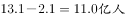

# 现期比重逆推总量（部分量÷比重）后求剩余量

考点：[[20-考点/资料分析/比重/现期比重逆推总量（部分量÷比重）后求剩余量|比重 / 现期比重逆推总量（部分量÷比重）后求剩余量]]
材料：[[15-材料/资料分析/192255 2005～2015年各年末中国网民规|192255 2005～2015年各年末中国网民规]]

**问法模型**：题干'截至2007年末约有多少亿非网民'→ 用现期数据（网民数÷普及率）求总人口，再减网民数得非网民，并做万人→亿人换算

## 推理链
1. 第1步：从柱形图/折线图读取2007年末数据：网民数21000万人，互联网普及率16%（截至2007年末即为现期，无需基期换算）
2. 第2步：由普及率=网民÷总人口，得总人口=网民数÷普及率=21000÷16%
3. 第3步：21000÷0.16=131250万人（约13.1亿总人口）
4. 第4步：非网民=总人口−网民=131250−21000=110250万人
5. 第5步：单位换算：110250万=11.025亿≈11.0亿，与选项C（11.0）对应

**最快解法**：⚡ 倍数转化法：非网民=网民×(1−16%)/16%=21000×84/16=21000×5.25=110250万人=11.025亿≈11.0亿，避开大数直除；或截位直除21000÷16%≈131250万人再减21000万

## 易错点
- ⚠ 比重方向搞反：普及率=网民/总人口，求总人口必须'除以'16%而非乘16%，误乘会得3360万这个错误量级
- ⚠ 单位量级陷阱：结果为万人，110250万人=11.025亿，需除以10000换算成亿，易误报为1.1亿或把11.025直接当万人处理
- ⚠ 时间口径：'截至2007年末'即用2007年当年末数据作现期，勿误用2015年数据或把2007年当基期回推

## 母题抽象
> 🧩 当题干出现'已知某时点部分量及其占总量比重，求总量外的剩余部分（如非网民、未覆盖率人群）'时，用'总量=部分÷比重，剩余=总量−部分（或部分×(1−比重)/比重）'模型，最后务必做单位量级换算验证选项

**同类特征**：'截至……年末'现期时点表述、'非网民'＝总人口−网民的剩余量问法、以'亿'设问而材料以'万人'计、普及率作除数逆推总人口、纯读图取数（21000、16%）

## 相关题
（暂无）

---

### 题干
截至2007年末，我国约有多少亿非网民？

### 选项
- A. 10.1
- B. 10.6
- C. 11.0　✅
- D. 11.9

### 官方解析

根据题干所求“2007年非网民人数…”，定位柱形图“截止2007年我国网民数为21000万人，互联网普及率为”，故判定本题为现期比重问题。根据现期比重公式：，因此2007年末我国，故2007年末我国非网民人数约为。

故正确答案为C。

### 给定材料

        2015年末，全国网民人数为68826万人，互联网普及率（网民人数占总人口数的比重）为。

        2015年新增网民中，低龄（19岁以下）、学生群体占比分别为、。2015年新增网民中，的人使用手机上网，占比较2014年末提升了7.4个百分点；的人使用台式电脑上网，较2014年有所下降。

> [!warning] 疑点（官方解析可能有误，待人工复核）
> 官方解析文字中公式存在排版空缺（如'根据现期比重公式：'后内容缺失），但数值结论21000÷16%=131250万人、非网民110250万≈11.0亿与图表数据核算一致，无实质错误

<!-- CODEX-ANSWER-REVIEW:BEGIN -->
### 本次独立复核

**复核状态：** `resolved`（答案与解析已核定）

**计分答案：** C（可计分）

**复核解析：**

2007年网民约21000万人，互联网普及率16%。总人口约21000/16%=131250万人；非网民约131250−21000=110250万人，即11.0亿，选C。

**相关信息：**

普及率=网民/总人口，非网民=总人口−网民。

**题源依据：** [固定版本原题](https://github.com/Mentat-Uran/kaogongzhentizhengliu/blob/84ab93d4b64b61d897bece8a1c0a5bab06b4feb2/10-%E7%9C%9F%E9%A2%98/%E8%B5%84%E6%96%99%E5%88%86%E6%9E%90/%E6%AF%94%E9%87%8D/2144593%20%E7%8E%B0%E6%9C%9F%E6%AF%94%E9%87%8D%E9%80%86%E6%8E%A8%E6%80%BB%E9%87%8F%EF%BC%88%E9%83%A8%E5%88%86%E9%87%8F%C3%B7%E6%AF%94%E9%87%8D%EF%BC%89%E5%90%8E%E6%B1%82%E5%89%A9%E4%BD%99%E9%87%8F.md)；固定内容 commit `84ab93d4b64b61d897bece8a1c0a5bab06b4feb2`，Markdown blob `ed187a8835eb9890d34e0d2e2d84b44a024643ab`。
<!-- CODEX-ANSWER-REVIEW:END -->
