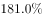
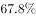

# 两期比重变化判定（部分增速与整体增速比较数个数）

考点：[[20-考点/资料分析/比重/两期比重变化判定（部分增速与整体增速比较数个数）|比重 / 两期比重变化判定（部分增速与整体增速比较数个数）]]
材料：[[15-材料/资料分析/192253 2016年某市本级财政预算收支情况：|192253 2016年某市本级财政预算收支情况：]]

**问法模型**：题干问'比重较上年有所提高的项目个数' → 采用两期比重判定模型：部分增速a＞整体增速r则现期比重上升，先补算整体增速，再逐项比对数个数

## 推理链
1. 第1步：从正文提取整体数据——2016年该市本级完成财政一般预算支出49.86亿元，比上年增支16.79亿元，但增长百分比在原文中缺失，须自行派生；表1是收入不能作支出基准，故'总预算支出'只能是49.86亿元
2. 第2步：用增量÷基期求整体增速：r=16.79÷(49.86-16.79)=16.79÷33.07≈50.8%
3. 第3步：依据两期比重规则：部分增速a＞整体增速50.8% ⇒ 比重上升；a＜50.8% ⇒ 比重下降
4. 第4步：逐项比对表2的12个增速：教育51.7%、科学技术181.0%、节能环保567.0%、资源勘探电力信息等事务67.8%共4项大于50.8%
5. 第5步：其余8项均小于50.8%——一般公共服务31.0%、公共安全37.3%、文化体育与传媒35.8%、社会保障和就业26.7%、医疗卫生14.4%、城乡社区事务48.7%、农林水事务34.5%、交通运输10.8%（城乡社区事务48.7%、教育51.7%与50.8%极接近，须精确比较）
6. 第6步：满足'比重提高'的项目共4个，与选项D（4个）对照得出结论

**最快解法**：⚡ 两期比重比较口诀（部分增速＞整体增速则比重上升）+基期增速补算：先由正文算16.79÷33.07≈50.8%，再目测表2增速列只数大于50.8%的行——51.7、181.0、567.0、67.8，共4行即4个，无需计算任何比重

## 易错点
- ⚠ 正文增长百分比缺失，若误以为材料没给整体增速而无法作答；必须自行用16.79÷33.07≈50.8%派生
- ⚠ 整体增速须用增量÷基期（16.79÷33.07≈50.8%），若误用增量÷现期（16.79÷49.86≈33.7%）作基准，会把公共安全37.3%、城乡社区事务48.7%等也判为上升，错数成6个而误选B
- ⚠ 判定基准是各分项增速与总支出增速50.8%相比，不是分项之间互比大小；教育51.7%（超0.9个百分点）与城乡社区事务48.7%（差2.1个百分点）两个临界值易误判
- ⚠ 口径陷阱：表1为收入端数据不能当支出用；表2是'主要'项目（12项合计约45.03亿元）小于总支出49.86亿元，但本题只比增速无需算比重，不受此影响

## 母题抽象
> 🧩 当题干出现'比重较上年提高/下降的项目（地区）个数'特征时，用口诀'部分增速＞整体增速⇒比重上升'直接比增速数个数，不算比重；若整体增速缺失，先补算：整体增速=增量÷(现期-增量)

**同类特征**：比重较上年有所提高、项目个数、两期比重、主要预算支出项目、数个数、总预算支出

## 相关题
- [[10-真题/资料分析/比重/15833771 两期比重升降判断（计数型）|15833771]]（内蒙古 2026，相关度1）
- [[10-真题/资料分析/比重/18643861 两期比重差（比重升降判断+变化幅度估算）|18643861]]（四川 2026，相关度1）
- [[10-真题/资料分析/比重/10204445 两期比重变化量（比重差）判定与计算|10204445]]（广东 2024，相关度1）
- [[10-真题/资料分析/比重/10942279 两期比重变化（比重差计算与方向判断）|10942279]]（山东 2024，相关度1）
- [[10-真题/资料分析/比重/13504463 两期比重变化（比重差，百分点）|13504463]]（新疆 2025，相关度1）

---

### 题干
2016年该市本级主要预算支出项目中，占总预算支出比重较上年有所提高的项目个数有：

### 选项
- A. 7个
- B. 6个
- C. 5个
- D. 4个　✅

### 官方解析

由题意“2016年······比重较上年有所提高的项目个数有几个”，判定此题为两期比重问题。若，则现期比重上升。定位文字材料可知，2016年该市本级完成财政一般预算支出49.86亿元，比上年增支16.79亿元，增长（这个地方一定要注意，材料中提到总的预算支出的只有这个位置，表1为收入并非支出，因此可以判定题干中的“总预算支出”只有可能是“财政一般预算支出”，否则本题将无法求解），即。定位表2可知部分增长率大于整体增长率（）的项目有教育（）、科学技术（）、节能环保（）、资源勘探电力信息等事务（），共4个。

故正确答案为D。

### 给定材料

2016年该市本级完成财政一般预算支出49.86亿元，比上年增支16.79亿元，增长。

