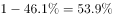
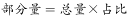

# 现期比重求部分量（整体为新增流量，比重需作1−x互补转换）

考点：[[20-考点/资料分析/比重/现期比重求部分量（整体为新增流量，比重需作1−x互补转换）|比重 / 现期比重求部分量（整体为新增流量，比重需作1−x互补转换）]]
材料：[[15-材料/资料分析/192255 2005～2015年各年末中国网民规|192255 2005～2015年各年末中国网民规]]

**问法模型**：题干问'2015年新增网民中19岁以上约多少万人'→先由'本年末−上年末'求整体（新增流量3951万），再用部分=整体×(1−19岁以下占比)计算部分量

## 推理链
1. 第1步：题干主体是'2015年新增网民'，文字材料未直接给出新增量，须由柱状图作差：2015年末68826万人−2014年末64875万人=3951万人（流量口径）
2. 第2步：文字材料第二段给出新增网民中低龄（19岁以下）占比为46.1%（原卷完整数值，给定文本此处空缺），故19岁以上占比=1−46.1%=53.9%
3. 第3步：代入现期比重公式：19岁以上人数=整体×比重=3951×53.9%≈2129.6万人
4. 第4步：与选项对照：2129.6≈2130，与A项(2130)最接近；干扰项D(1830)恰为3951×46.1%≈1821，即误把低龄占比直接相乘的结果，排除

**最快解法**：⚡ 公式法+有效数字放缩：先心算作差68826−64875=3951（截位≈4000），再乘互补占比1−46.1%≈54%：4000×54%=2160，精确3951×53.9%≈2130，直接锁定A

## 易错点
- ⚠ 把2015年末网民总量68826万误当'新增'整体（量级差约17倍）；新增量必须用68826−64875=3951万作差自行计算
- ⚠ 题干问'19岁以上'而文字给的是'19岁以下'占比，须用1−46.1%=53.9%转换后相乘；直接乘46.1%得约1821万，正好落入D项(1830)陷阱
- ⚠ 给定文字中低龄占比为空缺，不得凭空补数或漏用，须按原卷数值46.1%代入；同时保持'万人'量级，勿错换算成亿（0.213亿）

## 母题抽象
> 🧩 当题干出现'某年新增/净增群体中满足某特征的部分约有多少'时，先用'本期末−上期末'作差求流量整体，再乘(1−对立部分占比)得部分量，并用干扰选项（对立占比直接相乘的结果）反向验证

**同类特征**：2015年新增网民（流量，需年末数作差）、19岁以上（互补表述1−x）、约有多少万人、现期比重求部分量、占比数值在给定文字中空缺须按原文补齐

## 相关题
- [[10-真题/资料分析/比重/48527 现期部分量计算（总人数×录取百分比）比较|48527]]（湖南 2009，相关度1）
- [[10-真题/资料分析/比重/1789644 现期比重计算·部分量之差（占比差×总量求人数）|1789644]]（江苏 2016，相关度1）
- [[10-真题/资料分析/比重/2042320 现期比重计算（部分量=整体量×比重）|2042320]]（江苏 2017，相关度1）
- [[10-真题/资料分析/比重/2030154 现期比重求部分量（占比×样本总量）|2030154]]（四川 2016，相关度1）
- [[10-真题/资料分析/比重/1789668 现期比重计算（饼图多档位占比合并×基数求人数）|1789668]]（江苏 2016，相关度1）

---

### 题干
2015年新增网民中，年龄在19岁以上的网民约有多少万人？

### 选项
- A. 2130　✅
- B. 2030
- C. 1930
- D. 1830

### 官方解析

根据题干所求“2015年新增…19岁以上的网民人数”，结合文字材料第二段给出“2015年新增网民中，19岁以下的占比为”，可判断本题为现期比重问题。定位柱形图，可知2015年新增网民人数。定位文字材料第二段，可知2015年新增网民中低龄（19岁以下）占比，因此19岁以上的占比为。根据比重公式：，因此2015年新增网民中19岁以上的人数为，与A项最为接近。

故正确答案为A。

### 给定材料

        2015年末，全国网民人数为68826万人，互联网普及率（网民人数占总人口数的比重）为。

        2015年新增网民中，低龄（19岁以下）、学生群体占比分别为、。2015年新增网民中，的人使用手机上网，占比较2014年末提升了7.4个百分点；的人使用台式电脑上网，较2014年有所下降。

> [!warning] 疑点（官方解析可能有误，待人工复核）
> 官方解析与给定文字中'19岁以下占比'数值均被挖空；按整体3951万与官方答案A(2130)反推，原卷占比应为46.1%（3951×53.9%≈2130自洽），此为原卷数值空缺需按完整原文补齐，非解析计算错误

<!-- CODEX-ANSWER-REVIEW:BEGIN -->
### 本次独立复核

**复核状态：** `resolved`（答案与解析已核定）

**计分答案：** A（可计分）

**复核解析：**

新增网民总量3951万人；19岁以下占比约46.1%，故19岁以上约53.9%。人数=3951×53.9%≈2130万人，选A。题目公式图补回缺失年龄占比。

**相关信息：**

年龄组互补至100%；求新增量中的年龄构成部分。

**题源依据：** [固定版本原题](https://github.com/Mentat-Uran/kaogongzhentizhengliu/blob/84ab93d4b64b61d897bece8a1c0a5bab06b4feb2/10-%E7%9C%9F%E9%A2%98/%E8%B5%84%E6%96%99%E5%88%86%E6%9E%90/%E6%AF%94%E9%87%8D/2144603%20%E7%8E%B0%E6%9C%9F%E6%AF%94%E9%87%8D%E6%B1%82%E9%83%A8%E5%88%86%E9%87%8F%EF%BC%88%E6%95%B4%E4%BD%93%E4%B8%BA%E6%96%B0%E5%A2%9E%E6%B5%81%E9%87%8F%EF%BC%8C%E6%AF%94%E9%87%8D%E9%9C%80%E4%BD%9C1%E2%88%92x%E4%BA%92%E8%A1%A5%E8%BD%AC%E6%8D%A2%EF%BC%89.md)；固定内容 commit `84ab93d4b64b61d897bece8a1c0a5bab06b4feb2`，Markdown blob `4a5ad1264822842f3841a39b4894c1328654fd40`。
<!-- CODEX-ANSWER-REVIEW:END -->
