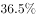
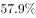

# 基期比重计算

考点：[[20-考点/资料分析/比重/基期比重计算|比重 / 基期比重计算]]
材料：[[15-材料/资料分析/194328 2012—2017年全国农村贫困人口|194328 2012—2017年全国农村贫困人口]]

**问法模型**：题干问'2016年（基期）西部地区占全国的比重'→ 先由'2017年现期值±比上年减少量'分别倒推2016年分子分母，再做除法（基期比重=基期部分÷基期整体）

## 推理链
1. 第1步：题干时间为2016年，材料数据均为2017年末（现期），判定为基期比重计算，须先倒推基期值
2. 第2步：定位段1，'全国农村贫困人口减少至3046万人，比上年末减少1289万人'→2016年末全国=3046+1289=4335万人
3. 第3步：定位段2，'西部地区农村贫困人口1634万人，比上年减少617万人'→2016年西部=1634+617=2251万人
4. 第4步：代入基期比重公式：2251÷4335≈0.519，即约51.9%（勾稽校验：东490+中1594+西2251=4335，数据自洽）
5. 第5步：与选项对照，C项（≈51.9%）最接近，故选C

**最快解法**：⚡ 截位直除：倒推基期2251/4335后，先看4335的一半≈2168，2251略过半，锁定'略大于50%'量级，再截位直除225÷433≈0.519，直接对照选项选C；切勿用现期1634/3046≈53.7%作答

## 易错点
- ⚠ 基期现期混淆：误用现期数据1634/3046≈53.7%，而正确须倒推为2251/4335≈51.9%，二者相差约1.8个百分点，足以误选
- ⚠ 漏加减量：材料不直接给2016年数据，'减少'方向须做加法（3046+1289、1634+617），若按'减少'误做减法即错
- ⚠ 口径混淆：分母是'全国农村贫困人口'总量（万人，绝对数），不能与'贫困发生率'（相对数）或东中西部之和以外的口径混用；材料原文中2016年值全部隐含，须自行倒推

## 母题抽象
> 🧩 当题干出现'基期年份+A占B的比重'且材料只给现期值与增减量时，先分别倒推基期（A₀=A现期+减少量、B₀=B现期+减少量），再做除法对照选项，并可勾稽各部分基期之和=整体基期以验算

**同类特征**：2016年（基期时间）、占…的比重、西部地区、全国农村贫困人口、现期值+比上年减少量、纯文字材料基期倒推

## 相关题
- [[10-真题/资料分析/比重/2049856 基期比重计算|2049856]]（湖南 2017，相关度2）
- [[10-真题/资料分析/比重/2050986 基期比重计算|2050986]]（江西 2017，相关度2）
- [[10-真题/资料分析/比重/2188466 基期比重计算|2188466]]（黑龙江 2018，相关度2）
- [[10-真题/资料分析/比重/2262597 基期比重计算|2262597]]（选调 2016，相关度2）
- [[10-真题/资料分析/比重/2377004 基期比重计算|2377004]]（选调 2019，相关度2）

---

### 题干
2016年，西部地区农村贫困人口占全国农村贫困人口的比重为（  ）。

### 选项
- A. 

- B. 

- C. 

　✅
- D. 

### 官方解析
由题干“2016年，…占…的比重为”，结合材料时间“2017年”，判定本题为基期比重计算问题。定位文字材料第一段可得“截至2017年末，全国农村贫困人口从2012年末的9899万人减少至3046万人，比上年末减少1289万人”，则2016年全国农村贫困人口为万人；定位第二段可得“2017年，西部地区农村贫困人口1634万人，比上年减少617万人”，则2016年西部地区农村贫困人口为万人。代入公式：，则2016年，西部地区农村贫困人口占全国农村贫困人口的比重为，与C项最接近。
故正确答案为C。

### 给定材料

        截至2017年末，全国农村贫困人口从2012年末的9899万人减少至3046万人，比上年末减少1289万人；贫困发生率从2012年的下降至，比上年末下降1.4个百分点。

        分三大区域看，2017年东、中、西部地区农村贫困人口全面减少。东部地区农村贫困人口300万人，比上年减少190万人；中部地区农村贫困人口1112万人，比上年减少482万人；西部地区农村贫困人口1634万人，比上年减少617万人。

        分省看，2017年各省农村贫困发生率普遍下降至以下。其中，农村贫困发生率降至及以下的省份有17个，包括北京、天津、河北、内蒙古、辽宁、吉林、黑龙江、上海、江苏、浙江、安徽、福建、江西、山东、湖北、广东、重庆。

        全国农村贫困监测调查显示，2017年，贫困地区农村居民人均可支配收入9377元，比上年增加894元。

        2017年贫困地区农村居民收入增速快于上年。其主要特点：一是粮食丰收，贫困地区农村居民出售农产品数量增加，粮食、肉羊等部分大宗农产品市场价格回升。农民家庭一产经营净收入人均2826元，增长，增速比上年提高0.5个百分点。二是随着产业扶贫、旅游扶贫、电商扶贫等深入推进，贫困地区二三产业加快发展，一二三产业融合发展取得可喜进展。农民家庭二三产业经营净收入人均897元，增长，增速比上年提高6.5个百分点。

        2017年贫困地区农村居民分项收入增速全面快于全国农村居民。贫困地区农村居民人均工资性收入3210元，比上年增长，增速比全国农村平均水平高2.3个百分点；人均经营净收入3723元，增长，增速比全国农村平均水平高0.9个百分点；人均财产净收入119元，增长，增速比全国农村平均水平高0.5个百分点；人均转移净收入2325元，增长，增速比全国农村平均水平高3.0个百分点。

