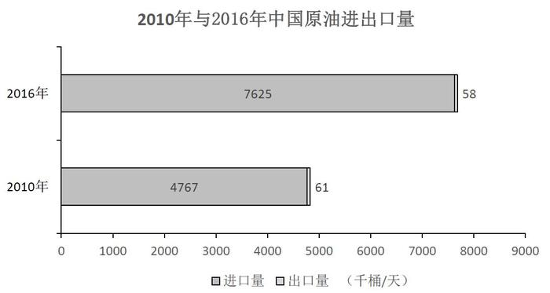

# 两期比重变化幅度比较（百分点差值取绝对值，进口、出口分别找最大）

考点：[[20-考点/资料分析/比重/两期比重变化幅度比较（百分点差值取绝对值，进口、出口分别找最大）|比重 / 两期比重变化幅度比较（百分点差值取绝对值，进口、出口分别找最大）]]
材料：[[15-材料/资料分析/194329 2010年与2016年世界七大地区原|194329 2010年与2016年世界七大地区原]]

**问法模型**：题干问'与2010年相比，2016年占世界比重变化最大的地区'（进口、出口各一个）→ 表中已给两期比重，直接|现期比重−基期比重|逐行作差取绝对值，分别在进口列、出口列找最大者

## 推理链
1. 第1步：从地区表读取进口量占世界比重（2010→2016）：北美24.7→19.5，拉丁美洲3.2→1.9，东欧4.3→3.9，西欧24.7→22.9，中东1.2→1.1，非洲1.9→1.5，亚太40.1→49.2
2. 第2步：进口比重变化幅度=|2016−2010|：北美|19.5−24.7|=5.2，西欧|22.9−24.7|=1.8，亚太|49.2−40.1|=9.1，其余均不超过1.3
3. 第3步：进口比重变化最大为亚太地区（9.1个百分点）＞北美（5.2），A、B项进口均给北美，排除A、B
4. 第4步：读取出口量占世界比重（2010→2016）：北美3.7→7.4，东欧17.7→16.7，西欧6.2→4.7，中东38.8→43.5，非洲18.6→13.0，亚太3.8→3.1
5. 第5步：出口比重变化幅度：中东|43.5−38.8|=4.7，非洲|13.0−18.6|=5.6，北美|7.4−3.7|=3.7，其余更小
6. 第6步：出口比重变化最大为非洲（5.6个百分点）＞中东（4.7），C项出口给中东，排除C
7. 第7步：进口最大=亚太地区、出口最大=非洲，对照选项锁定D

**最快解法**：⚡ 查表作差法（比重列直接相减取绝对值）：进口列先扫变动显眼的两行——亚太49.2−40.1=9.1、北美24.7−19.5=5.2，即亚太最大，秒杀排除A、B；出口列只需比中东与非洲——43.5−38.8=4.7＜18.6−13.0=5.6，非洲最大，排除C，锁定D，无需算完全部7个地区

## 易错点
- ⚠ '变化最大'须取绝对值：北美进口比重下降5.2个百分点是进口中第二大变化，若只找'上升最大'或漏掉负向变化会误选北美；非洲出口比重是下降5.6个百分点，方向为负但幅度最大
- ⚠ 中东出口量绝对值大且43.5%−38.8%直观显眼，但非洲13.0%−18.6%=5.6＞4.7，凭直觉选C是本题最大坑
- ⚠ 表中已直接给出两期'占世界比重'，直接相减即可；若误用进出口量÷世界合计重新计算比重则费时且受四舍五入干扰；比重差单位是'百分点'而非'%'；另注意北美与西欧2010年进口占比同为24.7，易看串行

## 母题抽象
> 🧩 当题干出现'两期比重变化最大的对象'且表格直接给出两期比重时，用|现期比重−基期比重|逐行作差取绝对值，先扫数值变动最显眼的行锁定候选，正负两个方向都要比，再与选项对照排除

**同类特征**：与2010年相比，2016年、占世界比重变化最大、进口量和出口量分别比较、两期比重差（百分点）、直接查表作差、进口、出口各选一个地区

## 相关题
（暂无）

---

### 题干
与2010年相比，2016年原油进口量和出口量占世界比重变化最大的地区分别是（  ）。

### 选项
- A. 北美和中东
- B. 北美和非洲
- C. 亚太地区和中东
- D. 亚太地区和非洲　✅

### 官方解析
，代入表格数据，各地区原油进口量占世界比重变化分别为：北美，亚太地区，，排除A项、B项；各地区原油出口量占世界比重变化分别为：中东，非洲，，排除C项。
故正确答案为D。

### 给定材料

