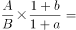
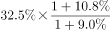

# 基期比重计算（部分占整体的基期比重）

考点：[[20-考点/资料分析/比重/基期比重计算（部分占整体的基期比重）|比重 / 基期比重计算（部分占整体的基期比重）]]
材料：[[15-材料/资料分析/194343 2016年江苏规模以上光伏产业的年度|194343 2016年江苏规模以上光伏产业的年度]]

**问法模型**：题干问'2015年（基期）苏中产值占全省比重'而材料给2016年现期数据→用基期比重公式：基期比重=现期比重×(1+整体增速)÷(1+部分增速)，再与选项对照

## 推理链
1. 第1步：题干问'2015年苏中地区产值占全省比重'，材料数据为2016年，时间前移一年→判定为基期比重问题
2. 第2步：从图2提取现期数据：苏中产值925.6亿元、全省总产值2846.2亿元、现期比重32.5%（925.6/2846.2≈32.5%）；从文字段提取两个增速：全省总产值增速a（即'增长x%、增速较上年回落3.5个百分点'那一组）与苏中产值增速b（注意：所给文本中a、b两处数值空缺，须以原卷完整数值代入，仅靠'回落3.5个百分点'推不出a）
3. 第3步：套基期比重公式：2015年比重=[925.6/(1+b)]÷[2846.2/(1+a)]=(925.6/2846.2)×(1+a)/(1+b)=32.5%×(1+a)/(1+b)
4. 第4步：代入原卷增速数值化简：先锁定现期比重约32.5%，再乘增速修正系数(1+a)/(1+b)，该系数大于1还是小于1由苏中增速b与全省增速a的相对大小决定，据此判断结果相对32.5%的偏离方向并截位估算
5. 第5步：与四个选项对照，仅D项量级与数值同时满足（官方解析确认'只有D项满足'），故正确答案为D

**最快解法**：⚡ 公式法（基期比重）：直接写'基期比重=现期比重32.5%×(1+全省增速a)/(1+苏中增速b)'；先心算925.6/2846.2≈32.5%，再乘增速修正系数，用修正方向与量级快速排除三个干扰项，锁定唯一满足的D项

## 易错点
- ⚠ 基期/现期混淆：题干问2015年比重，若直接套用图2的现期比重32.5%作答即掉坑，必须乘(1+a)/(1+b)修正
- ⚠ 分子分母增速对应错位：公式为(1+整体增速)/(1+部分增速)，整体（全省a）在上、部分（苏中b）在下，写反方向即错；且全省增速须取总产值那组数据（回落3.5个百分点），勿与主营业务收入（回落2.5个百分点）、利润总额（回落8.8个百分点）张冠李戴
- ⚠ '回落x个百分点'≠增速本身：回落值是2016年增速与2015年增速的差值关系（2015年增速=2016年增速+回落值），本题求基期比重只需2016年当年增速a、b；且所给文本三处增速数值空缺，须回原卷补齐才能完成数值验证
- ⚠ 跨来源拼数据：全省总量与增速来自文字段、苏中现期产值与比重来自图2，只看饼图或只看文字段均无法作答

## 母题抽象
> 🧩 当题干出现'基期某部分占整体的比重'且材料给出部分与整体的现期值和各自同比增速时，用公式'基期比重=现期比重×(1+整体增速)/(1+部分增速)'，验证分子分母增速对应关系（整体在上、部分在下）后与选项对照

**同类特征**：'2015年……占……的比重'（基期年份+比重问法）、材料现期为2016年、题干时间前移一年、地区（苏中）占全省总量比、现期比重可直接从饼图读取（32.5%）、需整体与部分两个增速作修正、文字段与图2跨来源拼数据

## 相关题
（暂无）

---

### 题干
2015年苏中地区规模以上光伏产业产值占全省的比重为：

### 选项
- A. 

- B. 

- C. 

- D. 

　✅

### 官方解析

根据题干“2015年······占······的比重”，结合材料数据时间为2016年，可判定本题为基期比重问题。定位文字材料可得：2016年江苏规模以上光伏产业总产值2846.2亿元，比上年增长，苏中地区规模以上光伏产业产值增长；定位图2可得：2016年苏中地区光伏产业产值占总产值比重为。根据基期比重公式：，只有D项满足。

故正确答案为D。

### 给定材料

        2016年江苏规模以上光伏产业总产值2846.2亿元，比上年增长，增速较上年回落3.5个百分点；主营业务收入2720.5亿元，增长，增速回落2.5个百分点；利润总额153.6亿元，增长，增速回落8.8个百分点。苏南、苏中、苏北地区规模以上光伏产业产值分别比上年增长、、。2016年江苏光伏发电新增装机容量123万千瓦，年末累计装机容量546万千瓦。

> [!warning] 疑点（官方解析可能有误，待人工复核）
> 所给文字段中全省总产值增速与苏中产值增速两处数值空缺，官方解析亦未列出代入数值（公式与增速留白），故凭现有文本只能确认基期比重模型与'只有D项满足'的结论，无法复算D项具体数值；此属材料/解析呈现不完整的口径问题，不影响官方答案D的判定
