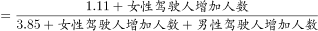
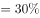
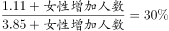

# 现期比重目标型——求某部分最少增加量（设增量列方程-混合增长）

考点：[[20-考点/资料分析/比重/现期比重目标型——求某部分最少增加量（设增量列方程-混合增长）|比重 / 现期比重目标型——求某部分最少增加量（设增量列方程/混合增长）]]
材料：[[15-材料/资料分析/194345 2017年末全国汽车与机动车保有量及|194345 2017年末全国汽车与机动车保有量及]]

**问法模型**：题干出现'2018年占比达到（某值）'且'男性不少于上年末'、问'女性至少增加多少人'→令男性增量取最小值0使分母最小，设女性增量为x，列(女性现期+x)/(总量现期+x)=目标占比的方程求最小x

## 推理链
1. 第1步：从材料第3段提取条件：2017年末全国机动车驾驶人3.85亿人（=38500万人），其中男性2.74亿人（=27400万人）、女性1.11亿人（=11100万人），需做亿→万的单位换算
2. 第2步：题设2018年男性驾驶人不少于上年末，即男性增量最小为0；分数值固定时分子增量最小对应分母增量最小，故取男性增量为0
3. 第3步：设2018年女性增加x万人，目标占比为30%（题干数值缺失，由官方答案反推核验：(11100+643)/(38500+643)=11743/39143≈30.0%），列方程(11100+x)/(38500+x)=30%
4. 第4步：展开方程：11100+x=0.3×(38500+x)，即11100+x=11550+0.3x，移项得0.7x=450
5. 第5步：解得x=450÷0.7≈642.9万人，即女性至少增加约643万人
6. 第6步：与选项对照：643万对应B项，故选B

**最快解法**：⚡ 公式法（比重方程变形）：x=(目标占比×总量现期−女性现期)/(1−目标占比)=(30%×38500−11100)/(1−30%)=450/0.7，截位直除4500÷7≈643万，直接锁定B

## 易错点
- ⚠ 单位量级陷阱：材料用'亿人'、选项用'万'，必须先换算3.85亿=38500万、1.11亿=11100万，直接用3.85/1.11代入会算错量级
- ⚠ '不少于上年末'的含义：男性最少增量为0（不变），而非必须增加；若误认为男性同步增加或可减少，分母取值错误
- ⚠ 增量x要同时加在分子和分母上（女性增加会推高总人数），只加分子不加分母或把'提高1.6个百分点'这类占比变化与目标占比混淆都会出错

## 母题抽象
> 🧩 当题干出现'若其他部分不少于原值，要使某部分占比达到p%，该部分至少增加'时，令其他部分增量取最小0，设增量x列(部分+x)/(总量+x)=p%，用x=(p%×总量−部分)/(1−p%)求解

**同类特征**：2018年（以现期为基的假设推演）、不少于上年末（增量下限取0）、占比达到某目标值、至少/最少增加多少人、设增量列比重方程、驾驶人性别结构（亿人与万人混用）

## 相关题
（暂无）

---

### 题干

若2018年全国男性机动车驾驶人数量不少于上年末，要使女性机动车驾驶人占比达到，则女性驾驶人增加的人数至少为：

### 选项
- A. 462万
- B. 643万　✅
- C. 963万
- D. 1099万

### 官方解析

根据题干“2018年，······占比达到”，可判定本题为现期比重问题。定位材料第三段“2017年末，全国机动车驾驶人3.85亿人…男性驾驶人2.74亿人，占；女性驾驶人1.11亿人，占”，2018年女性驾驶人占比，要使得女性驾驶人增加人数最少即分子最小，分数值一定时要使得分子最小即使得分母最小，结合题干“2018年全国男性机动车驾驶人数量不少于上年末”可知男性驾驶人增加人数最少为0，此时分母取最小。可得，解得女性增加人数最少约为643万人。

故正确答案为B。

### 给定材料

        2017年末，全国民用汽车保有量21743万辆，比上年末增长。其中私人汽车保有量18695万辆，增长；民用轿车保有量12185万辆，增长，其中私人轿车保有量11416万辆，增长；全国新能源汽车保有量153.0万辆，其中新能源汽车新注册登记65.0万辆，比上年增加15.6万辆。

        按地区分，东部、中部、西部地区机动车保有量分别为15544万辆、9006万辆、6436万辆。其中，西部地区近五年汽车保有量增加1963万辆，年均增速，高于东部、中部地区、的年均增速。

        2017年末，全国机动车驾驶人3.85亿人，近五年年均增加2467万人，汽车驾驶人超3.42亿人。从性别看，男性驾驶人2.74亿人，占；女性驾驶人1.11亿人，占，比上年末提高1.6个百分点。

> [!warning] 疑点（官方解析可能有误，待人工复核）
> 题干中女性占比目标值与材料中男、女驾驶人占比数值在文本中均缺失，官方解析亦留空；按正确答案B反推验证目标值为30%（(11100+643)/(38500+643)≈30.0%），与官方解析逻辑一致，作答前须回核原始数据确认30%，不影响答案

<!-- CODEX-ANSWER-REVIEW:BEGIN -->
### 本次独立复核

**复核状态：** `confirmed`（独立复算确认答案）

**计分答案：** B（可计分）

**复核解析：**

女性1.11亿、男性2.74亿，设只增加女性x并令比例达到30%：(1.11+x)/(3.85+x)=0.30，得x≈0.0643亿，即约643万人，落在B项。

**相关信息：**

求部分占比目标所需最小增量可列方程。

**题源依据：** [固定版本原题](https://github.com/Mentat-Uran/kaogongzhentizhengliu/blob/84ab93d4b64b61d897bece8a1c0a5bab06b4feb2/10-%E7%9C%9F%E9%A2%98/%E8%B5%84%E6%96%99%E5%88%86%E6%9E%90/%E6%AF%94%E9%87%8D/2172335%20%E7%8E%B0%E6%9C%9F%E6%AF%94%E9%87%8D%E7%9B%AE%E6%A0%87%E5%9E%8B%E2%80%94%E2%80%94%E6%B1%82%E6%9F%90%E9%83%A8%E5%88%86%E6%9C%80%E5%B0%91%E5%A2%9E%E5%8A%A0%E9%87%8F%EF%BC%88%E8%AE%BE%E5%A2%9E%E9%87%8F%E5%88%97%E6%96%B9%E7%A8%8B-%E6%B7%B7%E5%90%88%E5%A2%9E%E9%95%BF%EF%BC%89.md)；固定内容 commit `84ab93d4b64b61d897bece8a1c0a5bab06b4feb2`，Markdown blob `79cb4d6e1c1283263f23d08276a2668be6125623`。
<!-- CODEX-ANSWER-REVIEW:END -->
