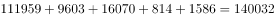
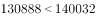
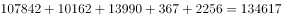
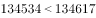
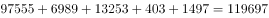
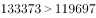
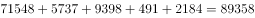
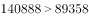

# 部分与其余部分之和比较（占比是否过半的逐年判定）

考点：[[20-考点/资料分析/比重/部分与其余部分之和比较（占比是否过半的逐年判定）|比重 / 部分与其余部分之和比较（占比是否过半的逐年判定）]]
材料：[[15-材料/资料分析/194354 2013-2016年中国在世界六大洲|194354 2013-2016年中国在世界六大洲]]

**问法模型**：题干问'亚洲派出人数超过其余5洲之和的年份个数' → 等价转化为'2×亚洲人数＞当年6洲总人数'（即亚洲占比过半），逐年判定后计数

## 推理链
1. 第1步：从表格右块'当年派出人数（人）'取数，亚洲2013-2016年依次为130888、134534、133373、140888人
2. 第2步：规则转化：'亚洲＞其余5洲之和' ⟺ '亚洲＞总人数−亚洲' ⟺ '2×亚洲＞6洲总人数'
3. 第3步：逐年求其余5洲之和并比较：2013年111959+9603+16070+814+1586=140032＞130888，不符合；2014年107842+10162+13990+367+2256=134617＞134534，不符合（仅差83人）；2015年97555+6989+13253+403+1497=119697＜133373，符合；2016年71548+5737+9398+491+2184=89358＜140888，符合
4. 第4步：符合条件的为2015、2016共2个年份
5. 第5步：对照选项，2个对应B，故正确答案为B

**最快解法**：⚡ 等价转化法+临界年精算：将'超其余5洲之和'转为'亚洲占当年6洲总人数是否过半'；2015年其余和≈11.97万、2016年其余和≈8.94万，均明显小于亚洲13.3万/14.1万，直接判符合；2013年其余和≈14.0万＞13.09万排除；唯一需精算的是临界年2014：其余5洲之和134617 vs 亚洲134534，仅差83人，粗截位会翻车，直接相加（或用尾三位842+162+990+367+256=2617→尾617>534辅助）确认134617＞134534排除，故符合年份2个选B

## 易错点
- ⚠ 双指标双单位混排：必须取右块'当年派出人数（人）'列，误读左块'完成营业额（万美元）'则全盘皆错
- ⚠ 2014年为极端临界年：其余5洲之和134617人与亚洲134534人只差83人，粗算/过度截位会把2014误判为'符合'，从而错选C（3个）
- ⚠ 审题口径：'超过其余5个洲派出总人数'是与5洲合计比较（等价于占比过半），不是'亚洲为最大洲'或'超过某一大洲'；且为严格大于，恰好相等也不符合

## 母题抽象
> 🧩 当题干出现'A超过其余各部分之和的年份/个数'特征时，转化为'2A与总量比较'（即A占比是否过半）逐年判定计数，数值接近的临界年份必须精算或用尾数法确认方向

**同类特征**：超过其余5个洲派出总人数、年份个数有（计数型问法）、可等价为占比是否过半、当年派出人数（人）列取数、逐年判定、含临界年份、双指标双单位混排统计表

## 相关题
（暂无）

---

### 题干
2013-2016年中国在亚洲承包工程当年派出人数超过其余5个洲派出总人数的年份个数有：

### 选项
- A. 1个
- B. 2个　✅
- C. 3个
- D. 4个

### 官方解析

定位表格材料“当年派出人数（人）”可得：

2013年中国在亚洲承包工程当年派出人数为130888人，其余5个洲派出总人数为人，，不符合；

2014年中国在亚洲承包工程当年派出人数为134534人，其余5个洲派出总人数为人，，不符合；

2015年中国在亚洲承包工程当年派出人数为133373人，其余5个洲派出总人数为人，，符合；

2016年中国在亚洲承包工程当年派出人数为140888人，其余5个洲派出总人数为人，，符合。

符合条件的有2015年和2016年两个年份。

故正确答案为B。

### 给定材料

> [!warning] 疑点（官方解析可能有误，待人工复核）
> 官方解析文字中'其余5个洲派出总人数为____人'处具体数值缺失（显示空白），按表格数据核算2013-2016年其余5洲之和分别为140032、134617、119697、89358人，解析结论（2015、2016两年符合，答案B）无误。

<!-- CODEX-ANSWER-REVIEW:BEGIN -->
### 本次独立复核

**复核状态：** `resolved`（答案与解析已核定）

**计分答案：** B（可计分）

**复核解析：**

逐年比较亚洲派出人数与其余五洲合计：2013年130888<140032，2014年134534>134617为否，2015年133373>119697，2016年140888>89358。满足年份为2015、2016，共2年，选B。

**相关信息：**

其余五洲人数=当年派出总人数−亚洲人数；相等不算超过。

**题源依据：** [固定版本原题](https://github.com/Mentat-Uran/kaogongzhentizhengliu/blob/84ab93d4b64b61d897bece8a1c0a5bab06b4feb2/10-%E7%9C%9F%E9%A2%98/%E8%B5%84%E6%96%99%E5%88%86%E6%9E%90/%E6%AF%94%E9%87%8D/2172456%20%E9%83%A8%E5%88%86%E4%B8%8E%E5%85%B6%E4%BD%99%E9%83%A8%E5%88%86%E4%B9%8B%E5%92%8C%E6%AF%94%E8%BE%83%EF%BC%88%E5%8D%A0%E6%AF%94%E6%98%AF%E5%90%A6%E8%BF%87%E5%8D%8A%E7%9A%84%E9%80%90%E5%B9%B4%E5%88%A4%E5%AE%9A%EF%BC%89.md)；固定内容 commit `84ab93d4b64b61d897bece8a1c0a5bab06b4feb2`，Markdown blob `d88bfa8b4b121ee77b0f8a9f196f5e08f57cbc64`。
<!-- CODEX-ANSWER-REVIEW:END -->
