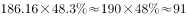
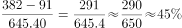

# 现期比重计算与比重差值（地区构成比重×地区基数后再对全省同类总量作比作差）

考点：[[20-考点/资料分析/比重/现期比重计算与比重差值（地区构成比重×地区基数后再对全省同类总量作比作差）|比重 / 现期比重计算与比重差值（地区构成比重×地区基数后再对全省同类总量作比作差）]]
材料：[[15-材料/资料分析/194389 2016年江苏农业生产经营人员127|194389 2016年江苏农业生产经营人员127]]

**问法模型**：题干问'苏南/苏北地区女性占全省女性…比重与苏北…相差多少个百分点'→ 先用地区基数×表内地区女性比重求各地女性人数，再除以全省女性总量求比重，最后两比重作差

## 推理链
1. 第1步：从文字段提取基数：全省女性645.40万人，苏南地区总人数186.16万人，苏北地区总人数763.42万人
2. 第2步：从表格'性别—女性'行提取地区比重：苏南48.3%、苏北49.8%（苏北一列，切勿误取苏中的54.6%或全省的50.8%）
3. 第3步：代入'人数=地区基数×地区内比重'：苏南女性=186.16×48.3%≈89.9万人，苏北女性=763.42×49.8%≈380.2万人
4. 第4步：代入'占全省女性比重=地区女性÷645.40'：苏南89.9/645.40≈13.9%，苏北380.2/645.40≈58.9%
5. 第5步：作差：58.9%−13.9%=45.0个百分点
6. 第6步：与选项对照，45.0个百分点对应D项，故选D

**最快解法**：⚡ 综合式+截位估算：所求=(763.42×49.8%−186.16×48.3%)/645.40；因48.3%、49.8%均≈50%，先粗算(763.42−186.16)×50%/645.40≈288.6/645.4≈44.7%，锁定45.0（D）；再精算分子380.2−89.9≈290，290/645.4≈45%验证无误

## 易错点
- ⚠ 表格列错位：苏北女性49.8%易误取成苏中的54.6%或全省的50.8%，地区比重必须与地区基数同列配对
- ⚠ 只算一半：苏南占全省女性比重≈13.9%正是A项14.0的陷阱，漏减苏北比重会误选A
- ⚠ 两步口径混淆：第一步分母是地区总人数（186.16/763.42），第二步分母是全省女性645.40万，不能全程都用645.40或用1270.87；且结果单位是'个百分点'而非人数

## 母题抽象
> 🧩 当题干出现'某地区内部某类人群占更大范围（全省）同类人群的比重、两地相差'特征时，用'地区基数×地区内比重→除以更大范围该类总量→两比重作差'，每一步分子分母口径必须与基数同源配对

**同类特征**：占全省女性…比重、与苏北地区的相差、多少个百分点、文字段给基数+表格给比重的拼接、两个地区同口径对比

## 相关题
- [[10-真题/资料分析/比重/10297073 两期比重差（比重变化量，百分点）|10297073]]（天津 2025，相关度1）
- [[10-真题/资料分析/增长/1752612 增速同比变动幅度（百分点作差）·折线图读数|1752612]]（北京 2016，相关度1）
- [[10-真题/资料分析/其他/2376766 基期率之差（现期值±变化百分点的简单加减计算）|2376766]]（黑龙江 2019，相关度1）

---

### 题干
2016年苏南地区的女性农业生产经营人员占全省女性农业生产经营人员比重与苏北地区的相差：

### 选项
- A. 14.0个百分点
- B. 27.2个百分点
- C. 31.7个百分点
- D. 45.0个百分点　✅

### 官方解析

根据题干“2016年…比重与…相差”可判定此题为现期比重问题。定位文字材料可得，2016年江苏女性农业生产经营人员645.40万人，苏南、苏北地区农业生产经营人员分别为186.16万人、763.42万人；定位表格，苏南地区农业生产经营人员中女性占、苏北地区中女性占。则苏南地区女性农业生产经营人员为万人，苏北地区女性农业生产经营人员为万人，二者占全省女性农业生产经营人员的比重相差：，即相差45个百分点，与D项最接近。

故正确答案为D。

### 给定材料

二、根据以下资料回答116-120题。

        2016年江苏农业生产经营人员1270.87万人。其中女性645.40万人，苏南、苏中、苏北地区分别有186.16万人、321.29万人、763.42万人；年龄35岁及以下的有127万人。36-54岁的有524.90万人、55岁及以上的有618.87万人。

