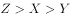
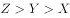
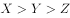
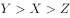
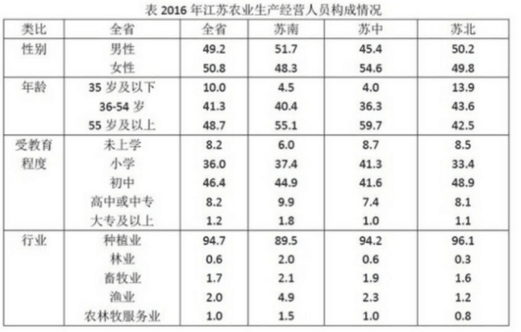

# 现期比重求部分量（部分=整体×比重）与三地区人数排序比较

考点：[[20-考点/资料分析/比重/现期比重求部分量（部分=整体×比重）与三地区人数排序比较|比重 / 现期比重求部分量（部分=整体×比重）与三地区人数排序比较]]
材料：[[15-材料/资料分析/194389 2016年江苏农业生产经营人员127|194389 2016年江苏农业生产经营人员127]]

**问法模型**：题干用X、Y、Z分别表示苏南、苏中、苏北从事渔业的人数并比较三者大小 → 必须分别用'各地区基数×各地区渔业比重'算出三个具体人数再排序，不能直接比表中百分数

## 推理链
1. 第1步：从文字段提取三地区农业生产经营人员基数：苏南186.16万人、苏中321.29万人、苏北763.42万人
2. 第2步：从统计表'行业-渔业'行提取三地区渔业比重：苏南4.9%、苏中2.3%、苏北1.2%
3. 第3步：套用公式'部分量=整体量×比重'：X=186.16×4.9%≈9.12万人，Y=321.29×2.3%≈7.39万人，Z=763.42×1.2%≈9.16万人
4. 第4步：比较三个结果：9.16(Z) > 9.12(X) > 7.39(Y)，即Z>X>Y
5. 第5步：与选项对照，Z>X>Y对应A项，故正确答案为A

**最快解法**：⚡ 先粗筛锁定：Y=321.29×2.3%≈7.4万人明显最小（其余两项基数或比重更大的组合都远超它），排除Y最大或Y居中的选项；再精算X与Z两个'约9万'的接近值：X≈186×4.9%≈9.11万人，Z≈763×1.2%≈9.16万人，Z仅比X大约0.04万人，靠截位直除/精乘确认Z>X，得出Z>X>Y选A

## 易错点
- ⚠ 最大陷阱：直接比较表中比重得X(4.9%)最大、Z(1.2%)最小，忽略苏北基数763.42万是苏南186.16万的4倍多，实际Z反而略大于X
- ⚠ X与Z实算值极接近（9.12 vs 9.16万人，差不足0.5%），粗略估算（如按5%和1%口算）或四舍五入过猛会误判两者大小
- ⚠ 基数与比重错配：若错用全省总量1270.87万或套错地区基数，结果量级和排序全错；表内百分数是构成比，绝不能直接当人数

## 母题抽象
> 🧩 当题干出现'用X、Y、Z分别表示各地区某指标人数并比较大小'时，必须逐项'地区基数×该地区比重'换算成具体人数再排序；尤其当某地区比重最小但基数最大时，低位比重×大基数可能反超高位比重×小基数，接近值必须精算

**同类特征**：用X、Y、Z分别表示、从事渔业…人数、三者的大小关系、地区人数×行业比重、比重与基数反向（苏南比重高基数小、苏北比重低基数大）、现期构成比较无增长

## 相关题
（暂无）

---

### 题干
用X、Y、Z分别表示2016年苏南、苏中、苏北地区从事渔业的农业生产经营人数，则三者的大小关系为：

### 选项
- A. 

　✅
- B. 

- C. 

- D. 

### 官方解析
定位文字与表格材料可得：苏南、苏中、苏北地区的人数分别为186.16万人、321.29万人、763.42万人，从事渔业的人数占比分别为、、，根据公式，苏南地区从事渔业的农业生产经营，苏中地区从事渔业的农业生产经营,苏北地区从事渔业的农业生产经营,故,因此A项正确。
故正确答案为A。

### 给定材料

二、根据以下资料回答116-120题。

        2016年江苏农业生产经营人员1270.87万人。其中女性645.40万人，苏南、苏中、苏北地区分别有186.16万人、321.29万人、763.42万人；年龄35岁及以下的有127万人。36-54岁的有524.90万人、55岁及以上的有618.87万人。

