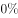
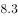
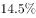

# 现期比重计算（结构余量：其余部分占比=100%−各已知部分占比之和）

考点：[[20-考点/资料分析/比重/现期比重计算（结构余量：其余部分占比=100%−各已知部分占比之和）|比重 / 现期比重计算（结构余量：其余部分占比=100%−各已知部分占比之和）]]
材料：[[15-材料/资料分析/194870 2017年1～4月S市对欧盟进出口贸|194870 2017年1～4月S市对欧盟进出口贸]]

**问法模型**：题干以“除一般贸易、加工贸易和海关特殊监管之外，其余贸易方式约占其对欧盟进出口总值的比重”提问→用结构余量模型：其余占比=100%−三项占比之和，其中只给金额未给占比的海关特殊监管项先按139.3÷802.6化为占比再相减。

## 推理链
1. 第1步：题干时间“2017年1～4月”与材料一致，问“约占……比重”，判定为现期比重问题；三项占比的共同分母为第一段S市对欧盟进出口总值802.6亿元人民币。
2. 第2步：第二段只给海关特殊监管方式金额139.3亿元、未给占比，须自求占比：139.3÷802.6≈17.4%。
3. 第3步：一般贸易、加工贸易“占同期全市对欧盟进出口总值的比重”由第二段直接读取（原版材料以百分数给出，本页面文本中显示为空缺，解题时按原版材料数值代入，无须计算）。
4. 第4步：结构余量规则：三项贸易方式之外仍有“其余贸易方式”，故其余贸易方式占比=100%−一般贸易占比−加工贸易占比−17.4%。
5. 第5步：代入原版材料中一般贸易、加工贸易占比数值，与17.4%一并从100%中减去，得其余贸易方式占比约为百分之几的量级。
6. 第6步：与选项对照，结果与B项最接近，故正确答案为B。

**最快解法**：⚡ 结构余量+截位直除：海关特殊监管占比139.3÷802.6，截位直除（139.3/802.6≈17.4%）；再心算100%−一般贸易占比−加工贸易占比−17.4%，与四个选项对照取最接近者即B。

## 易错点
- ⚠ 海关特殊监管方式只给金额139.3亿元、未给占比，占比须自算139.3÷802.6≈17.4%，误以为材料已给占比或漏掉该项是第一大坑（其“下降”只是方向词，不是数值）。
- ⚠ 三项占比之和≠100%：一般贸易+加工贸易+海关特殊监管之外还有“其余贸易方式”，余项=100%−三项之和，勿把三项之和直接当作答案。
- ⚠ 同名不同径：第二段各占比的分母是“同期全市对欧盟进出口总值802.6亿元”（S市内部结构），勿与第一段“S市占我国对欧盟进出口总值的比重”（分母为全国值）混淆；另本页面文本中一般贸易、加工贸易占比数值显示空缺，须以原版材料数值补齐代入，不得凭空设数。

## 母题抽象
> 🧩 当题干出现“除A、B、C之外的其余部分约占……比重”且各部分分母为同一总量时，用结构余量法：余项占比=100%−各部分占比之和，缺占比只给金额的项先按金额÷总量化为占比，验证三项之和加余项=100%，结果对照选项取最近值。

**同类特征**：除一般贸易、加工贸易和海关特殊监管方式之外、其余贸易方式、约占其对欧盟进出口总值的（比重）、占同期全市对欧盟进出口总值的比重（第二段口径）、现期比重、结构余量/补集思想

## 相关题
- [[10-真题/资料分析/比重/4792819 现期比重计算（多部分比重依次求解）|4792819]]（新疆 2014，相关度1）
- [[10-真题/资料分析/比重/827355 现期比重比较（部分占比过半速判）|827355]]（政法干警 2014，相关度1）
- [[10-真题/资料分析/比重/2272297 现期比重比较|2272297]]（选调 2015，相关度1）
- [[10-真题/资料分析/比重/2032972 现期比重计算（多地区占比求和）|2032972]]（吉林 2015，相关度1）
- [[10-真题/资料分析/比重/2187857 现期比重计算（部分量需先由'总量−其中量'减法间接求得）|2187857]]（山东 2018，相关度1）

---

### 题干
2017年1～4月，S市除一般贸易、加工贸易和海关特殊监管方式进出口贸易之外，其余贸易方式对欧盟进出口约占其对欧盟进出口总值的：

### 选项
- A. 

- B. 

　✅
- C. 

- D. 

### 官方解析
根据题干“2017年1~4月······占······”，结合选项为百分数，时间与材料一致，可判定本题为现期比重问题。定位材料第一段“2017年1~4月，S市对欧盟进出口总值为802.6亿元人民币”，定位材料第二段“以一般贸易方式进出口总值······占同期全市对欧盟进出口总值的；以加工贸易方式进出口总值······占同期全市对欧盟进出口总值的；以海关特殊监管方式进出口总值为139.3亿元”。则以海关特殊监管方式进出口总值占比，故除这三种贸易方式以外的其余贸易方式占比约为，与B项最接近。
故正确答案为B。

### 给定材料

        2017年1～4月，S市对欧盟进出口总值为802.6亿元人民币，比去年同期（下同）增长，占我国对欧盟进出口总值的。其中，对欧盟出口621.2亿元，增长，占我国对欧盟出口总值的；自欧盟进口181.4亿元，增长。

        1～4月，S市对欧盟以一般贸易方式进出口总值增长，占同期全市对欧盟进出口总值的；以加工贸易方式进出口总值下降，占同期全市对欧盟进出口总值的；以海关特殊监管方式进出口总值为139.3亿元，下降。

        1～4月，在欧盟前5大贸易国中，S市对德国进出口164.3亿元，增长；对英国进出口123亿元，增长；对荷兰进出口108.1亿元，增长；对意大利进出口61.4亿元，增长；对法国进出口81.1亿元，下降。同期，对“一带一路”沿线欧盟国家进出口113.5亿元，增长。

