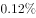
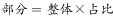
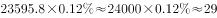

# 现期比重求部分量（部分量=总体×占比）

考点：[[20-考点/资料分析/比重/现期比重求部分量（部分量=总体×占比）|比重 / 现期比重求部分量（部分量=总体×占比）]]
材料：[[15-材料/资料分析/195079 2016年（含2012-2016年趋|195079 2016年（含2012-2016年趋]]

**问法模型**：题干问'某产业营业收入约为'+表格只给占比%且文字给总营收 → 用部分量=总体×比重模型

## 推理链
1. 第1步：题干求2016年音像制品出版业营业收入（部分量），统计表（图1）给出其占比0.12%，文字材料给出全行业营业收入23595.8亿元
2. 第2步：根据比重公式，部分量=总体×比重，即音像制品营收=23595.8×0.12%
3. 第3步：代入计算：23595.8×0.12%=23595.8×0.0012≈28.3亿元
4. 第4步：与选项对照，28.3亿元与B项28亿元最接近，A(47亿)、C(12亿)、D(62亿)均偏差过大，故选B

**最快解法**：⚡ 百化分+截位直除：0.12%≈1/833，23595.8×0.0012，先按23600×12÷10000≈28.3，口算即锁B；亦可用总营收÷1000≈23.6，再×1.2≈28.3验证量级

## 易错点
- ⚠ 占比量级看错：把0.12%看成1.2%会得约283亿元，四个选项均不在此量级，应立即察觉小数点错误；或与相邻的电子出版物出版0.06%串行，得约14亿元误选C附近
- ⚠ 误以为表格直接给出营收额，跳过'总营收23595.8亿元×占比'这一跨图表换算步骤
- ⚠ 分子分母口径混淆：切勿用512.53亿册（总出版数量）或其他产业占比参与计算，本题只需总营收与0.12%两个数

## 母题抽象
> 🧩 当题干问'某分类的绝对量约为'而表格只给占比%、文字给总量时，套用'部分量=总量×占比'，先确认占比的小数位量级，再截位直除对照选项

**同类特征**：某产业营业收入约为、统计表给占比(%)、部分量=总体×比重、现期比重、总量藏在文字段、选项为亿元

## 相关题
- [[10-真题/资料分析/比重/4792819 现期比重计算（多部分比重依次求解）|4792819]]（新疆 2014，相关度1）
- [[10-真题/资料分析/比重/827355 现期比重比较（部分占比过半速判）|827355]]（政法干警 2014，相关度1）
- [[10-真题/资料分析/比重/2272297 现期比重比较|2272297]]（选调 2015，相关度1）
- [[10-真题/资料分析/比重/2032972 现期比重计算（多地区占比求和）|2032972]]（吉林 2015，相关度1）
- [[10-真题/资料分析/比重/2187857 现期比重计算（部分量需先由'总量−其中量'减法间接求得）|2187857]]（山东 2018，相关度1）

---

### 题干
2016年我国音像制品出版业营业收入约为：

### 选项
- A. 47亿元
- B. 28亿元　✅
- C. 12亿元
- D. 62亿元

### 官方解析

根据题干“2016年我国音像制品出版业营业收入约为”，结合材料中统计表已知音像制品出版业营业收入所占比重，可判定此题为现期比重问题。定位文字材料第一段“2016年全国出版、印刷和发行服务实现营业收入23595.8亿元”和统计表中已知音像制品出版业营业收入所占比重为，根据比重公式：，可得2016年我国音像制品出版业营业收入约为亿元，与B项最接近。

故正确答案为B。

### 给定材料

根据下面资料回答101-105题：

        2017年7月24日，国家新闻出版广电总局发布的《2016年新闻出版产业分析报告》指出，2016年全国出版、印刷和发行服务实现营业收入23595.8亿元，较2015年增加1939.9亿元，增长。其中，数字出版实现营业收入5720.85亿元，比2015年增长，对全行业营业收入增长贡献超三分之二。

        2016年，全国共出版图书、期刊、报纸、音像制品和电子出版物512.53亿册（份、盒、张）。其中，出版图书49.99万种，重版、重印23.75万种。

