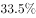

# 构成比最大项查找（读数比较，无计算）

考点：[[20-考点/资料分析/比重/构成比最大项查找（读数比较，无计算）|比重 / 构成比最大项查找（读数比较，无计算）]]
材料：[[15-材料/资料分析/195309 第五次国家卫生服务调查（2013年）|195309 第五次国家卫生服务调查（2013年）]]

**问法模型**：题干问'某年份某类人群两周就诊的最主要去向'→ 定位表2对应年份行与对应医保类型列，直接比较6个构成比找最大项

## 推理链
1. 第1步：题干限定两个条件——年份2013年、人群为参加职工医保的调查者，据此锁定表2的2013行×职工医保列
2. 第2步：表2为就诊地点构成比，每行同一医保类型6项合计100%，'最主要去向'即构成比最大的就诊地点，属纯比较查找
3. 第3步：读取2013年职工医保6项构成比：社区卫生服务站/卫生室14.9%、社区卫生服务中心/卫生院12.4%、县/市/区级医院14.8%、地市级医院33.5%、省级医院18.4%、其他6.0%
4. 第4步：横向比较得最大值为33.5%，对应就诊地点为地市级医院
5. 第5步：与选项对照——地市级医院为C项，四个选项均未涉及最大项之外的干扰排序，无需再算

**最快解法**：⚡ 直接查找比较法（无计算）：定位表2'2013行+职工医保列'，一眼扫出最大数33.5%落在'地市级医院'下方，秒选C；只需警惕并排的居民医保列（最大47.1%在社区卫生服务站/卫生室）与上一行2008年数据不可混读

## 易错点
- ⚠ 串列陷阱：表2职工医保与居民医保两列并排，居民医保最大项是社区卫生服务站/卫生室（47.1%），若串列读数会误判去向类型
- ⚠ 串行陷阱：2008年职工医保最大项是社区卫生服务中心/卫生院（27.4%），若误取2008行会得出错误去向，题干限定2013年只取2013行
- ⚠ 接近数值干扰：14.9%（服务站/卫生室）、14.8%（县级医院）与12.4%相互接近，扫读不细时可能漏看真正的最大项33.5%在地市级医院

## 母题抽象
> 🧩 当题干出现'某年份某类别中占比最大/最主要去向/所占比重最高的是'特征时，用'锁行列→直接扫最大值'方法，并逐一核对所取行列与题干限定的年份、类别完全一致，防并排双列双行串读

**同类特征**：2013年（限定年份取行）、参加职工医保（限定列）、两周就诊、最主要去向、构成比最大项、表2定位

## 相关题
- [[10-真题/资料分析/增长/2261965 增长量比较|2261965]]（广东 2019，相关度1）

---

### 题干
在2013年，参加职工医保的调查者两周就诊的最主要去向是：

### 选项
- A. 社区卫生服务中心/卫生院
- B. 县/市/区级医院
- C. 地市级医院　✅
- D. 省级医院

### 官方解析

定位表格材料表2可知，2013年参加职工医保的调查者两周就诊地点中，社区卫生服务中心/卫生院、县/市/区级医院、地市级医院、省级医院就诊人数占总人数的比重分别为、、、，所以就诊人数最多的是去地市级医院，即两周就诊的主要去向是地市级医院。

故正确答案为C。

### 给定材料

根据以下资料，回答以下各题。

        两周就诊率被定义为每百人中两周内因病或身体不适寻求各级医疗机构治疗服务的人次数。第五次国家卫生服务调查结果显示，调查地区居民两周就诊率为，其中城市地区为，农村地区为。城市地区，东部、中部、西部两周就诊率分别为、、；农村地区，东部、中部、西部两周就诊率分别为、、。

> [!warning] 疑点（官方解析可能有误，待人工复核）
> 官方解析中四个比重数值处为空白（'分别为、、、'），经表2核对应为12.4%、14.8%、33.5%、18.4%；另解析将表2构成比表述为'就诊人数占总人数的比重'，与表2'就诊地点构成'的口径措辞略有出入，但结论'地市级医院最大'与表2数据一致，不影响答案

<!-- CODEX-ANSWER-REVIEW:BEGIN -->
### 本次独立复核

**复核状态：** `resolved`（答案与解析已核定）

**计分答案：** C（可计分）

**复核解析：**

2013年职工医保调查者两周就诊去向四项比例从原公式图可读为12.4%、14.8%、33.5%、18.4%；最大为33.5%，对应区/县医院，选C。原解析留空的四个百分数已由公式图补全。

**相关信息：**

构成比按各就诊去向人数占受访就诊者总数计算；比较最大比例即可。

**题源依据：** [固定版本原题](https://github.com/Mentat-Uran/kaogongzhentizhengliu/blob/84ab93d4b64b61d897bece8a1c0a5bab06b4feb2/10-%E7%9C%9F%E9%A2%98/%E8%B5%84%E6%96%99%E5%88%86%E6%9E%90/%E6%AF%94%E9%87%8D/2187645%20%E6%9E%84%E6%88%90%E6%AF%94%E6%9C%80%E5%A4%A7%E9%A1%B9%E6%9F%A5%E6%89%BE%EF%BC%88%E8%AF%BB%E6%95%B0%E6%AF%94%E8%BE%83%EF%BC%8C%E6%97%A0%E8%AE%A1%E7%AE%97%EF%BC%89.md)；固定内容 commit `84ab93d4b64b61d897bece8a1c0a5bab06b4feb2`，Markdown blob `bcb4628748ee7002563bd84aeaed1983d0e4430d`。
<!-- CODEX-ANSWER-REVIEW:END -->
