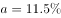
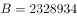
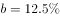
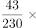
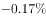

# 两期比重比较（两期比重差计算）

考点：[[20-考点/资料分析/比重/两期比重比较（两期比重差计算）|比重 / 两期比重比较（两期比重差计算）]]
材料：[[15-材料/资料分析/195083 2017年5月我国境内银行业金融机构|195083 2017年5月我国境内银行业金融机构]]

**问法模型**：题干问“某期比重与上年相比约…”，选项以“增加/减少+个百分点”给出→两期比重差模型：比重差=现期比重×(a-b)/(1+a)，方向由部分增速a与整体增速b的大小决定

## 推理链
1. 第1步：从表中提取数据：部分=股份制商业银行总资产431150亿元、同比增速a=11.5%；整体=银行业金融机构总资产2328934亿元、同比增速b=12.5%（同为2017年5月总资产口径）
2. 第2步：两期比重差公式：现期比重-基期比重=(A/B)×(a-b)/(1+a)；定性规则：a＜b则比重下降，a＞b则比重上升
3. 第3步：定性判断：部分增速11.5%＜整体增速12.5%，比重下降，排除“增加”的A、C
4. 第4步：计算现期比重：431150÷2328934≈18.5%（约1/5.4）
5. 第5步：代入公式求差值：18.5%×(11.5%-12.5%)÷(1+11.5%)≈18.5%×(-1%)/1.115≈-0.17个百分点
6. 第6步：与选项对照：比重下降约0.2个百分点，D项“减少了0.2个百分点”最接近，故选D

**最快解法**：⚡ 定性排除+比重差公式速算：先由a=11.5%＜b=12.5%排除A、C；再用现期比重≈18.5%乘以(a-b)/(1+a)=(-1%)/1.115≈-0.9%，得-0.17≈-0.2个百分点，秒选D（无需精确直除，18.5%×1%≈0.19%已够）

## 易错点
- ⚠ 量级陷阱：误把增速差(a-b)=1个百分点当作比重变化量，错选A/B（2个百分点）为放大干扰；实际须乘现期比重18.5%再除以(1+a)，真实差值仅约0.17个百分点
- ⚠ 方向陷阱：a＜b应为比重下降，若把部分与整体的增速看串（如误用股份行负债增速或与总计行12.6%负债增速比较），或把部分整体关系颠倒，会误判为上升选A/C
- ⚠ 单位陷阱：结果单位是“百分点”而非“%”；且表中金额为亿元，虽本题不涉及万亿元换算，但基期值2328934/(1+12.5%)≈207万亿元的量级易在其他小题踩坑

## 母题抽象
> 🧩 当题干出现“某部分占整体的比重与上年相比约上升/下降多少个百分点”时，先用“部分增速a vs 整体增速b”定方向（a＜b降、a＞b升），再用“现期比重×|a-b|/(1+a)”估算差值量级，验证选项中只有一个小数量级（零点几个百分点）项与之匹配

**同类特征**：“总资产占……的比重”、“与上年相比”、选项为“增加/减少+若干个百分点”、材料只给现期值与同比增速、无基期列、部分与整体同表同行列（同为总资产口径）、差值仅为0.2个百分点的精细量级辨析

## 相关题
（暂无）

---

### 题干
2017年5月，股份制商业银行总资产占银行业金融机构的比重与上年相比约：

### 选项
- A. 增加了2个百分点
- B. 减少了2个百分点
- C. 增加了0.2个百分点
- D. 减少了0.2个百分点　✅

### 官方解析

根据题干“……比重与上年相比约”，结合选项为百分点，判定为两期比重问题。定位统计表，可得：2017年5月股份制商业银行总资产亿元，增长率，银行业金融机构总资产亿元，增长率。根据两期比重差公式：，，因此比重下降，排除A、C，代入公式，，D项最为接近。

故正确答案为D。

### 给定材料

根据以下资料，回答以下问题。

注：

1.农村金融机构包括农村商业银行、农村合作银行、农村信用社和新型农村金融机构。

2.其他类金融机构包括政策性银行及国家开发银行、民营银行、外资银行、非银行金融机构、资产管理公司和邮政储蓄银行。

3.净资产额等于总资产额减去总负债额。

