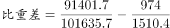
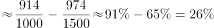

# 现期比重计算与比重差（百分点）比较

考点：[[20-考点/资料分析/比重/现期比重计算与比重差（百分点）比较|比重 / 现期比重计算与比重差（百分点）比较]]
材料：[[15-材料/资料分析/195087 2016年我国境内（颁证）民用航空机|195087 2016年我国境内（颁证）民用航空机]]

**问法模型**：题干问'A占总量的比重'比'C占总量的比重'高/低多少个百分点 → 分别用部分÷整体求两个现期比重，作差取百分点，再就近匹配选项

## 推理链
1. 第1步：题干要求比较2016年国内航线旅客占比与国内航线货邮占比之差，从材料第二段取旅客数据：国内航线91401.7万人次、总量101635.7万人次
2. 第2步：从材料第三段取货邮数据：国内航线974.0万吨、总量1510.4万吨；分子分母口径一致（旅客对旅客、货邮对货邮）
3. 第3步：现期比重公式：比重=部分/整体，比重差=比重旅客−比重货邮（单位：百分点）
4. 第4步：代入计算：旅客比重91401.7/101635.7≈89.9%（101635.7×0.9=91472.1，略大于91401.7，故略低于90%）；货邮比重974.0/1510.4≈64.5%（1510.4×0.645≈974.2）
5. 第5步：比重差≈89.9%−64.5%≈25.4个百分点，为正值即旅客比重'高'
6. 第6步：与选项对照：25.4个百分点最接近B项'高25个百分点'；A差5、C方向反、D数值与方向均不符，故选B

**最快解法**：⚡ 截位直除+百化分估算：旅客占比≈91.4/101.6，接近90%；货邮占比≈97/151≈64.5%（记151×0.645≈97.4）；两比重相减≈25.4个百分点，锁定'高25个百分点'选B，全程口算即可

## 易错点
- ⚠ 单位表述混淆：比重之差应用'百分点'表述，不能当作'%'倍数关系；也不能把两比重交叉相除（如91401.7/1510.4）
- ⚠ 张冠李戴：旅客、货邮、架次三段结构完全平行且数值相近，易把货邮分母误用成旅客总量101635.7；且'国内航线'已包含港澳台子集（旅客2764.5、货邮93.6），不可重复加总
- ⚠ 方向判断：两比重相减顺序颠倒（货邮−旅客）会得到负值而误选C/D；本题旅客比重(≈90%)明显高于货邮比重(≈64.5%)，应为'高'

## 母题抽象
> 🧩 当题干出现'A占整体比重比B占整体比重高/低多少个百分点'特征时，分别用部分÷整体求两个现期比重作差（结果为百分点），先估各比重量级（如接近90%对60%+），再与选项就近匹配

**同类特征**：国内航线……占总……的比重、比重比……（比重差比较）、高/低……个百分点、现期（2016年）比重、旅客吞吐量与货邮吞吐量双口径对比、同一材料两段平行结构分别取数

## 相关题
- [[10-真题/资料分析/比重/5893730 现期比重计算与比重差（百分点）比较|5893730]]（国考 2024，相关度2）
- [[10-真题/资料分析/比重/2049300 现期比重计算（整体值未直接给出，需跨句拼凑分母）|2049300]]（选调 2017，相关度1）
- [[10-真题/资料分析/比重/2579807 现期比重计算及两比重作差比较|2579807]]（浙江 2020，相关度1）
- [[10-真题/资料分析/增长/4639489 增长率计算与增长率之差（百分点比较）|4639489]]（国考 2022，相关度1）
- [[10-真题/资料分析/增长/2136478 增长率比较（两个主体增速作差，比较与'1个百分点'的大小）|2136478]]（河南 2017，相关度1）

---

### 题干
2016年我国国内航线完成旅客吞吐量占总旅客吞吐量的比重比国内航线完成货邮吞吐量占总货邮吞吐量的比重：

### 选项
- A. 高5个百分点
- B. 高25个百分点　✅
- C. 低5个百分点
- D. 低25个百分点

### 官方解析

根据题干“2016年······占······的比重······”，结合材料时间为2016年，可判定本题为现期比重问题。定位文字材料第二段可得：“2016年我国境内机场全年完成旅客吞吐量101635.7万人次，国内航线完成91401.7万人次”，定位文字材料第三段可得：“全年完成货邮吞吐量1510.4万吨，国内航线完成974.0万吨”。根据公式：，故所求，即高26个百分点，与B项最接近。

故正确答案为B。

### 给定材料

        2016年，我国境内民用航空（颁证）机场共218个（不含香港、澳门和台湾地区，以下简称境内机场）。

        2016年我国境内机场全年完成旅客吞吐量101635.7万人次，比上年增长。分航线看，国内航线完成91401.7万人次，增长；其中内地至香港、澳门和台湾地区航线完成2764.5万人次，下降。国际航线完成10234.0万人次，增长。

        全年完成货邮吞吐量1510.4万吨，比上年增长。分航线看，国内航线完成974.0万吨，增长；其中内地至香港、澳门和台湾地区航线完成93.6万吨，增长。国际航线完成536.4万吨，增长。

        全年完成飞机起降923.8万架次，比上年增长；其中运输架次为793.5万架次，增长。分航线看，国内航线完成842.8万架次，增长；其中内地至香港、澳门和台湾地区航线完成20.3万架次，下降。国际航线完成81.0万架次，增长。

        2016年，年旅客吞吐量1000万人次以上的机场有28个，较上年净增2个，完成旅客吞吐量占全部境内机场旅客吞吐量的。年旅客吞吐量200～1000万人次的机场有21个，较上年净减1个，完成旅客吞吐量占全部境内机场旅客吞吐量的。年旅客吞吐量200万人次以下的机场有169个，较上年净增7个，完成旅客吞吐量占全部境内机场旅客吞吐量的。

> [!warning] 疑点（官方解析可能有误，待人工复核）
> 官方解析文字表述'即高26个百分点'与精确计算略有出入：89.93%−64.49%≈25.4个百分点，四舍五入应为25个百分点；此系解析笔误，不影响答案判断，25.4与B项'高25个百分点'最接近，答案B无误

<!-- CODEX-ANSWER-REVIEW:BEGIN -->
### 本次独立复核

**复核状态：** `resolved`（答案与解析已核定）

**计分答案：** B（可计分）

**复核解析：**

国内航线客运占比约89.93%，国内航线货邮占比约64.49%，差25.44个百分点；国内客运比重高约25个百分点，选B。官方写26个百分点偏粗。

**相关信息：**

比重差用百分点表示，不能说“高25%”。

**题源依据：** [固定版本原题](https://github.com/Mentat-Uran/kaogongzhentizhengliu/blob/84ab93d4b64b61d897bece8a1c0a5bab06b4feb2/10-%E7%9C%9F%E9%A2%98/%E8%B5%84%E6%96%99%E5%88%86%E6%9E%90/%E6%AF%94%E9%87%8D/2187853%20%E7%8E%B0%E6%9C%9F%E6%AF%94%E9%87%8D%E8%AE%A1%E7%AE%97%E4%B8%8E%E6%AF%94%E9%87%8D%E5%B7%AE%EF%BC%88%E7%99%BE%E5%88%86%E7%82%B9%EF%BC%89%E6%AF%94%E8%BE%83.md)；固定内容 commit `84ab93d4b64b61d897bece8a1c0a5bab06b4feb2`，Markdown blob `377c085c27dd2ebc2c240c39e1d7359b86dc70ff`。
<!-- CODEX-ANSWER-REVIEW:END -->
