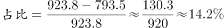

# 现期比重计算（部分量需先由'总量−其中量'减法间接求得）

考点：[[20-考点/资料分析/比重/现期比重计算（部分量需先由'总量−其中量'减法间接求得）|比重 / 现期比重计算（部分量需先由'总量−其中量'减法间接求得）]]
材料：[[15-材料/资料分析/195087 2016年我国境内（颁证）民用航空机|195087 2016年我国境内（颁证）民用航空机]]

**问法模型**：'所有民用飞机起降中，不承担运输任务的架次占比约为'→ 先用总架次减运输架次求隐含部分量，再部分÷总量求现期比重

## 推理链
1. 第1步：题干问2016年所有飞机起降中'不承担运输任务'架次的占比，定位材料第四段：全年完成飞机起降923.8万架次，其中运输架次为793.5万架次（材料时间即2016年，为现期比重）
2. 第2步：材料未直接给出'不承担运输任务的架次'，需先做减法：不承担运输任务架次＝总架次−运输架次＝923.8−793.5＝130.3万架次
3. 第3步：现期比重公式：比重＝部分量÷总量＝130.3÷923.8
4. 第4步：截位直除：130.3/923.8≈130/924≈0.141，即约14.1%；亦可用乘法验证：923.8×14%≈129.3，与130.3十分接近，确认比重略高于14%
5. 第5步：与选项对照，计算结果约14%，与官方答案C选项相符

**最快解法**：⚡ 减法＋截位直除：先心算 923.8−793.5=130.3（即924−794，尾数对齐快速得130.3），再 130.3/923.8≈130/924≈14.1%；或用乘法反验 923.8×14%≈129，锁定约14%，选C

## 易错点
- ⚠ 忘记做减法：直接把'其中运输架次793.5万架次'当作部分量，错算成793.5/923.8（约86%），或误把运输占比当成不承担运输的占比
- ⚠ 分子分母张冠李戴：误用分航线数据（国内842.8/国际81.0万架次）或旅客、货邮数据作分子分母；正确分母必须是全部起降923.8万架次，且不能用793.5当基数
- ⚠ 口径与时间陷阱：'运输架次'口径小于总架次（含训练、校验等非运输架次）；材料为2016年现期数据，无需基期换算，也不要把起降数据与旅客吞吐量'万人次'混淆

## 母题抽象
> 🧩 当题干出现'所有（总量）中，不承担/不属于其中某子类的占比'特征时，材料只给'总量'和'其中'子量，必先减法求隐含部分量（总量−其中量），再部分÷总量求现期比重，用截位直除或乘法反验锁定选项

**同类特征**：所有民用飞机起降中、不承担运输任务的架次、占比约为、'其中'引导的子集量、现期比重、需先做减法求部分量

## 相关题
- [[10-真题/资料分析/比重/4792819 现期比重计算（多部分比重依次求解）|4792819]]（新疆 2014，相关度1）
- [[10-真题/资料分析/比重/827355 现期比重比较（部分占比过半速判）|827355]]（政法干警 2014，相关度1）
- [[10-真题/资料分析/比重/2272297 现期比重比较|2272297]]（选调 2015，相关度1）
- [[10-真题/资料分析/比重/2032972 现期比重计算（多地区占比求和）|2032972]]（吉林 2015，相关度1）
- [[10-真题/资料分析/比重/10297330 基数不同的比重加权合成（混合比重）|10297330]]（浙江 2025，相关度1）

---

### 题干
2016年我国完成的所有民用飞机起降中，不承担运输任务的架次数占比约为：

### 选项
- A. 

- B. 

- C. 

　✅
- D. 

### 官方解析

根据题干“2016年······中······占比”，结合材料时间为2016年，可判定本题为现期比重问题。定位文字材料第四段可得：“全年完成飞机起降923.8万架次，其中运输架次为793.5万架次”。根据公式：，故不承担运输任务的架次数，与C选项最接近。

故正确答案为C。

### 给定材料

        2016年，我国境内民用航空（颁证）机场共218个（不含香港、澳门和台湾地区，以下简称境内机场）。

        2016年我国境内机场全年完成旅客吞吐量101635.7万人次，比上年增长。分航线看，国内航线完成91401.7万人次，增长；其中内地至香港、澳门和台湾地区航线完成2764.5万人次，下降。国际航线完成10234.0万人次，增长。

        全年完成货邮吞吐量1510.4万吨，比上年增长。分航线看，国内航线完成974.0万吨，增长；其中内地至香港、澳门和台湾地区航线完成93.6万吨，增长。国际航线完成536.4万吨，增长。

        全年完成飞机起降923.8万架次，比上年增长；其中运输架次为793.5万架次，增长。分航线看，国内航线完成842.8万架次，增长；其中内地至香港、澳门和台湾地区航线完成20.3万架次，下降。国际航线完成81.0万架次，增长。

        2016年，年旅客吞吐量1000万人次以上的机场有28个，较上年净增2个，完成旅客吞吐量占全部境内机场旅客吞吐量的。年旅客吞吐量200～1000万人次的机场有21个，较上年净减1个，完成旅客吞吐量占全部境内机场旅客吞吐量的。年旅客吞吐量200万人次以下的机场有169个，较上年净增7个，完成旅客吞吐量占全部境内机场旅客吞吐量的。

