# 现期比重差值计算（比重相差多少个百分点）

考点：[[20-考点/资料分析/比重/现期比重差值计算（比重相差多少个百分点）|比重 / 现期比重差值计算（比重相差多少个百分点）]]
材料：[[15-材料/资料分析/195088 J省2016年规模以上工业取水与用水|195088 J省2016年规模以上工业取水与用水]]

**问法模型**：题干问'用新水量最多的2个行业占全省规模以上工业用新水总量的比重相差约多少个百分点'→ 现期比重差模型：比重差 =（两行业量之差）÷ 用新水总量 × 100%

## 推理链
1. 第1步：从图1（用新水量行业结构，单位亿立方米）读取六项数据：纺织5.5、电力3.7、水生产供应4.0、化学原料3.6、造纸2.3、其他9.2；注意注释：'其他'是所有用新水量不足2亿立方米行业的合计，不是单一行业
2. 第2步：确定用新水量最多的2个真实行业为纺织5.5亿立方米与水生产供应4.0亿立方米（须排除'其他9.2'），两者差值 = 5.5 − 4.0 = 1.5亿立方米
3. 第3步：求分母（全省用新水总量）：图1六项加和 5.5+3.6+3.7+4.0+2.3+9.2 = 28.3亿立方米，并可用文字'超2亿5行业合计19.1' + 图1'其他9.2' = 28.3交叉验证，口径确为'用新水量'而非取水量86.4或重复用水量168.4
4. 第4步：代入比重差公式：1.5 ÷ 28.3 × 100% ≈ 5.30%，即约5.3个百分点
5. 第5步：与选项对照：5.3对应A项，故选A

**最快解法**：⚡ 截位直除：分子取两行业差值5.5−4.0=1.5，分母用总量28.3（可速记为19.1+9.2），1.5/28.3≈1.5/28≈5.4%，与5.3最接近，直选A；全程不需要文字段中空缺的任何增速或比重数据

## 易错点
- ⚠ 把'其他9.2'当成一个行业，误判最大的2个行业为'其他'与纺织（差值3.7/28.3≈13.1%），导致无对应选项或误判
- ⚠ 三个总量口径混用：分母误取取水量86.4（得1.5/86.4≈1.7%）或重复用水量168.4，本题分母必须是图1对应的用新水量28.3亿立方米
- ⚠ 图1总量28.3未直接印出，需六项加和或用文字'19.1+其他9.2'拼出；同时看清问法是'比重相差多少个百分点'（差值÷总量），不是倍数也不是量的差

## 母题抽象
> 🧩 当题干出现'最多的2个（行业/类别）占总量比重相差多少个百分点'且饼图含'其他'合并项时，先剔除'其他'锁定真实主体，再以'两主体之差÷各项加和总量'直除，并用'文字合计+其他'交叉校验总量口径

**同类特征**：用新水量最多的2个行业、占……比重相差约多少个百分点、现期（2016年）截面数据、饼图六项加和求总量（28.3未直接给出）、'其他'为不足2亿行业之和，须排除、差值÷总量的比重差模型

## 相关题
（暂无）

---

### 题干
2016年J省用新水量最多的2个行业，用新水量占全省规模以上工业用新水总量的比重相差约多少个百分点？

### 选项
- A. 5.3　✅
- B. 6.7
- C. 7.9
- D. 9.5

### 官方解析

方法一：根据“2016年······占······的比重”，结合材料时间为2016年，可判定本题为现期比重问题。定位图形材料1可知，用新水量最多的2个行业为纺织业和水生产供应业，新水量分别为5.5亿立方米、4.0亿立方米。定位文字材料第二段可知，全年用新水量超过2亿立方米的5个行业用新水量为19.1亿立方米，占总用新水量的。根据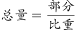可得，全省规模以上用新水总量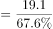。故比重差值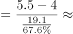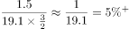，即5.3个百分点，与A项最接近。

方法二：根据“2016年······占······的比重”，结合材料时间为2016年，可判定本题为现期比重问题。定位文字材料第二段可知，全年用新水量超过2亿立方米的5个行业用新水量合计19.1亿立方米。定位图形材料1可知，用新水量最多的2个行业为纺织业和水生产供应业，新水量分别为5.5亿立方米、4.0亿立方米，其他行业新水量为9.2亿立方米。故比重差值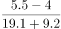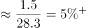，即5.3个百分点，与A项最接近。

方法三：根据“2016年······占······的比重”，结合材料时间为2016年，可判定本题为现期比重问题。定位图形材料1可知，用新水量最多的2个行业为纺织业和水生产供应业，新水量分别为5.5亿立方米、4.0亿立方米，所以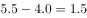亿立方米，定位文字材料第二段可知，全年用新水量超过2亿立方米的5个行业用新水量为19.1亿立方米，占总用新水量的。那么1.91亿立方米，占总用新水量的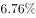，故1.5亿立方米占总用新水量的比重肯定明显小于，根据选项排除B、C、D三项，A项当选。

故正确答案为A。

### 给定材料

        2016年，J省规模以上工业取水量为86.4亿立方米，比上年增长。其中，直接采自江、河、淡水湖、水库等的地表淡水68.1亿立方米，比上年增长，所占比重比上年下降0.4个百分点；自来水取水量15.9亿立方米，同比增长。 

        2016年，规模以上工业重复用水量168.4亿立方米，比上年增长；重复用水利用率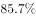，比上年提高0.1个百分点。其中，石油加工、黑色金属冶炼及压延加工、电力和化学原料等4个行业的重复用水总量占规模以上工业的，重复用水利用率分别为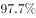、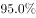、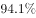和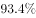。全年用新水量超过2亿立方米的5个行业用新水量合计19.1亿立方米，占总用新水量的，比重比上年下降0.9个百分点。

> [!warning] 疑点（官方解析可能有误，待人工复核）
> 本版本文字材料中'5个行业占总用新水量的比重'等关键百分数显示为空缺，官方方法一、方法三引用的该数值无法从本版本直接读出；但方法二（1.5/28.3≈5.3%）不依赖任何缺失数据，完整验证答案A，官方答案无矛盾
