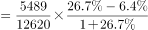
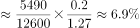

# 两期比重差值计算（现期比重-基期比重）

考点：[[20-考点/资料分析/比重/两期比重差值计算（现期比重-基期比重）|比重 / 两期比重差值计算（现期比重-基期比重）]]
材料：[[15-材料/资料分析/195125 2017年我国电信业务收入规模（总量|195125 2017年我国电信业务收入规模（总量]]

**问法模型**：题干问'A在B中的比重比2016年（基期）提高了大约几个百分点' → 用两期比重差公式 A/B×(a−b)/(1+a)，其中a为部分增速、b为总量增速

## 推理链
1. 第1步：增速数据在统计图（2013–2017年年度同比增速）中读取：2017年移动数据及互联网业务收入增速a=26.7%，2017年电信业务收入增速b=6.4%；与文字'总量增速同比提高1个百分点'互证（图中2016年总量增速5.4%，6.4%−5.4%=1个百分点，口径吻合）
2. 第2步：从文字材料提取现期量：部分量A=移动数据及互联网业务收入5489亿元，总量B=电信业务收入12620亿元
3. 第3步：代入两期比重差公式：5489/12620×(26.7%−6.4%)/(1+26.7%)≈43.5%×20.3%/1.267≈43.5%×16.0%≈7.0个百分点（精确约6.97）
4. 第4步：差值为正（a>b，比重上升）且约6.9~7个百分点，与A项最接近，故选A

**最快解法**：⚡ 公式法+截位直除：两期比重差=A/B×(a−b)/(1+a)。先由a=26.7%>b=6.4%判定比重上升，|a−b|=20.3个百分点是差值上限，可排除过大选项；再截位估算：5489/12620≈0.435，20.3/1.267≈16，0.435×16≈7个百分点，锁定A。亦可正算基期：2016年部分量5489/1.267≈4332，2016年总量12620/1.064≈11861，比重43.5%−36.5%≈7个百分点。

## 易错点
- ⚠ 本题所需两个增速（26.7%、6.4%）只出现在文末统计图中，文字材料增速均为不可读公式图，不读图无法列式；且图中每年有5条不同业务条形，须按图例对准'移动数据及互联网'与'电信业务收入'两条，取错条形即错
- ⚠ 基期比重必须换算（或直接用两期比重差公式，分母是1+a=1.267而非1+b），不能拿2017年比重43.5%与未换算数据直接作差
- ⚠ 口径混淆三连：'拉动增长1.4个百分点'（分母=总量基期值）与本题'比重提高几个百分点'不同；'在移动通信业务中占比'分母是9071亿元，本题分母是电信业务总收入12620亿元；固定/移动数据互联网业务是各通信业务内部子项，不能与总量口径张冠李戴

## 母题抽象
> 🧩 当题干出现'A占B的比重比上一年提高/下降约多少个百分点'时，用两期比重差公式 (A/B)×(a−b)/(1+a)：先由a与b的大小判断升降方向、以|a−b|为上限排除选项，再对A/B和(a−b)/(1+a)截位相乘估算锁定答案

**同类特征**：比重比2016年提高了大约、两期比重差、百分点、移动数据及互联网业务收入、电信业务收入、基期与现期比重比较

## 相关题
- [[10-真题/资料分析/比重/2172166 两期比重差计算（现期比重−基期比重）|2172166]]（广州市考 2018，相关度2）
- [[10-真题/资料分析/比重/13504296 现期比重差（先找极值年份再比份额）|13504296]]（甘肃 2025，相关度1）
- [[10-真题/资料分析/比重/2042846 两期比重差（比重差值计算）|2042846]]（江苏 2017，相关度1）
- [[10-真题/资料分析/比重/2377295 两期比重差值计算（基期比重由'较上年同期占比增加-减少的百分点'加减反推）|2377295]]（选调 2019，相关度1）
- [[10-真题/资料分析/比重/4678705 两期比重差比较（比重变化量最小）|4678705]]（选调 2020，相关度1）

---

### 题干
2017年移动数据及互联网业务收入在电信业务收入中的比重比2016年提高了大约（  ）。

### 选项
- A. 

　✅
- B. 

- C. 

- D. 

### 官方解析

根据题干“2017年······比重比2016年提高了大约······”，可判定本题为两期比重计算问题。定位文字材料可知，移动数据及互联网业务收入()5489亿元，同比增速()，电信业务收入()12620亿元，同比增速()。代入两期比重差值公式，，即提高了6.9个百分点，与A项最接近。

故正确答案为A。

### 给定材料

<b>二、根据以下资料，回答</b><b>71--75题。</b>

        2017年，我国电信业务收入12620亿元，比上年增长，增速同比提高1个百分点。其中，2017年全年固定通信业务收入完成3549亿元，比上年增长，在电信业务收入中占比为。2017年，在固定通信业务中固定数据及互联网业务收入达到1971亿元，比上年增长，拉动电信业务收入增长1.4个百分点，对全行业业务收入增长贡献率达。2017年全年移动通信业务实现收入9071亿元，比上年增长，在电信业务收入中占比为。2017年，在移动通信业务中移动数据及互联网业务收入5489亿元，比上年增长，对收入增长贡献率达。

> [!warning] 疑点（官方解析可能有误，待人工复核）
> 按公式精确计算约为6.97个百分点（≈7.0），官方解析表述为'6.9个百分点'，属舍入/截位口径差异，不影响'最接近A项'的结论；选项为公式图片无法读取具体数值。另注意：材料导读标注统计图不可读，但实际图片给出了本题必需的2017年各业务同比增速（26.7%、6.4%），本题计算依赖该图数据。
