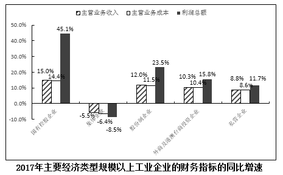
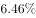
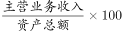
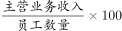

# 现期比重（比值）比较排序——主营业务收入利润率=利润总额-主营业务收入

考点：[[20-考点/资料分析/比重/现期比重（比值）比较排序——主营业务收入利润率=利润总额-主营业务收入|比重 / 现期比重（比值）比较排序——主营业务收入利润率=利润总额/主营业务收入]]
材料：[[15-材料/资料分析/195126 2017年全国规模以上工业企业经营与|195126 2017年全国规模以上工业企业经营与]]

**问法模型**：题干问'2017年各经济类型按主营业务收入利润率由低到高排序'→ 对表格中每一类企业分别计算现期比值 利润总额÷主营业务收入，按数值大小升序排列后与选项对照

## 推理链
1. 第1步：题干锁定2017年现期、指标为'主营业务收入利润率'，定位第二张表格，提取五类企业的主营业务收入与利润总额（亿元）：国有控股258357.4/16651.2，集体5413.8/399.9，股份制857196.1/52404.4，外商及港澳台259181.2/18752.9，私营400259.6/23753.1
2. 第2步：材料文字明示利润率定义=利润总额/主营业务收入，且全部数据为2017年当期值，故为现期比值比较，无需基期换算
3. 第3步：截位直除估算各利润率：私营23753.1/400259.6≈5.93%；股份制52404.4/857196.1≈6.11%；国有控股16651.2/258357.4≈6.45%；外商及港澳台18752.9/259181.2≈7.23%；集体399.9/5413.8≈7.39%
4. 第4步：由低到高排序为：私营企业(5.93%)＜股份制企业(6.11%)＜国有控股企业(6.45%)＜外商及港澳台商投资企业(7.23%)＜集体企业(7.39%)
5. 第5步：与选项对照：A项'私营→股份制→国有控股→外商及港澳台'顺序完全吻合；B项集体排在外商前（实为集体7.39%＞外商7.23%）、C项国有控股排在股份制前（实为6.45%＞6.11%）、D项股份制排在私营前（实为6.11%＞5.93%）均颠倒，故选A

**最快解法**：⚡ 截位直除：各利润率均在6%上下、分子分母同量级，只需各算首两位有效数字——私营23753/400260≈5.9%、股份制52404/857196≈6.1%、国有控股16651/258357≈6.4%、外商18753/259181≈7.2%，即得'私营→股份制→国有控股→外商'升序，秒选A（集体399.9/5413.8≈7.4%最高，可最后核验）

## 易错点
- ⚠ 口径陷阱：勿把第一张图中的增速（如国有控股利润增速45.1%、收入增速15.0%）误当利润率使用，利润率只能用表格中利润总额÷主营业务收入计算
- ⚠ 错列陷阱：表格列顺序为国有控股、集体、股份制、外商及港澳台、私营，与选项排列顺序不同，逐一提取时易串列；五类企业须全部计算，不能凭'每百元收入中的成本'单项大小替代排序（该指标未扣费用，股份制84.86与外商84.46过近，会误判二者先后）
- ⚠ 方向陷阱：'由低到高'是升序排列，注意勿排反；同时所有数据为2017年现期值，本题不涉及'减少0.25元''提高0.54个百分点'等变化量，不要与总体利润率口径混淆

## 母题抽象
> 🧩 当题干出现'按某率（利润率/比重/比值）由低到高（或由高到低）对多个主体排序'时，对每个主体做现期比值=分子÷分母的截位直除，只算出首两位有效数字即可排定顺序，再优先核对选项首尾两端快速排除

**同类特征**：由低到高排序、主营业务收入利润率、2017年现期值、主要经济类型、多个主体比值比较、利润总额/主营业务收入

## 相关题
- [[10-真题/资料分析/其他/2662206 百分点差值推算（利润率'高于全国4.1个百分点'反向相减）|2662206]]（新疆 2020，相关度1）
- [[10-真题/资料分析/增长/2033388 增长量比较（增量排序）|2033388]]（河南 2016，相关度1）
- [[10-真题/资料分析/比重/2443030 基期比重（基期利润率）|2443030]]（辽宁 2019，相关度1）

---

### 题干
2017年经济类型按主营业务收入利润率由低到高的排序是（  ）。

### 选项
- A. 私营企业  股份制企业  国有控股企业  外商及港澳台商投资企业　✅
- B. 股份制企业  国有控股企业  集体企业  外商及港澳台商投资企业
- C. 私营企业  国有控股企业  股份制企业  集体企业
- D. 股份制企业  私营企业  集体企业  外商及港澳台商投资企业

### 官方解析
由题干“2017年…主营业务收入利润率”， 结合表格材料已知2017年主营业务收入及利润总额，判定此题为现期比重问题。定位表格材料，根据利润率公式，，可得各经济类型规模以上工业企业主营业务利润率分别为：
国有控股企业：；集体企业：；股份制企业：；外商及港澳台商投资企业：；私营企业：。结合选项，只有A项正确。
故正确答案为A。

### 给定材料

根据以下资料，回答81-85题。

        2017年，全国规模以上工业企业实现主营业务收入116.5万亿元，比上年增长；全国规模以上工业企业发生主营业务成本98.9万亿元，增长；全国规模以上工业企业实现利润总额75187.1亿元，比上年增长，增速比2016年加快12.5个百分点；全国规模以上工业企业主营业务收入利润率（利润总额/主营业务收入）为，比上年提高0.54个百分点。

        2017年，全国规模以上工业企业每百元主营业务收入中的成本为84.92元，比上年减少0.25元；每百元主营业务收入中的费用为7.77元，减少0.2元；每百元资产实现的主营业务收入（）为108.4元，增加3.7元；人均主营业务收入（）为131.5万元，增加15万元。 

> [!warning] 疑点（官方解析可能有误，待人工复核）
> 选项A仅列出4类企业（缺集体企业），按计算集体企业利润率最高（约7.39%）应排末位，完整升序为'私营→股份制→国有控股→外商及港澳台→集体'，A项疑似漏列末位集体企业（不影响A为唯一正确答案的判定）
