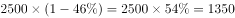
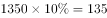

# 现期部分量计算（部分量=整体量×结构占比×内部比率）

考点：[[20-考点/资料分析/比重/现期部分量计算（部分量=整体量×结构占比×内部比率）|比重 / 现期部分量计算（部分量=整体量×结构占比×内部比率）]]
材料：[[15-材料/资料分析/195135 某高校2010-2017年男、女博士|195135 某高校2010-2017年男、女博士]]

**问法模型**：题干给出2015年教职工总数2500人与女性占比，问男博士人数 → 男博士人数＝男性教职工人数×2015年男博士比率10.0%，即2500×男性占比×10.0%两步连乘

## 推理链
1. 第1步：从题干提取——2015年教职工总数2500人，女性占46%（按官方答案反推的完整题干数值，即男性占54%）；从表格定位——2015年男博士比率＝10.0%
2. 第2步：明确口径——表下注释给出男博士比率＝男博士人数÷男性教职工人数，分母是男性教职工人数而非教职工总数2500，故必须先求出男性教职工人数
3. 第3步：求基数——男性教职工人数＝2500×(1−46%)＝2500×54%＝1350人
4. 第4步：套公式——男博士人数＝男性教职工人数×男博士比率＝1350×10.0%
5. 第5步：代入计算——1350×10.0%＝135人（等价合并为一步：2500×54%×10%＝2500×5.4%＝135）
6. 第6步：对照选项——135人对应D项，与官方答案一致

**最快解法**：⚡ 公式法＋百分数连乘（两步合一）：2500×54%×10%＝2500×5.4%＝135，10%只需移小数点一位，2500×5.4%口算即得135，直接锁定D

## 易错点
- ⚠ 比率口径陷阱：男博士比率的分母是男性教职工人数（1350人），不是教职工总数2500人，直接算2500×10.0%＝250就掉坑（选项中无250，但方向已错）
- ⚠ 量级陷阱：比率10.0%是百分数，乘法代入时必须除以100，否则会得出13500这类荒谬量级
- ⚠ 占比方向＋文本截断陷阱：题干给的是'女性占'46%，求男博士须先换成男性占比54%；且所给文本中'女性占'后的数值被截断，须以完整题干为准，不得凭空代入或误用其他年份比率

## 母题抽象
> 🧩 当题干出现'总体量N＋某部分占比p＋该部分内部比率r，求该部分下的子量'特征时，用连乘N×p×r，先由注释确认r的分母是哪一层基数（本题是分性别教职工而非总数），并把百分数统一除以100

**同类特征**：2015年（现期）部分量计算、教职工总数2500人、女性占…（性别结构占比）、男博士人数、男博士比率10.0%、注释口径：比率分母为分性别教职工人数

## 相关题
（暂无）

---

### 题干

假设该高校在2015年的教职工总数为2500人，其中女性占，则该校男博士人数为：

### 选项
- A. 120
- B. 125
- C. 130
- D. 135　✅

### 官方解析

根据题干“2015年……男博士人数”，结合表格材料给出男博士比率，可判定本题为现期比重问题。由题干可知，2015年总人数为2500人，女性占，故男性人数为人。定位表格材料可知，2015年男博士比率为，由可得，该校男博士人数=人。

故正确答案为D。

### 给定材料

<b>根据以下资料，回答</b><b>121-125题。</b>

> [!warning] 疑点（官方解析可能有误，待人工复核）
> 所给题干'其中女性占'后的比例数值缺失（文本截断），官方解析中该数值及中间结果亦显示不全；按官方答案D（135）反推：男博士人数＝男性教职工×10.0%＝135 → 男性教职工＝1350人 → 男性占54%、女性占46%，与官方解析'男性人数×男博士比率'的口径完全一致，不构成答案矛盾，仅为题干文本不完整需注意

<!-- CODEX-ANSWER-REVIEW:BEGIN -->
### 本次独立复核

**复核状态：** `resolved`（答案与解析已核定）

**计分答案：** D（可计分）

**复核解析：**

女性占比约46%，故男性教职工=2500×54%=1350人。2015年男性博士占男性教职工10%，人数=1350×10%=135人，选D。

**相关信息：**

第二层比重的分母是男性教职工数，而非全校教职工总数。

**题源依据：** [固定版本原题](https://github.com/Mentat-Uran/kaogongzhentizhengliu/blob/84ab93d4b64b61d897bece8a1c0a5bab06b4feb2/10-%E7%9C%9F%E9%A2%98/%E8%B5%84%E6%96%99%E5%88%86%E6%9E%90/%E6%AF%94%E9%87%8D/2188305%20%E7%8E%B0%E6%9C%9F%E9%83%A8%E5%88%86%E9%87%8F%E8%AE%A1%E7%AE%97%EF%BC%88%E9%83%A8%E5%88%86%E9%87%8F%3D%E6%95%B4%E4%BD%93%E9%87%8F%C3%97%E7%BB%93%E6%9E%84%E5%8D%A0%E6%AF%94%C3%97%E5%86%85%E9%83%A8%E6%AF%94%E7%8E%87%EF%BC%89.md)；固定内容 commit `84ab93d4b64b61d897bece8a1c0a5bab06b4feb2`，Markdown blob `c1601eff0905544cff7168898e6796e3deee87a6`。
<!-- CODEX-ANSWER-REVIEW:END -->
