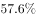
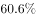

# 基期比重计算

考点：[[20-考点/资料分析/比重/基期比重计算|比重 / 基期比重计算]]
材料：[[15-材料/资料分析/195178 2017年上半年全国居民收入与消费支|195178 2017年上半年全国居民收入与消费支]]

**问法模型**：题干以基期时间（2016年上半年）+'占…的比重约为'设问 → 采用基期比重模型：基期比重=现期比重A/B×(1+g总体)/(1+g部分)，先截位直除现期比重，再按增速差定偏移方向。

## 推理链
1. 第1步：题干时间为2016年上半年（基期），材料只有2017年上半年现期值：全国居民人均工资性收入7435元、全国居民人均可支配收入12932元，各配同比名义增长率（文本中数值空缺，须回原图读取）。
2. 第2步：判定为基期比重问题，公式：基期比重=(7435/(1+g工资))/(12932/(1+g总))=7435/12932×(1+g总)/(1+g工资)。
3. 第3步：先算现期比重：7435/12932≈57.5%（截位直除：12932×57.5%=7435.9，恰在57.5%附近）。
4. 第4步：偏移方向判定：基期比重相对现期的升降由(1+g总)/(1+g工资)与1的大小决定；官方解析结论为'略大于'（现期比重），即总体收入增速高于工资性收入增速，(1+g总)/(1+g工资)>1，基期比重略高于57.5%。
5. 第5步：与选项对照：四个选项中仅B项为'略大于57.5%'量级的比重值，与官方解析'代入基期比重公式，略大于'的结论吻合，故正确答案为B。

**最快解法**：⚡ 截位直除+增速差定方向：先算现期比重7435/12932≈57.5%；再套基期比重公式乘以(1+g总)/(1+g工资)，由'部分增速与总体增速'的大小关系直接判定基期比重是'略大于'还是'略小于'57.5%，在选项中锁定邻域值即可，无需精算回推的基期分子分母。

## 易错点
- ⚠ 基期现期混淆：材料全为2017年上半年数据，若直接用7435/12932≈57.5%选现期比重对应项即掉坑，必须回推2016年上半年。
- ⚠ 两套相近口径混淆：文字段是收入体系（人均可支配收入12932元），统计表是消费支出体系（人均消费支出8834元），量级接近但含义完全不同，本题只能取收入块数据，误串到消费表全盘皆错。
- ⚠ 方向判定错：基期比重=现期比重×(1+g总)/(1+g部分)，'略大/略小'完全取决于部分增速与总体增速的相对大小，不看增速差想当然或硬算时截位不当，会错选57.5%另一侧的相邻选项。

## 母题抽象
> 🧩 当题干出现'上年同期/基期年份+A占B的比重约为'特征时，用基期比重公式=A/B×(1+gB)/(1+gA)：先截位直除现期比重A/B，再按部分增速gA与总体增速gB的大小定偏移方向（部分增速<总体增速→基期比重略大于现期；反之略小），在选项中找'略大/略小'邻域值验证即可。

**同类特征**：基期年份设问（2016年上半年）、'占…的比重约为'句式、部分/总体结构（工资性收入/人均可支配收入）、材料仅给现期值+同比名义增长率，无基期值、基期比重模型、选项为百分数、量级在57%附近

## 相关题
- [[10-真题/资料分析/比重/2444066 基期比重计算|2444066]]（江西 2019，相关度3）
- [[10-真题/资料分析/比重/2616071 基期比重计算|2616071]]（云南 2020，相关度3）
- [[10-真题/资料分析/比重/2307731 基期比重计算|2307731]]（辽宁 2018，相关度3）
- [[10-真题/资料分析/比重/2402471 基期比重计算|2402471]]（重庆 2018，相关度3）
- [[10-真题/资料分析/比重/3522676 基期比重计算|3522676]]（广西 2021，相关度3）

---

### 题干
2016年上半年，全国居民人均工资性收入占全国居民人均可支配收入的比重约为：

### 选项
- A. 

- B. 

　✅
- C. 

- D. 

### 官方解析
由题干“2016年上半年······占······的比重约为”，而材料数据时间为2017年，判定此题为基期比重问题。定位文字材料第一段“2017年上半年，全国居民人均可支配收入12932元，比上年同期名义增长”，定位文字材料第二段“2017年上半年，全国居民人均工资性收入7435元，增长，占全国居民人均可支配收入的比重为”，代入基期比重公式，略大于。
故正确答案为B。

### 给定材料

        2017年上半年，全国居民人均可支配收入12932元，比上年同期名义增长，其中，城镇居民人均可支配收入18332元，增长（以下如无特别说明，均为同比名义增长）；农村居民人均可支配收入6562元，增长。

        按收入来源分，2017年上半年，全国居民人均工资性收入7435元，增长，占全国居民人均可支配收入的比重为；人均经营净收入2117元，增长，占全国居民人均可支配收入的比重为；人均财产净收入1056元，增长，占全国居民人均可支配收入的比重为；人均转移净收入2324元，增长，占全国居民人均可支配收入的比重为。

> [!warning] 疑点（官方解析可能有误，待人工复核）
> 材料文字段中各增长率与比重数值、以及四个选项的具体百分数均为图片格式未随文本呈现（空缺），官方解析亦截断为'代入基期比重公式，略大于'，纯文本条件下无法完成精确数值复算；可确认的仅有现期比重7435/12932≈57.5%与官方'基期比重略大于现期'的方向结论，二者与B项吻合。答案仍以官方B为准。
