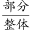
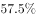
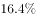
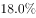

# 现期比重比较（同分母比大小）

考点：[[20-考点/资料分析/比重/现期比重比较（同分母比大小）|比重 / 现期比重比较（同分母比大小）]]
材料：[[15-材料/资料分析/195178 2017年上半年全国居民收入与消费支|195178 2017年上半年全国居民收入与消费支]]

**问法模型**：题干问'四个类别占同一整体的比重哪一个指标值最大'→ 整体量相同（均为人均消费支出8834元），比重比较退化为部分量（各类水平值）直接比较大小

## 推理链
1. 第1步：从统计表提取数据：全国居民人均消费支出8834元；居住1919元、食品烟酒2678元、交通通信1211元、医疗保健718元（均为2017年上半年现期水平值）
2. 第2步：依据比重=部分量/整体量，四个选项的分母均为同一整体8834元，故比重最大者即分子（部分水平值）最大者，无需逐个计算比重
3. 第3步：直接比较分子：2678（食品烟酒）> 1919（居住）> 1211（交通通信）> 718（医疗保健）
4. 第4步：验证估算：食品烟酒2678/8834≈30.3%，居住1919/8834≈21.7%，交通通信1211/8834≈13.7%，医疗保健718/8834≈8.1%，食品烟酒占比最大
5. 第5步：对照选项，B项'食品烟酒水平占全国居民人均消费支出水平的比重'最大，故选B

**最快解法**：⚡ 同分母定性比较法（免算比重）：四项分母同为8834元，直接比四个水平值，最大者食品烟酒2678元即对应比重最大，一步锁定B，无需任何除法运算

## 易错点
- ⚠ 误以'增长率'作比较依据：医疗保健增速11.9%、其他用品和服务11.9%最高，但本题问的是比重（份额），须比水平值而非增速，食品烟酒增速仅5.6%却占比最大
- ⚠ 与兄弟题第4题口径混淆：同表第4题数'增长率超过7.6%的类别个数'（比增速），本题比'占8834元的比重'（比水平），同表两题比较维度完全不同
- ⚠ 材料双口径陷阱：统计表整体是人均消费支出8834元，文字段是人均可支配收入12932元，量级接近但含义不同，分母必须锁定'消费支出'口径；增长率列精度不一（'10'即10.0%），但本题只读水平列不受影响

## 母题抽象
> 🧩 当题干问'哪一项占整体的比重（份额）最大'且四个选项共用同一整体时，比重公式同分母，直接比较部分量（分子）大小即可定序，完全跳过除法计算

**同类特征**：哪一个经济指标值最大、占全国居民人均消费支出水平的比重、按消费类别分、现期比重比较、同一整体、不同部分、统计表读数比较

## 相关题
- [[10-真题/资料分析/比重/10204607 现期比重比较（与1-3判定，分母需由累计值差分）|10204607]]（辽宁 2024，相关度1）
- [[10-真题/资料分析/比重/18643847 现期比值计算与百分点差值比较（资产负债率=总负债÷总资产）|18643847]]（四川 2026，相关度1）
- [[10-真题/资料分析/比重/19283749 现期比重比较（逐组求比重比大小）|19283749]]（国考 2025，相关度1）
- [[10-真题/资料分析/比重/2042810 现期比重比较（子口径占全口径比重，逐部计数判断）|2042810]]（江苏 2017，相关度1）
- [[10-真题/资料分析/比重/2052082 现期比重比较|2052082]]（吉林 2017，相关度1）

---

### 题干
2017年上半年，全国居民消费支出主要数据按消费类别分。下列哪一个经济指标值最大？

### 选项
- A. 居住水平占全国居民人均消费支出水平的比重
- B. 食品烟酒水平占全国居民人均消费支出水平的比重　✅
- C. 交通通信水平占全国居民人均消费支出水平的比重
- D. 医疗保健水平占全国居民人均消费支出水平的比重

### 官方解析

根据题干“2017年上半年…经济指标值最大”，且材料时间为2017年上半年，可判定本题为现期比重问题。定位表格材料可得：全国居民人均消费支出水平8834元、居住水平1919元、食品烟酒水平2678元、交通通信水平1211元、医疗保健水平718元。根据公式：比重=，可知当整体量相同时，部分量越大，则比重越大，故选项所求指标最大的是食品烟酒水平占全国居民人均消费支出水平的比重。

故正确答案为B。

### 给定材料

        2017年上半年，全国居民人均可支配收入12932元，比上年同期名义增长，其中，城镇居民人均可支配收入18332元，增长（以下如无特别说明，均为同比名义增长）；农村居民人均可支配收入6562元，增长。

        按收入来源分，2017年上半年，全国居民人均工资性收入7435元，增长，占全国居民人均可支配收入的比重为；人均经营净收入2117元，增长，占全国居民人均可支配收入的比重为；人均财产净收入1056元，增长，占全国居民人均可支配收入的比重为；人均转移净收入2324元，增长，占全国居民人均可支配收入的比重为。

