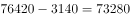
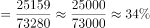

# 基期比重计算（现期、增量倒推基期）

考点：[[20-考点/资料分析/比重/基期比重计算（现期、增量倒推基期）|比重 / 基期比重计算（现期、增量倒推基期）]]
材料：[[15-材料/资料分析/195545 2002～2011年全国就业规模（城|195545 2002～2011年全国就业规模（城]]

**问法模型**：题干问'2002年末（基期）城镇占全国城乡就业的比重约是'而材料给的是2011年末现期值与增量 → 基期比重=（现期部分−部分增量）÷（现期整体−整体增量）

## 推理链
1. 第1步：从材料第一段提取条件：2011年末全国城乡就业76420万人（比2002年末增加3140万人），城镇就业35914万人（增加10755万人）
2. 第2步：倒推基期值：2002年末全国城乡就业=76420−3140=73280万人；2002年末城镇就业=35914−10755=25159万人（勾稽验证：25159+乡村48121=73280，自洽）
3. 第3步：基期比重公式：比重=基期部分值÷基期整体值=2002年末城镇就业÷2002年末全国就业
4. 第4步：代入计算：25159÷73280≈0.3433，即约34.3%
5. 第5步：与选项对照，C（约34.3%）与之相符，故正确答案为C

**最快解法**：⚡ 截位直除：先口算两组基期值（76420−3140=73280、35914−10755=25159），再直除25159/73280——分母截前两位73，25.2/73≈34.5%，首位商3、次位商4锁定34.3%，对应C

## 易错点
- ⚠ 现期误当基期：直接用35914÷76420≈47%会严重偏大，材料未给2002年末任何就业数值，必须先'现期−增量'倒推73280与25159
- ⚠ 两个增量对象易混淆：全国增3140万人、城镇增10755万人方向均为'增加'，而乡村是'减少7615万人'，若误拿乡村减量参与本题计算则基期值全错
- ⚠ 口径陷阱：农民工25278万人与城乡就业口径交叉，不能加进城镇或全国就业数；分子分母单位同为'万人'可约掉，结果为百分数而非人数

## 母题抽象
> 🧩 当题干出现'过去时点+部分占整体比重'且材料只给现期值与增减量时，先用'现期−增量'分别倒推基期部分值与基期整体值，再相除截位直除对照选项

**同类特征**：2002年末（基期时点）、占……比重约是、材料现期为2011年末、部分与整体均以'现期值+增加量'给出、基期值需倒推、选项为百分数

## 相关题
- [[10-真题/资料分析/增长/9629 一般增长率计算（现期需由增量倒推）|9629]]（安徽 2009，相关度1）
- [[10-真题/资料分析/比重/2604234 现期比重计算|2604234]]（广东 2020，相关度1）
- [[10-真题/资料分析/增长/27835 一般增长率计算（已知现期量与增长量求增长率）|27835]]（河北 2012，相关度1）
- [[10-真题/资料分析/平均数/10204497 平均数增长率（均价=值-量的比值增长率）|10204497]]（海南 2024，相关度1）
- [[10-真题/资料分析/增长/12536395 隔年（间隔）增长率|12536395]]（四川 2024，相关度1）

---

### 题干
2002年末城镇就业人数占全国城乡就业人数的比重约是：

### 选项
- A. 

- B. 

- C. 

　✅
- D. 

### 官方解析

根据题干“2002年末······占······比重约是”，结合材料时间“2011年末”，判定本题为基期比重计算问题。定位文字材料第一段可得“截至2011年末，全国城乡就业人数达到76420万人，比2002年末增加3140万人，其中，城镇就业人数35914万人，增加10755万人”，则2002年末全国城乡就业人数为万人，2002年末城镇就业人数为人。根据公式：，则2002年末城镇就业人数占全国城乡就业人数的比重。

故正确答案为C。

### 给定材料

二、根据以下资料，回答106～110题。

        截至2011年末，全国城乡就业人数达到76420万人，比2002年末增加3140万人，其中，城镇就业人数35914万人，增加10755万人；乡村就业人数40506万人，减少7615万人，农民工数量不断扩大，2011年末达到25278万人。

        2011年，城镇居民人均可支配收入21810元元（疑为：多字），比2002年增长1.8倍，扣除价格因素年均实际增长；农村居民人均纯收入6977元，比2002年增长1.8倍，扣除价格因素年均实际增长。2002～2011年，城乡居民收入年均增速超过1979～2011年的年均增速，是历史上增长最快的时期之一。其中，2010年、2011年农村居民人均纯收入增速连续两年快于城镇。

        2011年末（疑为：缺少“年末”），城乡居民家庭恩格尔系数分别为和，分别比2002年降低了1.4和5.8个百分点，主要耐用消费品拥有量大幅增长；2011年末，城镇居民家庭平均每百户拥有家用汽车18.6辆，比2002年末增加17.7辆；拥有移动电话205.3部，增长2.3倍；拥有家用电脑81.9台，增长3.0倍。农村居民家庭平均每百户拥有电冰箱61.5台，增长3.1倍；空调机2.6台，增长8.9倍；拥有移动电话179.7部，增长12.1倍。2011年末，全国电话普及率达到94.9部/百人，比2002年末增长1.8倍。

> [!warning] 疑点（官方解析可能有误，待人工复核）
> 官方解析中基期计算公式与比重结果被图片公式替代显示不全，但其口径（73280、25159、25159÷73280≈34.3%）与答案C一致，无实质矛盾
